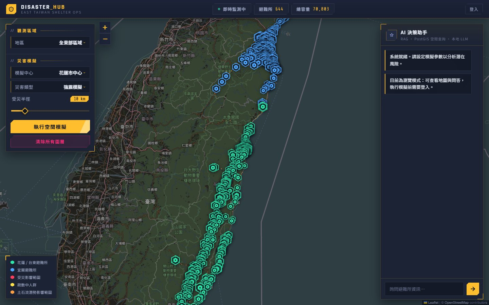
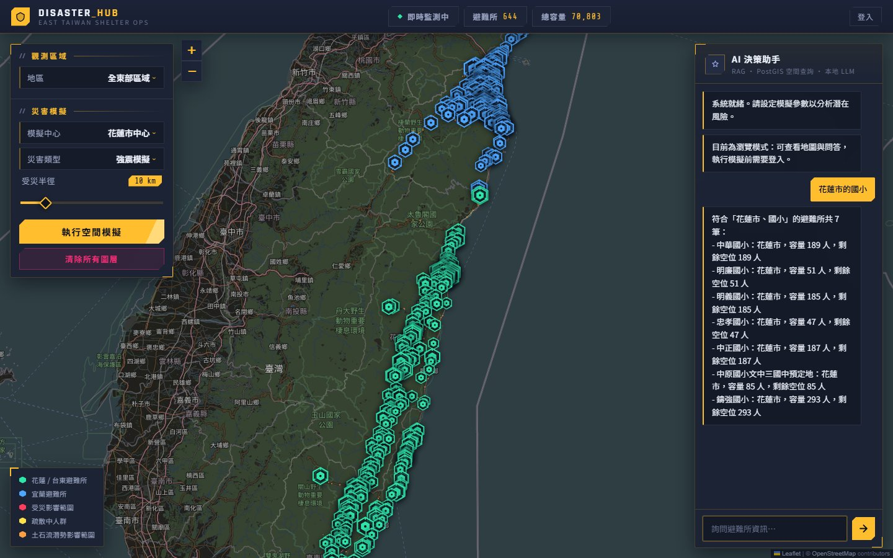
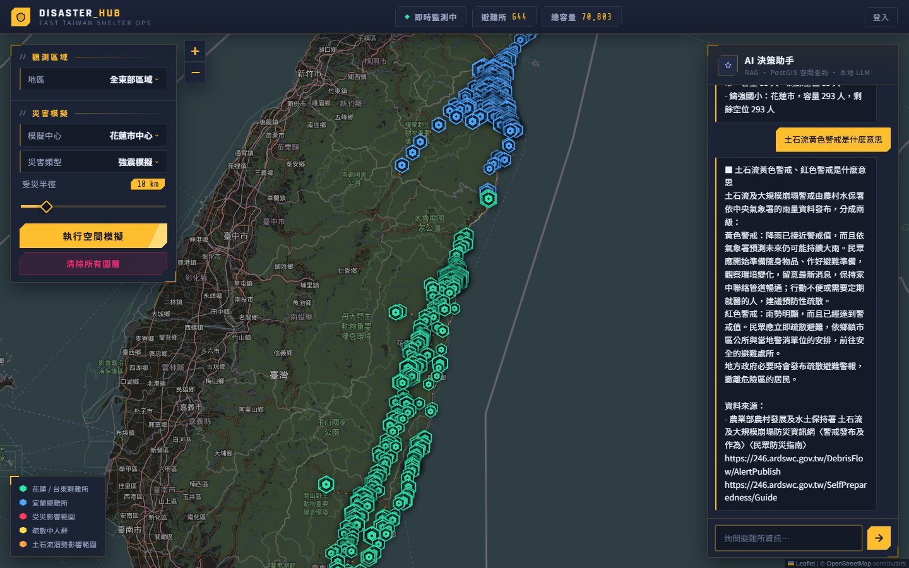
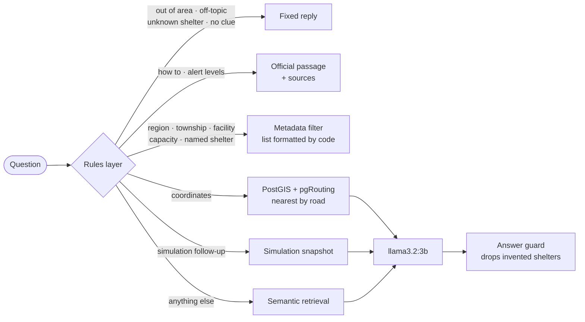
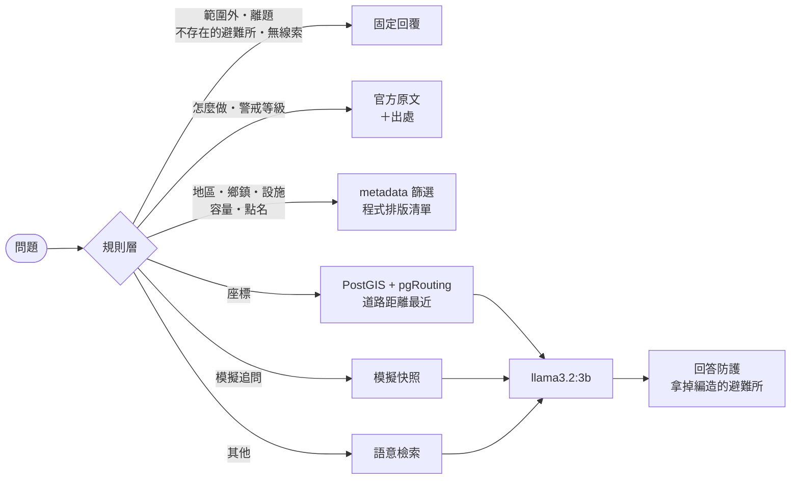

# Disaster Hub

<div align="center">

[](#english)
[](#zh-tw)

</div>

<a name="english"></a>


**An AI-powered shelter decision system for disasters in eastern Taiwan.**

Built in response to the 2025 barrier-lake disaster in Guangfu Township, Hualien, this simulation and decision system targets the three main pain points of existing shelter management: opaque information, no way to simulate, and slow decisions.

<p align="center"></p>

### At a glance

- **Real data.** 644 shelters from the National Fire Agency's open dataset, 531 debris-flow zones, the OpenStreetMap road network of the three counties, and 34 disaster-preparedness passages rewritten from official Central Weather Administration, Fire Agency and Soil and Water Conservation pages.
- **Answers in under a second, mostly without the LLM.** When the rules layer already knows which shelters or which passage answer a question, the reply is assembled by code. 201 of the 207 generation-eval questions never call the model. p50 latency is 0.2 s, and accuracy went up, because the model can no longer misquote a list it is copying.
- **Refuses what it does not know.** Out-of-area counties, off-topic questions, shelters that do not exist and misspelled names are handled before the model sees anything. 53 of 53 boundary questions are answered or refused correctly.
- **Evacuation by road, not straight line.** Simulations assign evacuees to the nearest shelters with free capacity along the road network (pgRouting), skipping shelters not designated for that disaster and, in floods, shelters inside a debris-flow zone.
- **Measured, not claimed.** Separate evaluations for retrieval, generation, routing, boundaries, counterfactual faithfulness and knowledge answers, with bootstrap confidence intervals, plus 631 tests.

| | |
|---|---|
| Shelters / debris-flow zones / road edges | 644 / 531 / 118,641 |
| Answered by code, no LLM | 201 of 207 eval questions, p50 0.2 s |
| Boundary and refusal questions | 53 / 53 |
| Routing decisions | 56 / 56 |
| Knowledge questions, right passage returned | 40 / 40 |

<table>
<tr>
<td width="50%"></td>
<td width="50%"></td>
</tr>
<tr>
<td>「花蓮市的國小」: a filtered list built from the index metadata in 0.2 s, one shelter per line.</td>
<td>「土石流黃色警戒是什麼意思」: the official passage verbatim, with its sources appended.</td>
</tr>
</table>

### How a question is answered



Only the last three paths (coordinates, simulation follow-ups, plain semantic questions) still use the language model. Everything else is answered by code from the data, which is why most answers take well under a second and cannot invent a shelter or a number.

---

## Features

- **Real map visualization** — Leaflet.js + OpenStreetMap. 644 official shelters (National Fire Agency open data) across Yilan, Hualien and Taitung are plotted at their real coordinates; marker size scales with capacity, and clicking one shows live information.
- **PostGIS spatial simulation** — Set a disaster epicenter and impact radius; the backend computes the list of affected shelters via `ST_DWithin`. Earthquake, flood and fire scenarios are supported.
- **Road-network distance** — Nearest-shelter answers and the evacuation assignment use distance along the OpenStreetMap road network (pgRouting), not straight-line distance, with a straight-line fallback.
- **Crowd evacuation animation** — The backend estimates the population inside the impact radius and the resulting evacuation demand from a township population model, then computes a deterministic, capacity-bounded evacuation plan (nearest first) and writes it to the database and the vector index straight away. The frontend only replays that plan as an animation, so the loads the AI assistant reports match the map as soon as the simulation returns.
- **Debris-flow hazard zones** — 531 debris-flow impact zones in Yilan, Hualien and Taitung from the Ministry of Agriculture are imported into PostGIS and drawn on the map. Flood simulations keep evacuees out of shelters inside a zone, and nearest-shelter answers warn when a shelter lies inside one.
- **AI decision assistant** — A rules layer plus RAG and a local LLM answer questions from real shelter data, covering semantic lookups, geographic distance queries, capacity rankings, and simulation-result queries. Region, township, facility and capacity conditions become metadata filters, and questions about counties outside the coverage area are declined outright.
- **Disaster-preparedness knowledge** — "What should I prepare before a typhoon?" or "What does a yellow debris-flow alert mean?" is answered from 34 short passages rewritten from official Central Weather Administration, National Fire Agency and Agency of Rural Development and Soil and Water Conservation pages, with the sources appended to every answer.

---

## Architecture

```
Data          PostgreSQL + PostGIS + pgRouting (spatial data, road network)
              ChromaDB (semantic vector index)

Backend       FastAPI + Uvicorn
              ShelterRepository (database access, connection pool)
              ChatService (intent detection + RAG + LLM)
              VectorStore (ChromaDB management)
              KnowledgeStore (disaster-preparedness passages, separate collection)

Frontend      Leaflet.js + OpenStreetMap
              Canvas API (crowd evacuation animation)
              iOS-style UI

Containers    Docker + Docker Compose
LLM           Ollama + llama3.2:3b (running locally on the host)
```

---

## Quick Start

### Requirements

- Docker Desktop
- [Ollama](https://ollama.com) installed on the host (containers reach it via `host.docker.internal`)
- 16 GB RAM or more

### 1. Clone the project

```bash
git clone https://github.com/sleepomen/DisasterHub.git
cd DisasterHub
```

### 2. Configure environment variables

```bash
cp .env.example .env
```

Edit `.env`:

| Variable | Description |
|---|---|
| `POSTGRES_DB` / `POSTGRES_USER` / `POSTGRES_PASSWORD` | Database credentials, created automatically on first start |
| `POSTGRES_HOST` / `POSTGRES_PORT` | Keep `disaster_db` / `5432` inside containers |
| `OLLAMA_HOST` | Ollama address, defaults to `http://host.docker.internal:11434` |
| `SYNC_API_KEY` | Key required to call `/api/sync` manually — replace it with a long random string |
| `ADMIN_USERNAME` / `ADMIN_PASSWORD` | Administrator account. Running a simulation, writing back occupancy and resetting the simulation require logging in through the web UI first; when unset, those three endpoints are disabled (503) |
| `SESSION_SECRET` | Long random string used to sign the login cookie. When unset, one is generated at startup and every login is invalidated on restart |
| `SESSION_HOURS` | Login validity in hours, default 12 |
| `WRITE_API_KEY` | Optional. Write key for curl or scheduled scripts (`X-API-Key` header); leave empty to disable |
| `CHROMA_PATH` | Where the vector index is persisted; compose sets it to `/data/chroma` for Docker. Leave it empty and the index lives only in memory |
| `TRUST_PROXY_HEADERS` | Set to `true` only when a reverse proxy (Caddy / nginx) sits in front. Then the login throttle keys on the real client IP from `X-Forwarded-For` and the cookie is marked `Secure` behind HTTPS. Leave `false` when the app is exposed directly, otherwise anyone can bypass the throttle by sending the header themselves |
| `APP_BIND` | Host address the container port is published on, default `127.0.0.1` so only the reverse proxy on the same machine can reach it. Set `0.0.0.0` if there is no proxy and other machines on the LAN must connect directly |
| `CHAT_MAX_CONCURRENT` | How many LLM generations may run at once, default 2. Extra questions get an immediate 429 instead of queueing, so the map and readiness never wait on Ollama |
| `CHAT_RATE_LIMIT` / `CHAT_RATE_WINDOW` | How many `/api/chat` questions one source may ask per window, default 15 per 60 s. The concurrency cap only limits how many run at once; this limits how many one client can ask at all, because chat needs no login. Set `CHAT_RATE_LIMIT=0` to disable |
| `DB_CONNECT_TIMEOUT` / `DB_STATEMENT_TIMEOUT_MS` | Database connect timeout (seconds, default 5) and per-statement timeout (milliseconds, default 15000), so a hung database fails requests within seconds instead of blocking every worker thread |

Optional variables: `OLLAMA_MODEL` (default `llama3.2:3b`), `OLLAMA_TEMPERATURE`, `OLLAMA_NUM_CTX` (default 8192 — must hold the 20–30 shelter documents a list-style query retrieves), `OLLAMA_NUM_PREDICT` (default 800), `OLLAMA_TIMEOUT`, `EMBEDDING_PROVIDER` (`ollama` or `minilm`), `EMBEDDING_MODEL` (default `bge-m3`), `EMBEDDING_TIMEOUT`, `RAG_TOP_K`, `RAG_MAX_DISTANCE` (default 0.70 — cosine distance above which a plain semantic search is treated as "no relevant data"; a last-resort backstop, since off-topic questions are already refused by the earlier layers), `KNOWLEDGE_MAX_DISTANCE` (default 0.45 — the same cutoff for knowledge passages), `DB_POOL_MIN` / `DB_POOL_MAX` (default 1 / 10).

Numeric settings are range-checked at startup (for example `SESSION_HOURS` must be positive and `DB_POOL_MAX` may not be smaller than `DB_POOL_MIN`); an out-of-range value stops the service with a clear message, and a value that cannot be parsed falls back to the default with a warning in the log.

Leaflet is bundled under `static/vendor/leaflet/`, so the map UI loads without internet access; the CARTO basemap tiles and Google Fonts are still fetched online and degrade gracefully (grey tiles, system fonts) when offline.

### 3. Pull the models (first time only, on the host)

```bash
ollama pull llama3.2:3b   # chat model; switch to qwen2.5:7b etc. via OLLAMA_MODEL
ollama pull bge-m3        # multilingual embedding model used for RAG retrieval
```

### 4. Start the services

```bash
docker compose up --build
```

The first start runs `init.sql` to create the tables, syncs the JSON files in `data_for_refuge/` into PostGIS, and builds the vector index. Then open <http://localhost:8501>.

The vector index is stored in the `chroma_data` volume. Later restarts reuse it as long as the data has not changed, so embeddings are not recomputed. To force a rebuild, call `/api/sync`.

If required environment variables (database credentials and the like) are missing at startup, the service exits with a clear error message instead of running with a broken configuration. The same applies when the source JSON files cannot be read: startup sync and `/api/sync` report a failure instead of silently continuing with an empty dataset, and rows that lack a name or valid coordinates are skipped and counted in the log.

The application process runs as an unprivileged `app` user inside the container. The entrypoint fixes the ownership of the `chroma_data` volume on start, so a volume created by an older (root-running) image keeps working without manual steps.

### Development mode (hot reload + test dependencies)

`docker-compose.yml` is the production setup: no source mount, no test dependencies, no `--reload`. For development, layer `docker-compose.dev.yml` on top:

```bash
docker compose -f docker-compose.yml -f docker-compose.dev.yml up --build
```

---

## Project Structure

```
DisasterHub/
├── app.py                      # FastAPI application
├── config.py                   # Single place for all environment variables
├── Dockerfile                  # INSTALL_DEV build arg controls dev dependencies
├── docker-compose.yml          # Production setup
├── docker-compose.dev.yml      # Dev overlay (hot reload / source mount / test deps)
├── ruff.toml                   # Lint config (CI runs `ruff check .`)
├── requirements.txt            # Runtime dependencies (intent: version ranges)
├── requirements-dev.txt        # Test dependencies (pytest / httpx)
├── requirements.lock           # Fully pinned runtime set — what the image installs
├── requirements-dev.lock       # Fully pinned test set
├── init.sql                    # Database bootstrap (runs automatically on first start)
├── .env.example
├── .github/workflows/ci.yml    # Runs the tests on push / PR
├── conftest.py                 # Default environment variables for tests
│
├── models/
│   └── shelter.py              # Shelter + NearbyShelter (shelter plus a per-query distance)
│
├── repositories/
│   └── shelter_repository.py   # PostGIS queries (pooling, batch upsert, schema migration)
│
├── services/
│   ├── data_fetcher.py         # Reads the JSON data
│   ├── map_service.py          # Domain objects → API JSON (the only place dicts are built)
│   ├── metrics.py              # In-memory counters + latency samples (/api/stats)
│   ├── rate_limit.py           # Per-source sliding-window request limit (chat)
│   ├── sync_service.py         # Data synchronization
│   ├── chat_service.py         # Intent detection + RAG + LLM
│   ├── answer_guard.py         # Drops reply lines naming a place that is not in the prompt's shelter data
│   ├── knowledge.py            # Disaster-preparedness passages: parsing, index, retrieval, source lines
│   ├── direct_answer.py        # Shelter lists, rankings, overviews and named shelters formatted by code (no LLM)
│   ├── query_rules.py          # Query rules layer: region / township / facility / capacity → metadata filters, out-of-scope rejection
│   ├── shelter_profile.py      # Name/address → township, facilities, aliases
│   ├── embeddings.py           # Ollama / MiniLM embeddings
│   ├── health.py               # Readiness dependency checks
│   ├── population_service.py   # Coastline + township population model, evacuee estimation
│   ├── evacuation.py           # Evacuation plan: townships → shelters, nearest first, capacity-bounded
│   ├── routing.py              # Road distances for nearest shelters and evacuation, straight-line fallback
│   └── vector_store.py         # ChromaDB vector index (supports partial updates)
│
├── data_for_refuge/
│   ├── hualien_shelter.json    # Hualien (197 entries, National Fire Agency)
│   ├── taitung_shelter.json    # Taitung (198 entries)
│   └── yilan_shelter.json      # Yilan (249 entries)
│
├── data_reference/
│   ├── east_taiwan_population.json  # Coastline polylines + population of 29 townships (shared by the frontend animation and the AI)
│   ├── debris_flow_east.geojson     # Debris-flow impact zones in the three eastern counties (Ministry of Agriculture)
│   ├── east_roads.json.gz           # Road network of the three eastern counties (OpenStreetMap, ODbL)
│   ├── shelter_coordinate_fixes.json # Official shelter coordinates corrected from OpenStreetMap
│   └── knowledge/                   # Disaster-preparedness passages, one Markdown file per hazard (README explains the format)
│
├── tools/
│   ├── build_hazard_zones.py   # Ministry of Agriculture SHP → debris_flow_east.geojson (TWD97 → WGS84)
│   ├── build_shelters.py       # National Fire Agency CSV → data_for_refuge/*.json
│   └── build_road_network.py   # OpenStreetMap PBF → east_roads.json.gz (pgRouting edge table)
│
├── static/
│   ├── index.html              # Page skeleton
│   ├── style.css               # UI styles
│   └── app.js                  # Map / simulation / chat logic
│
└── tests/
    ├── test_shelter_model.py
    ├── test_map_service.py
    ├── test_metrics.py
    ├── test_rate_limit.py
    ├── test_bootstrap.py
    ├── test_boundary_eval.py
    ├── test_route_eval.py
    ├── test_data_fetcher2.py
    ├── test_shelter_profile.py
    ├── test_shelter_repository.py
    ├── test_population_service.py
    ├── test_evacuation.py
    ├── test_hazard_zones.py
    ├── test_routing.py
    ├── test_query_rules.py
    ├── test_vector_store.py
    ├── test_chat_service.py
    ├── test_eval_metrics.py
    ├── test_gen_metrics.py
    ├── test_sync_service.py
    ├── test_config.py
    └── test_api_data.py
```

---

## API Endpoints

| Method | Path | Description |
|---|---|---|
| GET | `/health` | Liveness — only reports that the process is alive |
| GET | `/health/ready` | Readiness — actually checks the database and vector index; returns 503 when not ready |
| GET | `/api/shelters` | Fetch all shelter data |
| GET | `/api/population` | The population model (coastline polylines + township population) used by the frontend crowd animation |
| GET | `/api/stats` | Online counters and latency percentiles (requires login, or `X-API-Key`) |
| POST | `/api/login` | Log in with the administrator credentials; sets an HttpOnly session cookie. Five consecutive failures lock the source for 5 minutes |
| POST | `/api/logout` | Log out and clear the cookie |
| GET | `/api/me` | Current login state; the frontend uses it on load to decide whether to show the login panel |
| POST | `/api/simulate_disaster` | Run the spatial disaster simulation; returns the affected shelters, estimates of the population inside the radius, the evacuation demand and the shelter shortfall, the evacuation plan (`evacuation`) and the resulting occupancy, which is already written to the database (requires login, or `X-API-Key`) |
| POST | `/api/occupancy` | Set each shelter's current occupancy directly (for external tools or manual correction; the simulation no longer needs it); only the changed vector documents are recomputed (requires login, or `X-API-Key`) |
| POST | `/api/reset_simulation` | Clear the simulation state and restore occupancy to the initial values from the source data (requires login, or `X-API-Key`) |
| POST | `/api/nearest_shelter` | Find the nearest shelters, ranked by road distance (`road_distance_km`; `null` when it cannot be computed) with the straight-line `distance_km` alongside |
| GET | `/api/hazard_zones` | Debris-flow impact zones as GeoJSON, for the map layer |
| POST | `/api/chat` | AI decision assistant. Streams the answer back as Server-Sent Events. Returns 429 when all `CHAT_MAX_CONCURRENT` generation slots are busy |
| POST | `/api/sync` | Trigger a data sync manually. Accepts `SYNC_API_KEY`, a logged-in session, or `WRITE_API_KEY` — the startup sync can fail, and an operator must be able to recover without restarting the container. The index is rebuilt into a staging collection and swapped in atomically, so chat keeps answering from the old index while embeddings are recomputed |

`/health/ready` treats the database and the vector index as hard requirements — restarting the container can recover them. Ollama is only reported, never decisive, because it runs on the host and restarting the container cannot fix it. The container `HEALTHCHECK` hits this endpoint. Readiness also stays answerable while Ollama is slow: query and document embeddings are computed outside the index lock, so a stalled embedding call cannot block the `count()` the index check performs. If the sync at startup fails the service still starts and retries it in the background with backoff (5 s, 15 s, 30 s, 60 s, 120 s, 300 s) until it succeeds — a database that was not up yet, or an Ollama still loading the embedding model, fixes itself inside that window; until then readiness stays 503.

Manual sync example:

```bash
curl -X POST http://localhost:8501/api/sync -H "X-API-Key: $SYNC_API_KEY"
```

### Streaming the Chat Answer

`/api/chat` replies with `text/event-stream` rather than one JSON body. A county-wide listing takes the model about a minute (`region` p50 is roughly 60 s on llama3.2:3b and 80 s on qwen2.5:7b), and a spinner that long is indistinguishable from a hang. Each event is one JSON object on a `data:` line:

```
data: {"type": "delta", "text": "甲避難所：容量 100 人"}
data: {"type": "delta", "text": "、乙避難所：容量 300 人"}
data: {"type": "done"}
```

- `delta` — a fragment of the answer; append it as it arrives. Replies the retrieval layer can produce on its own (out of scope, "please give me your coordinates", no relevant data) arrive as a single `delta` without the LLM being called at all.
- `error` — a message meant for the user. If `delta` events were already sent, the stream was cut mid-answer: the text already on screen stays and the notice is appended. If it is the first event, generation never produced anything.
- `done` — end of stream.

A generation slot is held for the whole stream, including when the client closes the tab, so `CHAT_MAX_CONCURRENT` still bounds concurrent generations. One generation is still capped at `OLLAMA_TIMEOUT` seconds, now enforced by a deadline inside the stream loop — in streaming mode a read timeout only limits the gap between two chunks, not the total.

```bash
curl -N -X POST http://localhost:8501/api/chat \
  -H "Content-Type: application/json" \
  -d '{"message": "宜蘭有哪些避難所"}'
```

Behind a reverse proxy, response buffering has to be off or the stream is pointless: the endpoint sends `X-Accel-Buffering: no` for nginx, and Caddy does not buffer by default.

### Where dicts are built

`ShelterRepository` returns domain objects everywhere — `list[Shelter]`, or `list[NearbyShelter]`
(a shelter plus the distance that one query computed, which is not a property of the shelter). The
`dict`s that go out as JSON are built only in `MapService`, which is also the only place the
`current_people` → `current_ppl` rename happens.

That rename, and the key sets for `/api/shelters`, `/api/simulate_disaster` and `/api/nearest_shelter`,
are an external contract: the frontend's evacuation animation reads `remaining` / `lat` / `lon`, and the
occupancy write-back reads `name`. `tests/test_map_service.py` pins the exact key sets so a field rename
cannot break the map silently.

### Online Counters and Logs

The evaluations under `evals/` measure the model against a fixed 130-question set. These counters
measure what real traffic actually does, which is not the same thing — and without them there is no
way to tell whether the questions users ask resemble the ones the system was tuned on.

`GET /api/stats` (same access as the write endpoints — it exposes traffic patterns and throttle state,
so it is not public; use `/health/ready` for external probes) returns:

```json
{
  "uptime_s": 167.0,
  "counters": {
    "chat.route.rag": 1, "chat.route.out_of_scope": 1, "chat.route.needs_coords": 0,
    "chat.answer.early_reply": 1, "chat.answer.generated": 1,
    "chat.generation.ok": 1, "chat.generation.interrupted": 0, "chat.generation.unavailable": 0,
    "retrieval.named": 1, "retrieval.filtered": 0, "retrieval.fell_back": 0,
    "retrieval.no_match": 0, "retrieval.truncated": 0,
    "chat.rejected.rate_limit": 0, "chat.rejected.busy": 0
  },
  "latency_ms": {
    "chat.early_reply": {"count": 1, "p50": 3.1, "p95": 3.1, "max": 3.1},
    "chat.generated": {"count": 1, "p50": 12163.8, "p95": 12163.8, "max": 12163.8}
  }
}
```

Counter names are registered up front, so one that has never fired still reports `0` — "never happened"
and "no such metric" would otherwise look identical, and these numbers are only meaningful as ratios.
The ones worth watching:

- **`retrieval.fell_back` over `chat.route.rag`** — how often the rules layer extracted a condition that
  nothing in the index matched, so the model was handed "the closest other data" instead. A rising ratio
  means the keyword tables in `services/query_rules.py` are mis-reading real questions.
- **`retrieval.no_match`** — how often the distance gate refused to answer. `RAG_MAX_DISTANCE` was tuned
  on the eval set; this is the only signal for whether it is also right for real questions.
- **`retrieval.truncated`** — results that hit `MAX_FILTERED_RESULTS`, so the prompt saw fewer shelters
  than exist. Zero at the current data size; it starts firing when a county passes 30 shelters.
- **`chat.rejected.rate_limit` vs `chat.rejected.busy`** — someone hammering the endpoint versus not
  enough generation slots. Both return 429 and need completely different responses.
- **`chat.generation.interrupted`** — answers cut off mid-stream (upstream died, or the `OLLAMA_TIMEOUT`
  deadline fired). Failed generations are sampled into the latency percentiles too, so a timeout cannot
  quietly improve p95.

Everything is in memory and resets on restart; the percentiles cover the most recent 512 samples per
path, not the whole uptime.

Every response carries an `X-Request-ID`, every log line is prefixed with it, and each answer leaves one
`key=value` summary line — so a user reporting "the answer I just got was wrong" gives you the id to grep:

```
2026-10-05 08:59:12 INFO services.chat_service [e943c1f1]: chat route=rag source=generated outcome=ok context_chars=138 reply_chars=34 ms=12164
```

An incoming `X-Request-ID` is only honoured when `TRUST_PROXY_HEADERS=true`, and only if it matches
`[A-Za-z0-9._-]{1,64}` — the value reaches the log, so an unchecked one would let anyone inject newlines
into it.

### Simulation State and Occupancy

- The simulation flow: `/api/simulate_disaster` uses PostGIS to find the affected shelters and estimates the population inside the radius, the evacuation demand and the shelter shortfall from the township populations in `data_reference/east_taiwan_population.json`. It then computes the evacuation plan (see [Evacuation Assignment](#evacuation-assignment)) and writes the resulting occupancy to the database before responding, recomputing vector documents only for the shelters that changed. From then on the loads the AI sees match the map, whether the answer comes from RAG, capacity ranking, geographic distance, or the simulation snapshot. The simulation summary itself is only added to the prompt for simulation questions: when it was also attached to ordinary questions, llama3.2:3b mixed the two, answering 「我們一家五口可以去哪」 with a simulated shelter's name next to another shelter's township and capacity.
- The data sync at startup and via `/api/sync` only updates capacity, address and coordinates — it does **not** reset occupancy (it is only clamped down when the capacity shrinks below the current headcount). To clear occupancy, use "Clear all layers" in the UI or call `/api/reset_simulation`.
- The sync also **deletes** shelters that are no longer in the source JSON. Without it, removing a shelter from the source left its row in the database forever and the AI kept recommending a place that is no longer a shelter; a rename left both the old and the new name. Because this is the only step that deletes data, it runs only when the sync is complete and trustworthy — every source row was written, no source file failed to parse, and no individual row was skipped. One source file is one county, so a single unparsable file would otherwise wipe that whole county. When any of those does not hold, the deletion is skipped, a warning says why, and `sync.prune_skipped` in `/api/stats` counts it; a counter that keeps rising means the source data is broken and nobody noticed.
- After occupancy is written back, the snapshot's "current remaining space" is recomputed from the per-shelter figures, while "placeable / shortfall" stay as the planning numbers from the moment of simulation and the number of people already placed is reported separately, so the AI's totals never contradict its per-shelter list.
- Simulation, write-back and reset all mutate the database or global state, and once deployed anyone who can reach the domain can call these endpoints directly, so they require a login. Operators log in once when they open the site; the session cookie is sent automatically by the browser and nothing has to be typed again while it is valid. Without logging in the UI is read-only (map and chat).

### Evacuation Assignment

The evacuation plan is computed on the backend (`services/evacuation.py`). It used to be done in the browser: crowd points were scattered at random and each one picked a shelter, so the same parameters gave a different allocation every run, and the figures the AI quoted only matched the map after the animation finished and the write-back succeeded.

1. **Origins.** The evacuation demand is split across the affected townships in proportion to their population inside the radius, using the largest-remainder method so the parts add up exactly to the reported total. When the radius contains no township centroid (open sea, uninhabited mountains), a single origin is placed at the disaster center.
2. **Assignment.** Every (township, shelter) pair is sorted by road distance, nearest first, and each township's remaining people fill each shelter's remaining room in that order. Capacity is never exceeded, ties are broken by name so the result is reproducible, and the rule is easy to explain to an operator. Road distances for all pairs come from one many-to-many pgRouting query (all 29 townships × 644 shelters takes 0.54 s). Township centroids are only representative points, so origins may snap to a road within 5 km instead of 1 km; all 29 are currently within 734 m (新城鄉), so this is only a margin. A pair without a road distance is costed as straight-line × 1.16, the measured median road/straight ratio (4,287 centroid–shelter pairs within 30 km: median 1.163, p10 1.07, p90 1.55); comparing a raw straight-line distance against road distances would always favour the unrouted pair. If routing fails entirely, the whole plan falls back to straight-line distance.
3. **Write-back.** The plan is written to the database immediately (current occupancy plus the assigned people), and only the changed vector documents are recomputed. If the write fails, the simulation is cleared and the endpoint returns 500, so the AI never describes a plan the database does not hold.

The response carries `evacuation` (`flows` with `distance_km` and `road_km`, `assigned`, `placed`, `unplaced`, `distance_basis` = `road` / `mixed` / `straight`, `excluded`, `near_hazard`, `undesignated`, `designation`) and `occupancy`. Across 112 sample scenarios on a grid over the east coast, road distance changed the plan in 66; for example 太麻里鄉's evacuees now go to 香蘭國小 (4.39 km by road, 3.08 km straight) before 北里活動中心, which is closer in a straight line (2.16 km) but 5.44 km by road. The frontend only replays `flows` as an animation and applies `occupancy` when it ends. The AI answer lists every shelter in the plan with its assigned headcount; a truncated list made the model invent shelter names to fill the gap.

**Limitations:** each township starts from a single centroid, the frontend animation still draws straight lines rather than the actual routes, and the greedy rule does not minimise total travel distance (that is a transportation problem solved by min-cost flow).

### Shelter Data

The shelters come from the National Fire Agency's open dataset 避難收容處所點位檔 ([data.gov.tw/dataset/73242](https://data.gov.tw/dataset/73242), updated 2025-12-16, Open Government Data License v1). Until October 2026 the project used 50 hand-compiled shelters; only 9 of them appear in the official list, and their capacities did not match (澳花國小 was 150 there, 50 officially), so the data was replaced rather than merged.

- **Rebuilding.** Download the CSV into its own folder outside the project and run `python tools/build_shelters.py <csv>`. It writes `data_for_refuge/{yilan,hualien,taitung}_shelter.json`, one shelter per line so a rebuild shows up in the diff shelter by shelter.
- **Fields.** Besides name, capacity (預計收容人數), address and coordinates, each shelter carries its township and village, the disasters it is designated for (`hazards`: 水災 / 震災 / 土石流 / 海嘯), indoor / outdoor, whether it suits vulnerable evacuees, the villages it is planned to receive (`serves`) and the contact phone. The manager's personal name is not imported.
- **Cleaning.** The three counties have 650 rows; 644 are kept.
  - Coordinates outside the county are dropped: 澳花國小 sat in the Hsinchu mountains, 礁溪鄉公所 in Fujian, and three Changbin activity centres in Taipei.
  - Coordinates more than 40 km from the median of the same township's other shelters are also dropped. 賓朗村活動中心 was placed in Hualien, 0.7° of latitude off.
  - Four of these (澳花國小, 礁溪鄉公所二樓, 介達國小, 大南國民小學) match an OpenStreetMap object on both name and address. They are kept at the OSM position, recorded with the OSM id in `data_reference/shelter_coordinate_fixes.json`.
  - The other six are dropped. A one-digit house-number mismatch (474巷3號 vs 474巷3-1號) is not treated as a match.
  - Names that repeat within a county get their township appended, e.g. 南興社區活動中心（冬山鄉）, since the name is the database key.
  - English tails such as 介達國小 Jieda Elementary School are removed, and addresses are completed with county and township.
- **Known quirks of the source.**
  - 12 coordinate pairs are shared by several shelters; four in Changbin share one point, probably the village office.
  - 8 shelters list capacity 0. They are kept as locations but never receive evacuees.
  - A few rare characters were lost upstream and appear as `?` (台?基督教會).
  - One name is truncated (行政院國軍退除役官兵輔導委員會花).
- **Schema.** The new columns are added to existing databases with `ADD COLUMN IF NOT EXISTS` and filled by the next sync. The sync's delete-missing step removes the 41 old shelters that are not in the official list.

**How the new fields are used.**

- **Simulation.** Shelters whose official disaster types do not include the simulated one are not destinations. Floods require 水災 and earthquakes 震災; fire has no matching type.
  - A blank type list (51 shelters) means the source left it empty, so those shelters stay eligible.
  - The response lists the excluded shelters in `undesignated` (with `designation` naming the type). The AI's affected-shelter list marks each one, and the appended note names them all.
  - A 10 km flood around Hualien City excludes 7 of 65; a 10 km earthquake around Yilan City excludes 6 of 140.
- **Query rules.**
  - 地震 / 淹水 / 颱風 / 土石流 / 海嘯 map to the disaster type. 「適合長者」「行動不便的人可以去哪」「無障礙」 mean suitable for vulnerable evacuees; 室內 means indoor.
  - These conditions only narrow an existing place, facility or capacity filter. 「地震了要去哪裡」 on its own would otherwise match 442 shelters with no place to rank them by.
  - The bare word 老人 is not a condition, because 大武老人會館 is a name.
  - Townships come from a fixed list of all 41 in the three counties, not the 29 in the population model, and 臺 / 台 are treated as the same.
  - An off-topic word that is part of a shelter name (國軍805醫院, 元新溫泉飯店) no longer triggers the off-topic refusal.
- **Facility types.** New labels: 活動中心, 宗教場所, 大學, 幼兒園, 社福機構, 軍事營區, 旅館. Under the old rules 505 of the 644 shelters fell into 其他; now 48 do.
- **Size classes.** Small is ≤ 50 people, medium ≤ 150, large above that, roughly 40 / 41 / 19 %. The old 300 / 800 split put almost every official shelter in "small". A capacity of 0 is 未提供, and the document says the capacity was not provided, because 「容量 0 人、0 個空位」 reads as "full".
- **Documents and map.** Each shelter's vector document now ends with its disaster types, indoor / outdoor, suitability for vulnerable evacuees, planned villages and phone. Fields the source left empty are omitted rather than written as "unknown", which the model read as "no". The map popup shows the same fields, and marker size scales with the square root of capacity.

**Answering at 644 shelters.**

- **Overview instead of a long list.** 「宜蘭有哪些避難所」 now matches 249 shelters.
  - The old path sent the 30 most relevant full documents. That is about 4,800 prompt tokens, which fits the 8,192-token context, but listing 30 shelters one per line needs more than the 800-token output budget, so answers were cut off. Thirty was never "all" either.
  - When more than 15 shelters match, the prompt now gets an overview: total count, total capacity and remaining space (plus how many have no capacity listed), a breakdown by township (or by facility type when a township is already given) and the 10 most relevant shelters.
  - The model is told to state the total and the distribution, list those 10 and suggest narrowing the question. `retrieval.overview` counts these answers.
- **Full names are fetched directly.** If the question contains a complete shelter name, that shelter is fetched by metadata before dense retrieval runs. Long official names such as 內城國民中小學化育分校 were not in bge-m3's top 10.
- **Off-topic check uses shelter names everywhere.** The "this off-topic word is part of a shelter name" check moved into `query_rules.analyze(known_names=…)`, so the retrieval eval follows the same path as the chat. Before, 「805醫院」 was answered in chat but retrieved nothing in the eval.
- **Aliases for long official names.**
  - Leading place names now cover all 41 townships, and stripping one also yields the short form: 花蓮縣鶴岡國民小學 → 鶴岡國小, so 「鶴崗國小」 is corrected instead of reported as nonexistent.
  - When the place name is the name itself (成功國小體育館 → 國小體育館, 大同活動中心 → 活動中心), no alias is produced. Such generic aliases made the typo matcher see several candidates and correct none (「公證國小體育館」 stopped resolving).

The retrieval eval set was regenerated for this data (207 questions; name questions are sampled so the set stays the size it had with 50 shelters, and the hand-labeled alias / semantic cases were rewritten against the new names). The boundary eval's named, misspelled and near-name questions were rewritten too, and each replacement was checked against the actual typo and unknown-name rules. For example, 礁溪國小 and 蘇澳國中 used to be nonexistent near-names but exist in the official data, so they became 礁溪高中 and 蘇澳高中.

### Direct answers

Most shelter questions are answered by code, not by the LLM (`services/direct_answer.py`). Whenever the rules layer has already decided *which* shelters answer the question, the reply is formatted straight from the index metadata:

- a filtered list (region, township, facility, capacity, hazard)
- a capacity ranking
- an overview of a wide match (total, capacity, distribution, the ten most relevant, how to narrow down)
- a named shelter (address, capacity, occupancy, the disasters it is designated for)
- a filter that matched nothing ("no shelter matches; the closest are…")

Only plain semantic questions with no condition (「知本附近有避難所嗎」), simulation questions and nearest-shelter questions still go to the model.

- **Why.** These answers are structured data that the model was copying line by line. Copying was slow (listing p50 about 40 s) and lossy: one evaluation reply labelled every Taitung City shelter as 宜蘭, and named questions used to continue with invented 「宜蘭社區活動中心 30 人」 lines. The knowledge route had just shown that returning the source verbatim removes both problems (see [Disaster-Preparedness Knowledge](#disaster-preparedness-knowledge)).
- **Result.** On the 207-question generation set, 201 replies no longer call the model, p50 latency went from 19.7 s to 0.2 s, and answer recall and precision improved significantly (see [Generation Quality Evaluation](#generation-quality-evaluation)). Mixed knowledge questions now need no generation at all: the passage, the shelter list and the sources are all assembled by code.
- **Interface.** `VectorStore.search_result()` returns both the prompt text and the formatted answer; `ChatService` returns the formatted answer as an early reply. `search()` still returns the prompt text for the evaluation scripts.
- **Known weak spot.** The questions that remain with the model are the weakest. 「知本附近有避難所嗎」 retrieves shelters in Hualien's 吉安 instead of Taitung's 知本, because the place name only exists in the embedding, not in the rules.

### Disaster-Preparedness Knowledge

The shelter index answers *where to go*. `data_reference/knowledge/` answers *what to do* and *what an alert means*: 34 passages across typhoon, earthquake, debris flow, tsunami and heavy rain / flooding, covering before / during / after and every alert level (typhoon warnings and intensity, seismic intensity 0–7, debris-flow yellow / red, tsunami information types and wave-height grades, heavy-rain levels, flood alerts).

- **Sources.** Each passage is a short rewrite of an official page: the Central Weather Administration's 颱風百問, seismic-intensity table and 2025 tsunami information rules, the National Fire Agency's 消防防災館, and the Agency of Rural Development and Soil and Water Conservation's debris-flow site. All are published under the Open Government Data License v1 with attribution. Numbers (rain thresholds, hours, wave heights, intensity levels) are copied verbatim; sentences the sources do not support were removed in review. Every passage carries its source URL and retrieval date. The flood-alert passage is the only one based on a news quote of the Water Resources Agency, and is marked unconfirmed.
- **Separate collection.** The passages live in their own ChromaDB collection (`knowledge`), on the same client and embedding model as the shelters. Mixed into the shelter index they would compete with 644 shelters for the top-k slots, and none of the shelter metadata filters apply to them.
- **Routing.** `query_rules.knowledge_request` treats a question as a knowledge question when it names a hazard or an alert *and* asks how or what it means (怎麼辦, 要準備什麼, 是什麼意思, 差在哪, a yes/no 「要撤離嗎」…).
  - Having a hazard word alone is not enough: 「地震了要去哪裡」 and 「土石流要撤離到哪」 still go to the shelters.
  - When the same question also asks for shelters (「颱風要準備什麼，花蓮市有哪些避難所」), both are retrieved and the knowledge side is searched with the how-to clause only.
  - Knowledge questions are checked before the out-of-area rule, because what to do in an earthquake does not depend on the county. Simulation questions still win.
  - Off-topic words other than weather (subsidy, insurance, and now 停班停課) still refuse.
- **Answering: the passage itself, not the model.** A knowledge question is answered with the closest one or two passages verbatim, followed by their sources, without calling the LLM. The first version let llama3.2:3b rewrite the passages under a strict system prompt (no additions, no inference, numbers verbatim). In the knowledge evaluation, 20 of 46 answers still contained sentences with no source, and one turned 「往溪流兩側的高地疏散」 (evacuate to the high ground on either side of the stream) into "evacuate downstream", the opposite direction. The passages are already written as short answers (each title is a question), so the model added only risk. Answers now take under a second instead of about 11 s.
- **Mixed questions.** The passage is sent first by code, and the model only lists the shelters. It sees the shelter data and the shelter half of the question (「花蓮市有哪些避難所」), not the passage, so it cannot rewrite it. The shelter half is also routed on its own, so it behaves exactly as if asked alone. 「地震了在家要怎麼辦，附近收容所還有空位嗎」 gets the passage plus the request for coordinates, instead of a model listing shelters from nothing.
- **Fixed replies.** If no passage is within `KNOWLEDGE_MAX_DISTANCE` (0.45), the reply is a fixed "no data" sentence. If the index failed to build, knowledge questions get a fixed "unavailable" sentence while everything else keeps working.

### Debris-Flow Hazard Zones

Source: the Ministry of Agriculture's open dataset "115年度1753條土石流潛勢溪流影響範圍圖" ([data.gov.tw/dataset/176526](https://data.gov.tw/dataset/176526), Open Government Data License v1). `data_reference/debris_flow_east.geojson` keeps the 531 impact zones in Yilan, Hualien and Taitung, with stream number, township, village, risk level and household count.

- **Rebuilding the file.** `python tools/build_hazard_zones.py <path to .shp without extension>` reads the SHP/DBF directly (no GDAL or pyshp needed) and converts TWD97 TM2 (EPSG:3826) to WGS84 with the inverse transverse Mercator formula. Checked against PostGIS `ST_Transform`, the results agree to 1e-8 degrees. Keep the downloaded archive in its own folder outside the project.
- **Import.** The startup sync loads the GeoJSON into the `hazard_zones` table in one transaction (delete, then insert), repairing invalid polygons with `ST_MakeValid`. A failed import is logged and counted as `sync.hazard_failed`, but never fails the shelter sync.
- **Flood simulation.** Heavy rain triggers both flooding and debris flows, so a flood simulation does not send evacuees to shelters inside a debris-flow zone. In practice: 澳花國小 lies inside the high-risk zone 宜縣DF139. Excluded shelters are listed in the response, and the AI answer ends with a fixed sentence naming them, appended by code rather than left to the model. If the hazard query fails, the simulation runs without exclusions instead of failing. Earthquake and fire have no matching hazard data yet, so nothing is excluded for them.
- **Near a zone: warn, do not exclude.** A shelter outside a zone but within 200 m of one (`HAZARD_WARN_M`) is still assigned evacuees; the response lists it under `near_hazard` with the zone numbers and distance, and the same code-appended sentence tells the reader to stay alert during heavy rain. The impact zones already include the run-out area, and excluding near-misses would remove scarce capacity. Measured: only 南山國小 (121 m from 宜縣DF079) falls in that band; the next closest shelter is 482 m away.
- **Nearest shelter.** For AI nearest-shelter questions, a shelter inside a zone is flagged in the context the model receives, with the zone number and a note not to go there during heavy rain; a shelter within 200 m of a zone is flagged with the distance and a note to stay alert. The `/api/nearest_shelter` endpoint itself returns plain distances.
- **Map.** `GET /api/hazard_zones` serves the zones, and the map draws them in orange; clicking one shows its stream number and risk level.

### Road-Network Distance (pgRouting)

Straight-line distance misleads in eastern Taiwan: mountains and rivers force long detours. From the population centroid of 太麻里鄉, 北里活動中心 is 2.16 km away in a straight line but 5.44 km by road, while 香蘭國小 is 3.08 km straight and only 4.39 km by road. Nearest-shelter answers (`/api/nearest_shelter` and the AI) now rank by road distance.

- **Database image.** `pgrouting/pgrouting:15-3.3-3.4.1` is the same PostgreSQL 15 + PostGIS 3.3 as before, plus pgRouting, so an existing `db_data` volume keeps working: `docker compose up -d` recreates the container on the new image. `ensure_schema` runs `CREATE EXTENSION IF NOT EXISTS pgrouting` in its own transaction; on an image without pgRouting it only logs a warning and distances stay straight-line.
- **Data.** `data_reference/east_roads.json.gz` (2.6 MB) holds the drivable roads of Yilan, Hualien and Taitung from OpenStreetMap: 118,641 edges, 94,891 junctions, 19,395 km. Roads are split at junctions, lengths are measured on the full geometry before it is simplified for storage, and fragments under 20 edges are dropped so a location cannot snap onto an isolated parking lane. © OpenStreetMap contributors, ODbL 1.0; the file is a derived database and is distributed under the same licence.
- **Rebuilding.** Download `https://download.geofabrik.de/asia/taiwan-latest.osm.pbf` (about 330 MB) into its own folder outside the project, then run `tools/build_road_network.py` in a throwaway container (it needs pyosmium; the command is in the script's docstring). It takes about a minute. The county boundaries are stitched from OSM relations; part of the Yilan and Taitung boundaries lies at sea outside the Geofabrik extract, so open chains are joined across those gaps. The first version dropped them and lost both counties' mainland. The straight lines that close Taitung's gaps cut into southern Hualien, so 富里 and 玉里 lie inside both the Hualien and the Taitung ring; with all rings in one even-odd index such a point flips twice and counts as outside, and the second version had no roads in the whole 富里 valley (玉里's centroid was 3.2 km from the "nearest road", 富里鄉公所 3.8 km). Each county now has its own index and a road is kept if it lies in any of them. Since the fix every mainland shelter is within 1 km of a road; the 14 shelters on 綠島 and 蘭嶼 have roads but no road link to the main island, and two 西林 entries in 萬榮鄉 are about 4.4 km from any road (their coordinates are probably off), so these fall back to straight-line distance.
- **Import.** The startup sync loads the file into the `roads` table in one transaction (about 3 seconds) and records its SHA-256 in `dataset_versions`, so unchanged data is skipped on later starts. A failure is logged and counted as `sync.roads_failed` and never fails the shelter sync.
- **Query.** The 10 nearest shelters by straight line (KNN on the index) are re-ranked by road distance. Each point snaps to the nearest road within 1 km, and `pgr_withPointsCost` routes on the edges inside the points' bounding box plus a margin. Road distance = walk to the road + shortest path + walk from the road. A query takes 10–60 ms.
- **Fallback.** Shelters that cannot be routed (point more than 1 km from a road, disconnected network) are listed after the routed ones with their straight-line distance. If routing fails entirely the answer says so and uses straight-line distance; `routing.road` / `routing.fallback` / `routing.failed` in `/api/stats` count each case.
- **pgRouting pitfall.** `pgr_withPointsCost` in 3.4 returns no rows at all when a point's `fraction` is exactly 0 or 1, which happens whenever a location snaps onto a road end; before the fix, a query from Hualien station returned nothing. Fractions are now nudged into (0, 1).
- **Limitations.** Roads are treated as two-way (evacuees walk as well as drive) and costs are length only, with no speed or slope. Footpaths are not included. Evacuation counters: `routing.evacuation_road` / `routing.evacuation_fallback` / `routing.evacuation_failed`.

### Spatial Index

Every distance query casts `geom` to `geography` to work in metres, but the original GiST index was built on `geom`, so PostgreSQL never used it and scanned the whole table. An index has to be built on the same expression the query uses, so `idx_shelters_geog` indexes `(geom::geography)`. `ensure_schema` creates it at startup, so existing databases get it too. `EXPLAIN` now shows an Index Scan; the hazard-zone table gets the same kind of index.

### Deployment notes

- Always serve over HTTPS, otherwise credentials and cookies cross the network in plain text. The simplest option is a reverse proxy that issues certificates automatically, e.g. Caddy:

  ```
  disasterhub.example.org {
      reverse_proxy 127.0.0.1:8501
  }
  ```

  With `TRUST_PROXY_HEADERS=true` the app reads `X-Forwarded-Proto` to decide whether to mark the cookie `Secure` and `X-Forwarded-For` to key the login throttle on the real client; Caddy and nginx send both headers by default. Keep the flag off when there is no proxy.
- The container publishes port 8501 on `127.0.0.1` by default (`APP_BIND`), so the only way in from outside is through the proxy — exposing 8501 directly would let people bypass HTTPS and log in over plain HTTP.
- If your organisation already has SSO or a VPN, put the whole domain behind it and treat the in-app login as a second layer.
- Set `SESSION_SECRET` to a fixed long random string, otherwise every restart logs everyone out.
- **Known limitation: logout is client-side only.** Sessions are stateless signed cookies, so logging out clears the browser cookie but a copy stolen beforehand stays valid until it expires (`SESSION_HOURS`). Keep the lifetime short on shared machines, or rotate `SESSION_SECRET` to invalidate every session at once.
- **Known limitation: the simulation state is global.** The disaster simulation result and the occupancy live in a single backend state plus the database, with no session isolation, so concurrent users overwrite each other's simulations. That is a deliberate trade-off for a single-user demo; supporting multiple users would require sessions, or attaching the simulation result to the user.

---

## Running the Tests

All tests use mocks, so neither the database nor Ollama is needed. GitHub Actions runs them on every push and pull request.

```bash
docker exec -it disaster_app pytest tests/ -v
```

(Running the tests inside the container requires development mode — the production image does not include pytest.)

Or locally:

```bash
pip install --only-binary :all: -r requirements-dev.lock
pytest tests/ -v
```

Installing from the lock file gets the same versions the image has. Note that `chroma-hnswlib`
(pulled in by `chromadb` 0.5.x) has no wheels beyond CPython 3.12, so a local run needs Python 3.12 or older.

Lint, with the version CI pins:

```bash
pip install ruff==0.16.10
ruff check .
```

CI runs three jobs: `ruff check .`; the tests on a clean Python 3.12 installed from the lock file,
followed by the routing evaluation as a regression gate (`--min-accuracy 1.0`); and `docker build`
followed by the tests *inside* the image — the last one is what proves the image carries everything it
needs and that the "no compiler required" assumption still holds.

## RAG Recall Evaluation

### On the official data (644 shelters, 207 questions)

`--label official_bge-m3_rules`, bge-m3 + enriched documents + rules layer:

```
          n   |rel|   metrics that apply
single   92   1       MRR 0.984   hit@3 0.989   hit@10 0.989   R@all 0.989
multi   105   35.8    R-Prec 0.658   R@all 0.658   P@all 0.951   (R@10 0.621, its ceiling 0.634)
negatives 10/10 rejected by the rules layer
```

- **Single-answer questions are nearly saturated.** One question still misses: 「馬蘭榮家」, an abbreviation of 行政院國軍退除役官兵輔導委員會馬蘭榮譽國民之家 that no rule produces and bge-m3 does not connect.
- **List recall is low by design.** Listing questions now average 35.8 correct shelters each. A filtered result returns at most 30 shelters, and above 15 matches the prompt gets the overview with 10. Region questions (≈ 200 each) score R@all 0.047, and that is exactly what the model is shown.
- **What the listing numbers mean now.** Precision on listing questions stays at 0.951: whatever is returned matches the condition. For listings, the useful number is now whether the answer gives the right total and distribution, not R@all.

The tables below are the history on the previous 50-shelter data, where a county had at most 20 shelters and every listing fit in the prompt.

The evaluation set `evals/rag_eval.jsonl` (130 questions across 9 categories) is generated from `data_for_refuge/` by `evals/build_eval_set.py`. Ground truth for the structured categories (name, region, township, facilities, capacity) is derived programmatically; alias, semantic and negative cases are labeled by hand.

**Limitation worth stating in any write-up:** the township and facility ground truth (32 of the 130 questions) is computed by the same `township_of()` and `facility_of()` functions in `services/shelter_profile.py` that write the index metadata, so for those two categories the evaluation partly tests the retriever against itself, and part of the gain from "enriched documents" is circular. The alias, semantic and negative categories are hand-labeled and not affected. A held-out set written by someone who has not seen the data format is the only real fix.

```bash
docker exec -it disaster_app python evals/build_eval_set.py
docker exec -it disaster_app python evals/run_rag_eval.py --embedder minilm --label baseline
docker exec -it disaster_app python evals/run_rag_eval.py --embedder ollama:bge-m3 --label bge-m3
```

The run reports, per category, Recall@3/5/10 with the ceiling of Recall@10 next to it, R-Precision, Precision, MRR, the mean distance of the relevant documents, the top-1 distance for the negative cases (used to pick a similarity threshold), and query latency p50/p95. It then repeats the aggregate split into single-answer and listing questions, because Recall@K and MRR only mean something on the former. Full results land in `evals/results/<label>.json`. `--threshold` sets a cosine distance cutoff for computing the false-positive rate on negatives, and `--doc-style legacy` builds the index with the old document template for comparison.

Results so far (macro; R@all is scored over the full returned list, "misses" counts questions with no relevant document in the top 10):

| Configuration | R@3 | R@10 | R-Prec | R@all | P@all | MRR | Misses | Negatives rejected |
|---|---|---|---|---|---|---|---|---|
| MiniLM + legacy documents (baseline) | 0.379 | 0.619 | – | 0.619 | – | 0.561 | 27 | 0/10 |
| MiniLM + enriched documents | 0.530 | 0.775 | – | 0.775 | – | 0.726 | 10 | 0/10 |
| bge-m3 + legacy documents | 0.674 | 0.865 | – | 0.865 | – | 0.864 | 4 | 0/10 |
| bge-m3 + enriched documents | 0.748 | 0.898 | – | 0.898 | 0.335 | 0.926 | 2 | 0/10 |
| **bge-m3 + enriched documents + rules layer (current)** | **0.801** | **0.939** | **0.992** | **1.000** | **0.926** | **0.996** | **0** | **8/10** |

**R@10 on this set has a ceiling of 0.939, not 1.0.** Forty-one of the 130 questions ask for every shelter
in a region, township or facility class, and nine of those have 14 to 20 correct answers, so no ranking can
fit all of them into the top 10: `min(10, |rel|) / |rel|` averages 0.939 over the set. The current
configuration's R@10 is 0.939 — *exactly* the ceiling. That number measures the shape of the evaluation set,
not retrieval quality. `run_rag_eval.py` now prints the ceiling next to R@10 (`ceil@10`) and splits the
questions by how many correct answers they have, because Recall@K is only comparable across questions
when K ≥ |rel|:

```
          n   |rel|   metrics that apply
single   64   1       MRR 0.992   hit@3 1.000   hit@10 1.000   R@all 1.000
multi    56   6.6     R-Prec 1.000   R@all 1.000   P@all 0.986   (R@10 0.907, its ceiling 0.907)
```

For single-answer questions the ranking metrics are meaningful and nearly saturated. For listing questions
the honest metrics are R-Precision (precision at K = |rel|) and R@all, and both are 1.000: with the rules
layer, retrieval returns exactly the right set. What is left to improve is P@all on the two hand-labeled
categories — alias 0.642 and semantic 0.763 — where a metadata filter cannot help and the dense retriever
returns extra documents alongside the right ones. Those two categories are where RAG is doing the work on
this data set.

Without the rules layer retrieval always returns the top 10, so R@all equals R@10. With it, the region, township, facility and capacity categories all reach R@all and P@all of 1.0 ("Which shelters are in Yilan?" returns all 20 with no noise). The bare street-name query "四維路" used to be the one partial miss (R@all 0.5 in the `bge-m3_rules` run); the road metadata filter added afterwards fixed it, and every category now reaches R@all 1.000. A BM25 hybrid is therefore no longer motivated by a miss on this set — the reason to measure it would be to quantify how much the dense retriever still contributes once the rules layer is in place, which is what an ablation against a rules-only / SQL-only baseline would show. The two negatives that are not rejected ("What's the weather today?" and "How do I apply for disaster relief?") are not geographic questions; the prompt rules answer them with "no relevant data".

Scored this way, the `--no-rules` comparison says something the old table could not: the two components
carry different question types.

| | single: MRR | single: hit@10 | listing: R-Prec | listing: R@all | listing: P@all | negatives rejected |
|---|---|---|---|---|---|---|
| bge-m3 + enriched docs, **no rules layer** | 0.969 | 1.000 | 0.794 | 0.876 | 0.493 | 0/10 |
| **+ rules layer (current)** | 0.992 | 1.000 | 1.000 | 1.000 | 0.986 | 8/10 |

Dense retrieval alone already answers single-answer questions — hit@10 is 1.000 without the rules layer,
and MRR only moves 0.969 → 0.992. Everything the rules layer buys is on listing questions
(R-Precision 0.794 → 1.000, P@all 0.493 → 0.986) and on declining out-of-scope questions (0/10 → 8/10).
That is the honest division of labour between the two mechanisms, and it is the comparison an ablation
should extend rather than replace.

Pass `--no-rules` to run the comparison without the rules layer:

```bash
docker exec -it disaster_app python evals/run_rag_eval.py --embedder ollama:bge-m3 --label bge-m3_rules
docker exec -it disaster_app python evals/run_rag_eval.py --embedder ollama:bge-m3 --label bge-m3 --no-rules
```

"Enriched documents" means the township, facility types, capacity tier and aliases that `services/shelter_profile.py` derives from the name and address, written into both the vector document and its metadata. The "rules layer" is `services/query_rules.py`: before vector retrieval it extracts the region (Yilan / Hualien / Taitung), township (29 of them, taken from the population model, including suffix-less forms such as 礁溪), facility type (school / elementary school / gymnasium / township office…) and capacity conditions (over a thousand, more than 500, 300 or fewer, small…), turns them into a ChromaDB `where` filter and returns every matching document; "largest / most" questions are re-ordered by capacity; an empty filtered result falls back to plain semantic retrieval. A question that names a county outside the coverage area (Taipei, Kaohsiung…) with no eastern place name in it is declined by the rules layer and never reaches the vector index.

```
DisasterHub/
├── evals/
│   ├── build_eval_set.py       # Generates the evaluation set
│   ├── rag_eval.jsonl          # The evaluation set
│   ├── run_rag_eval.py         # Runs the retrieval evaluation
│   ├── metrics.py              # Recall / Precision / MRR / R-Precision / ceilings / bootstrap CIs
│   ├── compare_runs.py         # Paired bootstrap on the difference between two runs
│   ├── boundary_eval.jsonl     # Boundary / abstention set (43 questions, five defences)
│   ├── run_boundary_eval.py    # Reports which layer refused, --generate hits the real LLM
│   ├── faithfulness.py         # Counterfactual context perturbations and their scoring
│   ├── run_faithfulness_eval.py # Does the model follow a changed / incomplete context?
│   ├── route_eval.jsonl        # Routing test set (56 questions, all ten routes)
│   ├── run_route_eval.py       # Runs the routing evaluation (no services needed)
│   ├── knowledge_eval.jsonl    # Knowledge questions (positive / not covered / mixed / shelter look-alikes)
│   ├── run_knowledge_eval.py   # Knowledge routing, retrieval and, with --generate, answer faithfulness
│   ├── run_gen_eval.py         # Runs the generation evaluation (real ChatService + Ollama)
│   ├── gen_metrics.py          # Answer recall / hallucination / number faithfulness / format rules
│   └── results/                # Output of each run
```

---

## Generation Quality Evaluation

> **On the official data (644 shelters, 207 questions, llama3.2:3b, 2026-10-25):**
>
> | Run | ansR | ansP | full | halluc | f_abst | num_ok | fmt_ok | negatives | p50 |
> |---|---|---|---|---|---|---|---|---|---|
> | first run on the official data | 0.624 | 0.831 | 0.521 | 0.320 | 0.008 | 0.978 | 0.931 | 1.000 | 21.2 s |
> | + metric fixes + answer guard | 0.621 | 0.830 | 0.512 | 0.000 | 0.008 | 0.997 | 0.996 | 1.000 | 19.7 s |
> | **+ lists and named shelters formatted by code (2026-10-29)** | **0.684** | **0.857** | **0.594** | 0.000 | 0.000 | 1.000 | 1.000 | 1.000 | **0.2 s** |
>
> The last row is the [direct answers](#direct-answers) change: 201 of the 207 questions no longer call the model, p95 latency dropped from 61.5 s to 0.5 s, and a paired bootstrap against the previous run puts every gain outside zero (answer recall +0.050 [+0.021, +0.084], precision +0.028 [+0.005, +0.052], complete +0.076 [+0.035, +0.122], micro). `halluc` and `num_ok` are true by construction for answers written by code (they are scored against the answer's own source data), so the meaningful columns are `ansR` / `ansP` / `full`. What the gains measure is the model no longer dropping or misplacing shelters while copying them: named questions went from 0.954 to 1.000, facility lists from 0.412 to 0.535 complete. Listing recall stays low by design (the overview shows ten of a region's 200).
>
> - **Metric fixes.** `halluc` no longer flags a fragment of a real name (the facility-suffix rule cuts 礁溪鄉公所二樓 at 礁溪鄉公所), and `fmt_ok` no longer flags English letters that are part of a real name (F Hotel). Most of the first run's township `halluc` 0.516 and region 0.667 were these false positives.
> - **Answer guard** (`services/answer_guard.py`). A reply line that names something place-like (ends in 國小, 活動中心, 公所…) that matches none of the shelters sent in the prompt is removed; streaming is buffered one line at a time, so a removed line never reaches the screen. If every line would be removed, the reply is kept as is. In this run it removed 69 lines from 22 of 207 replies. 46 of them were in 9 single-shelter questions, where the 3B model answered the one shelter and then kept going with invented entries such as 「宜蘭社區活動中心：容量 30 人」.
> - **`halluc` 0.000 is not independent evidence.** The guard and the hallucination metric use similar rules, so a large part of the drop is one rule removing what the other rule would have flagged. What it does show is that no remaining line contains an unsupported place-like name; an invented name without a facility suffix passes both.
> - Reviewing the 69 removed lines found 3 wrong removals, fixed after the run and not reflected in the numbers above: the road name 女中路 in an address was read as a school (三聖宮's line), and 台東大學 did not match 國立臺東大學 (臺 / 台). Two near-correct names are still removed: 八桑安社區活動中心 (the data has 八桑安社區社活動中心) and 鳳禮活動中心 (the data has 鳳禮,鳳智里活動中心).
> - Recall did not change (0.624 → 0.621, 95% CI [0.565, 0.679]). Low recall on listing questions is by design: a wide question gets totals plus the ten most relevant shelters instead of all of them (region `ansR` 0.047, see [On the official data](#on-the-official-data-644-shelters-207-questions)).
> - The tables below were measured on the previous 50-shelter data.

Retrieval recall only says whether the right documents reached the model. `evals/run_gen_eval.py` measures what the model finally says: every question goes through the real `ChatService` path (rules layer, retrieval, prompt, Ollama) and the reply is scored by the rules in `evals/gen_metrics.py`. No LLM judge is involved, so the numbers are reproducible and do not depend on a second model.

```bash
docker exec -it disaster_app python evals/run_gen_eval.py --embedder ollama:bge-m3 --model llama3.2:3b --label gen_llama3.2-3b
docker exec -it disaster_app python evals/run_gen_eval.py --embedder ollama:bge-m3 --model qwen2.5:7b --label gen_qwen2.5-7b
docker exec -it disaster_app python evals/run_gen_eval.py --limit 10 --category region   # quick spot check
```

The same 130-question set is used. `evals/build_eval_set.py` attaches an `expect` block to every positive case with the capacity of each relevant shelter and, for "largest / most" questions, the shelter that must come first.

| Metric | Meaning |
|---|---|
| `ansR` answer recall | Share of the relevant shelters that are actually named in the reply (display name or alias) |
| `ansP` answer precision | Share of the shelters named in the reply that are relevant |
| `full` | Reply names every relevant shelter |
| `halluc` | Reply names a shelter that was not in the retrieved context, or a facility-like name that matches no known shelter |
| `f_abst` false abstain | Reply says "no data" although relevant data was retrieved |
| `num_ok` | Every integer ≥ 50 in the reply also appears in the retrieved context (capacity, occupancy, remaining space are not altered or invented) |
| `cap_ok` | Single-shelter questions: the reply states that shelter's capacity |
| `top1` | Ranking questions: the first shelter named is the correct largest one |
| `fmt_ok` | Traditional Chinese only, no English letters, no simplified characters, no emoji |
| `trunc` | Ollama stopped because `num_predict` ran out (the list was cut off) |
| negatives `abstain_correct` | Out-of-scope or unanswerable questions are declined without naming any shelter |

Each run also records latency p50/p95, output tokens and the full reply per question in `evals/results/<label>.json`.

Results so far (macro averages over the eight positive categories; `negatives` is the separate abstention score, `p50` the median end-to-end latency per question):

| Configuration | ansR | ansP | full | halluc | f_abst | num_ok | fmt_ok | trunc | negatives | p50 |
|---|---|---|---|---|---|---|---|---|---|---|
| llama3.2:3b, prompt before this round (baseline) | 0.725 | 0.719 | 0.707 | 0.022 | 0.214 | 0.986 | 1.000 | 0.014 | 0.900 | 9.4 s |
| **llama3.2:3b, current pipeline** | 0.961 | 0.913 | 0.943 | 0.006 | 0.016 | 0.994 | 1.000 | 0.000 | 1.000 | 8.6 s |
| **qwen2.5:7b, current pipeline** | 0.971 | 0.962 | 0.941 | 0.028 | 0.000 | 1.000 | 1.000 | 0.000 | 1.000 | 24.9 s |

The baseline's dominant failure was not hallucination but over-refusal: on 21% of the questions the model answered "no relevant data" even though the retrieved context listed exactly the shelters it had been asked about. Three changes removed it.

- The system prompt now says the shelter block is pre-filtered by the rules layer, so whatever is listed there must be used; refusing is only allowed when the block is empty or the question is not about shelters at all.
- A question that names a place ("near Zhiben", "around Zhonghua Road section 1") goes to retrieval instead of being bounced back with a request for coordinates.
- When a question names a shelter outright, retrieval keeps only that shelter, and the answer format is fixed at one line per shelter. Together these removed truncation on the 3B model (0.044 → 0.000), which used to answer a single-shelter question by listing ten and running out of output budget.

Out-of-scope questions are declined before generation rather than by the model: the rules layer refuses a county outside the coverage area or a question that is not about shelters at all, and a distance gate catches what is left — if plain semantic retrieval's closest document is farther than `RAG_MAX_DISTANCE`, a fixed reply is returned and no generation happens. The claim this paragraph used to make — that unanswerable questions sit at 0.588 and above while the farthest answerable one sits at 0.483 — held only for the two negatives in the original eval set. On a wider set of boundary questions the two classes overlap and no threshold separates them; see [Abstention and Boundary Questions](#abstention-and-boundary-questions).

`capacity_stated` in the baseline row is not comparable with the rows below it: that column now applies only to questions that actually ask about capacity or occupancy, instead of every single-shelter question.

What remains on both models is dropped or mistyped names rather than invented facts: 濤強國小 written as 涙強國小, 中興國小附幼 shortened to 中興國小, 台東縣立體育場 written as 台東縣立體場. That is what most of qwen2.5:7b's `halluc` 0.028 is, and it also explains the recall that is missing from 1.000. Every number either model printed was traceable to the retrieved context, nothing was truncated, and all ten out-of-scope questions were declined. The 3B model's `top1` of 0.667 is one of the three ranking questions, where it named the second-largest shelter first.

---

## Abstention and Boundary Questions

> **On the official data (644 shelters, 2026-10-29):** 53 of 53 scored questions correct (1.000). On 2026-10-24 it was 52 of 53; the one miss was a named question where llama3.2:3b appended 「目前沒有相關資料」 after a correct answer, and named questions are now answered by code (see [Direct answers](#direct-answers)). The `llm` layer in this report now means "passed every refusal gate", whether the reply was then written by code or by the model.
>
> - All 34 should-refuse questions are stopped before the LLM: 2 by out-of-area rules, 13 by off-topic, 12 by nonexistent name, 7 by no-clue, 0 by the distance gate. All 12 nonexistent shelters are acknowledged, with none fabricated or substituted.
> - 7 of 8 named and misspelled questions name the right shelter with the right numbers. The one miss is the known llama3.2:3b habit of appending 「目前沒有相關資料」 after a correct answer (「公證國小體育館在哪」).
> - The named-answer judge now also accepts numbers from the shelter's own address. Before, 「中正國小：花蓮縣花蓮市中正路210號」 was marked as a wrong number because of the house number 210.
> - The analysis below was written on the previous 50-shelter data.

The generation evaluation reported abstention as perfect (`negatives: abstain_correct 1.000`), but its
ten negatives were eight out-of-area county names — caught by the rules layer — plus two with no place
name at all. So the entire empirical basis for `RAG_MAX_DISTANCE = 0.56` was **two questions**, and the
most likely real-world irrelevant question (one that mentions a local place) was not represented.

`evals/boundary_eval.jsonl` (43 questions) probes exactly those gaps, and `run_boundary_eval.py` reports
**which of the five defences decided**, with `--generate` running the real LLM for whatever reaches it:

```bash
docker exec -it disaster_app python evals/run_boundary_eval.py --generate
```

| layer | decides when |
|---|---|
| `rules` | the question names a county outside Yilan / Hualien / Taitung |
| `off_topic` | the question names a non-shelter topic and the sentence mentions no shelter topic |
| `unknown_name` | the question names a facility that is not in the shelter list (see [Nonexistent shelters](#nonexistent-shelters)) |
| `distance` | plain semantic retrieval's nearest document is farther than `RAG_MAX_DISTANCE` |
| `llm` | nothing caught it; the shelters go into the prompt and only the model can still refuse |

**First measurement — the abstention claim did not hold.** Of 17 questions that must be refused, the
retrieval layer caught 4 and 13 reached the model, which refused only 4 of those 13. Asking
「宜蘭的超商在哪」(where are Yilan's convenience stores) returned a list of shelters. Accuracy 14/23.

Two independent causes:

1. Any in-scope place name produces a metadata filter, and **the distance gate is skipped on filtered
   paths by design** ("a filter hit is itself evidence of relevance"). The prompt header then tells the
   model "14 shelters match 花蓮地區", while `SYSTEM_PROMPT` rule 3 says whatever is listed must be used.
   The whole pipeline pushes the model towards answering.
2. The distance signal does not separate the classes anyway: 「花蓮的天氣」 sits at 0.427, *closer* than
   several answerable questions.

**The fix was chosen by measuring two alternatives**, not by picking one:

| | false rejections on 120 positives | boundary refusals caught (of 17) | failure direction |
|---|---|---|---|
| positive gate (require shelter vocabulary) | **16 (13.3%)** | 12 | unsafe — rejects valid questions |
| **negative gate (blocklist AND no shelter word in the sentence)** | **0** | **13** | safe — unlisted words fall through to today's behaviour |

The positive gate's false rejections are the terse location-only queries — 「礁溪」, 「冬山」,
「壯圍有哪些」 — which in a shelter app obviously mean "shelters there". The negative gate needs the
whole sentence, so 「下雨天要去哪個避難所」 (which shelter on a rainy day) is not blocked by 「下雨」.

**Result:** 23/28 on the full 29-question set, with the 130-question retrieval evaluation unchanged —
every positive metric identical, and `negatives` `rejected_by_rules` 8/10 → 10/10.

```
of the 22 that must be refused: rules 2, off_topic 13, distance 2, left to the LLM 5
```

### The distance threshold cannot be calibrated

The five remaining failures are two classes, and the first one is a dead end:

| question | top1 distance | should |
|---|---|---|
| 有沒有可以借錢的地方 (somewhere to borrow money) | 0.505 | refuse |
| **避難所有提供飲水嗎** (do shelters provide water) | **0.510** | **answer** |
| 有沒有人可以幫我顧小孩 (someone to watch my child) | 0.530 | refuse |
| 哪裡可以洗衣服 (where can I do laundry) | 0.556 | refuse |
| 怎麼聯絡里長 (how to contact the village head) | 0.570 | refuse |
| 垃圾車幾點來 (when does the garbage truck come) | 0.588 | refuse |

The classes **overlap**. At 0.56 the gate catches the last two and misses the first three; lowering it to
0.50 would start rejecting a legitimate question. The gap the old README claimed (unanswerable ≥ 0.588,
answerable ≤ 0.483) was an artefact of having two negatives. No threshold on this signal separates
off-topic questions from semantic ones — which is the honest limitation to state, rather than tuning the
number until the small sample looks clean.

The second class is **nonexistent shelters**, covered in the next section.

The three off-topic questions above are now the only scored questions whose outcome depends on the
model, and generation runs at `temperature=0.3`, so the same question can be refused on one run and
answered on the next. Either set the temperature to 0 for reproducible numbers or report an average
over several runs.

**Update — the threshold was raised to 0.70.** Once the `off_topic` and `no_clue` layers
existed, every question that must be refused (34 boundary questions, plus the 10 negatives in
`rag_eval.jsonl`) was stopped before retrieval, and the gate's only remaining effect was refusing two
legitimate questions: 「我們一家五口可以去哪」 (0.583) and 「土石流要撤離到哪」 (0.646). At 0.70 both
are answered from the retrieved shelters, nothing that should be refused reaches the model, and the
boundary set goes from 50/53 to 52/53. The gate stays as a backstop for wildly off-target phrasing.
The one remaining failure is the occasional stray 「目前沒有相關資料」 tail after a correct answer.

### Nonexistent shelters

「花蓮縣立游泳池還有空位嗎」 is a shelter question; it just names a place the data does not contain, so the
off-topic blocklist rightly ignores it. To see how large this gap is, the set gained ten **near-miss
names**, each one character away from a real shelter: 新生高中 next to 新生國中, 頭城國中 next to 頭城國小,
羅東高中 next to 台東高中. For these rows a refusal is not required — recommending a similar shelter is
helpful — but the reply must say the asked place is not in the data:

| verdict | meaning |
|---|---|
| acknowledged | says the place is not in the data (suggesting others afterwards is fine) |
| fabricated | gives the nonexistent place a capacity, a remaining space, an address or a status |
| substituted | answers with a different shelter without saying it is a different one |

**Measured on llama3.2:3b (the default model), over three runs: only 2–4 of the 12 acknowledged.** The
rest looked like ordinary answers:

- 「頭城國中：宜蘭縣頭城鎮，容量 400 人，剩餘空位 400 人」 — 頭城國小's data under a name that does not exist
- 「知本國中：尚有 400 個空位」, 「礁溪國小：沒有空位」 — an invented status for a place that does not exist
- asking for 蘇澳國中 returned 「蘇澳國小：容量 320 人」 with no word about the switch

In an evacuation the first two send people to a building that is not a shelter. The counterfactual
evaluation (`evals/run_faithfulness_eval.py`, which removes the asked shelter from the context) had shown
the same tendency on qwen2.5:7b: 57.8% of its replies silently answered with another shelter. It never
invented numbers; the 3B model does.

**A prompt instruction does not fix it.** Six of the twelve went down the filter-miss path, whose header
already tells the model *"no shelter matches 頭城鎮、國中 … tell the user first that nothing fully
matches"*. Not one of the six complied. So the decision is no longer left to the model:
`query_rules.unknown_shelter_name()` extracts a named facility (2–8 characters plus a facility suffix,
including suffixes the data never has, such as 游泳池 or 美術館), and when it matches nothing in the
index, `build_context` returns a fixed reply before retrieval and before any generation:

```
查無「頭城國中」這個避難收容場所的資料，本系統的避難所名單裡沒有這一間。
名稱相近的避難所：
- 頭城國小：宜蘭縣頭城鎮，容量 400 人，剩餘空位 400 人
如果要找的是其他地方，可以告訴我鄉鎮名稱，例如「頭城鎮有哪些避難所」。
```

The suggestions are the shelters whose names start the same way, with numbers copied from the index
metadata, so nothing in the reply comes from the model. The hard part is not flagging typos:

| question | decision | why |
|---|---|---|
| 頭城國小在哪裡, 宜蘭國民小學 | retrieval | the name or an alias exists |
| 中興國小 | retrieval | the first part of 中興國小附幼 |
| 原民會館 | retrieval | an abbreviation: its characters appear in order in 原住民文化會館 |
| 涙強國小 | retrieval | one character off a real name (濤強國小) → a typo |
| 中正國少, 花蓮縣立體育官 | retrieval | the suffix is not a facility type, so no name is extracted |
| 宜蘭的國小, 花蓮市國小, 大型體育館 | retrieval | asks about a category, not a named place |
| **羅東高中** | **查無** | one character off 台東高中, but 羅東 is itself a place, so it is a different school |
| **新生高中** | **查無** | same start as 新生國中 but a different facility type |

When the shelter list is empty (the index is not built yet) or cannot be read, the check is skipped and
the question goes to retrieval as before.

**Result:** all 12 acknowledged, 0 fabricated, 0 substituted. Boundary accuracy went from 25/38 to
**35/38**; none of the 120 positive questions in `rag_eval.jsonl` is flagged (a test pins this), and the
routing evaluation is 42/42 with `unknown_name` as a new route.

```
of the 32 that must be refused: rules 2, off_topic 13, unknown_name 12, distance 2, left to the LLM 3
```

### Misspelled shelter names

Typos were left to retrieval, and the model was not reliable on them — one run answered 涙強國小 with
250 people, while 濤強國小 holds 300. The boundary judge could not see that, because for questions that
should be answered it only checked "did not refuse". So two things changed.

**The judge now checks the answer itself.** Every question that names a shelter (correctly or with a
typo) carries the real shelter in `boundary_eval.jsonl`, and `judge_named_answer()` requires that the
first shelter named in the reply is that one and that every number ≥ 50 in the reply is its capacity or
remaining space. Eight such questions, six of them typos. With typo handling switched off, **2 of 8**
passed:

- 「澳化國小：宜蘭縣南澳鄉，容量 150 人」 — the right data under the wrong name, so the user never learns
  the shelter is called 澳花國小
- 「馬籃國小：沒有資料」 — the data was there
- 「清講國小可以收幾個人」 — eight schools listed, the user picks

**A one-character typo is now mapped to the shelter before retrieval.** `query_rules.typo_correction()`
returns the real name, and `ChatService` puts it into both retrieval (so the named-shelter path sends only
that shelter) and the prompt (so the model does not copy the typo). The reply starts with a line that code
adds, not the model:

```
（找不到「康落國小」，以下是名稱最接近的「康樂國小」的資料）
康樂國小：台東縣台東市，容量 250 人，剩餘空位 250 人。
```

The conditions are deliberately narrow, because a wrong correction answers a question nobody asked:

| question | result | why |
|---|---|---|
| 涙強國小, 馬籃國小 | → 濤強國小, 馬蘭國小 | first part one character off, and only one shelter is that close |
| 中正國少, 花蓮縣立體育官 | → 中正國小, 花蓮縣立體育館 | only the **last** character differs |
| 中強國小 | unchanged | one character from both 濤強國小 and 中正國小 — guessing could be wrong either way |
| 羅東高中 | 查無 | 羅東 is a place, so this is another school, not a typo of 台東高中 |
| 台中體育館 | out-of-scope reply | must never become 台東體育館 |
| 宜蘭的小型避難所 | unchanged | 「宜蘭的小」 is one character from 宜蘭國小, but not in the last position |

The last row is why only the final character may differ for suffix typos: the first version allowed either
of the last two and rewrote that question. A test now asserts that none of the 130 retrieval questions is
rewritten.

**Result:** named questions **2/8 → 8/8**, boundary accuracy 33/42 → **38/42**, routing 42/42.

Of the four failures left, three are the unlisted off-topic questions above. The fourth is 「中正國少的容量」,
where the model answered 中正國小 correctly and then appended 「目前沒有相關資料」. After the correction the
prompt is identical to the one for 「中正國小的容量」, and five repeats of the typo question produced that
tail once — sampling noise at `temperature=0.3`, not the correction.

## Statistical Uncertainty

With 130 questions and 50 shelters, a 0.03 gap between two configurations is not obviously meaningful.
Both runners now print a 95% bootstrap confidence interval (1000 resamples, fixed seed so the numbers
reproduce) next to every headline metric. `macro` is resampled *within* each category so the category
sizes stay fixed — resampling across all questions would change the category mix and stop being a macro
average.

```
95% CI (bootstrap 1000, seed=20261012; macro resampled within categories)
  macro  recall@3       0.801  [0.768, 0.839]  width 0.071
  micro  recall@3       0.856  [0.802, 0.906]  width 0.104
  micro  recall@10      0.957  [0.933, 0.976]  width 0.043
  micro  mrr            0.996  [0.988, 1.000]  width 0.012
```

So R@3 carries roughly ±0.05 of noise on this set: a 0.03 improvement in R@3 is not a result.

**To compare two runs, do not check whether their intervals overlap** — overlapping intervals do not
mean there is no difference. `evals/compare_runs.py` pairs the two runs question by question and puts the
interval on the *difference*, which also cancels the variance that comes from some questions simply being
harder than others:

```bash
docker exec -it disaster_app python evals/compare_runs.py   evals/results/gen_qwen2.5-7b.json evals/results/gen_llama3.2-3b.json
```

| | A = qwen2.5:7b | B = llama3.2:3b | A − B | 95% CI of A − B | |
|---|---|---|---|---|---|
| answer_recall | 0.970 | 0.955 | +0.015 | [−0.024, +0.054] | indistinguishable |
| answer_precision | 0.956 | 0.900 | **+0.055** | **[+0.007, +0.109]** | **difference** |
| complete | 0.942 | 0.942 | +0.000 | [−0.050, +0.058] | indistinguishable |
| hallucinated | 0.025 | 0.008 | +0.017 | [−0.017, +0.050] | indistinguishable |
| false_abstain | 0.000 | 0.017 | −0.017 | [−0.042, +0.000] | indistinguishable |

On 130 paired questions the only metric that separates the 7B model from the 3B model is answer
precision. Everything else is inside the noise — while the 7B model is 2.9× slower (p50 24.9 s against
8.6 s). That is the honest basis for a model choice, and it is not what the point estimates alone suggest.

The same test says both of this project's own claims do hold:

| Claim | metric | A − B | 95% CI |
|---|---|---|---|
| Prompt changes removed over-refusal | `false_abstain` | −0.200 | [−0.275, −0.125] |
| | `answer_recall` | +0.241 | [+0.160, +0.328] |
| | `hallucinated` | −0.017 | [−0.042, +0.000] — *not* significant |
| Rules layer improves retrieval | `precision@all` | +0.631 | [+0.562, +0.697] |
| | `r_precision` | +0.121 | [+0.081, +0.171] |

Note the third row: the prompt rewrite measurably removed over-refusal but did **not** measurably change
hallucination. A tool that reports "significant" for everything would not be worth running.

## Routing Evaluation

The system's design claim is hybrid routing: distance questions go straight to PostGIS, simulation
follow-ups read the snapshot, and only the rest enter RAG. Neither the retrieval nor the generation
evaluation measured that decision — and of the 130 questions in `rag_eval.jsonl`, only four contain a
geographic keyword and none contain a simulation keyword, so **four of the six routes had no test
coverage at all**, including both of the non-RAG paths that make the routing "hybrid".

`evals/route_eval.jsonl` is a separate 42-question set labelled with the route each question *should*
take, including the state-dependent case ("請給我疏散建議" must go to `no_simulation_advice` with no
simulation and to `simulation` while one is running). Two routes were added later: `off_topic` and
`unknown_name` (see [Nonexistent shelters](#nonexistent-shelters)), and with the disaster-preparedness passages `knowledge` and `knowledge_mixed` (10 more questions, 56 in total; the runner stubs the knowledge store as well, returning the first passage of the hazard so a mixed question has knowledge hits). The runner stubs the vector store and
the repository, because `metrics.route()` is recorded in `build_context` *before* retrieval or the
database is touched. The stub returns the real shelter list read from the JSON files in
`data_for_refuge/`, since `unknown_name` must be decided against real names. So it needs no Ollama, no
ChromaDB and no PostgreSQL, and it is the one evaluation that can run in CI:

```bash
docker exec -it disaster_app python evals/run_route_eval.py
python evals/run_route_eval.py --min-accuracy 1.0   # what CI runs
```

```
=== routing eval: 42/42 correct (accuracy 1.000) ===

expected route           n  correct     acc
nearest                  4        4   1.000
needs_coords             4        4   1.000
no_simulation_advice     4        4   1.000
off_topic                3        3   1.000
out_of_scope             4        4   1.000
rag                     13       13   1.000
simulation               8        8   1.000
unknown_name             2        2   1.000
```

The first run scored **33/34** and the one failure was a real defect: "離我最近的收容所是哪一間" is a
pure distance question with no place in it, but it was routed to RAG. `_needs_coordinates()` is
subtractive — it strips known words and treats anything left as a place name — and here the leftovers
were "離哪一間", i.e. a preposition and a measure word. The user got a semantic search instead of being
asked for coordinates. Adding those words to the blocklist fixes it, which is exactly the whack-a-mole
this kind of heuristic invites; the comment on `GEO_GENERIC_WORDS` says so, and `test_chat_service.py`
pins the case.

**How to read this number honestly:** the question set was written by the author after reading the
routing code, so 42/42 is a regression harness, not an independent measurement of the router. Its value
is that all eight routes are now covered, the state-dependent case is pinned, and CI fails if the accuracy
drops. An independent routing number needs the same thing the retrieval evaluation needs — questions
written by someone who has not seen the code.

## Knowledge Evaluation

`evals/knowledge_eval.jsonl` (56 questions) checks the knowledge route end to end:

- **40 positive questions.** Each lists the passage that should be returned and the key facts the answer must contain (「18 小時」, 「趴下、掩護、穩住」, 「往兩側」).
- **8 questions the passages do not cover**: fire escape, school closures, subsidies, insurance, SMS alerts, earthquake prediction.
- **4 mixed questions** that ask for steps and shelters together.
- **4 shelter look-alikes**: 「地震了要去哪裡」 must stay on the shelter route.

```bash
docker exec -it disaster_app python evals/run_knowledge_eval.py                      # routing + retrieval, no LLM
docker exec -it disaster_app python evals/run_knowledge_eval.py --generate --label knowledge_gen_llama3.2-3b
```

Routing and retrieval (bge-m3):

| Set | n | Correct route | Right passage returned | Right passage first | Precision of returned passages |
|---|---|---|---|---|---|
| positive | 40 | 1.000 | 1.000 | 0.975 | 0.912 |
| mixed | 4 | 1.000 | 1.000 | 1.000 | 0.875 |
| shelter look-alikes | 4 | 1.000 | – | – | – |
| not covered | 8 | refused 6 of 8 | | | |

- **The first run caught five routing gaps**, all in the rules, not in retrieval:
  - yes/no questions (「住山坡地颱風前要撤離嗎」, 「地震時可以跑出去嗎」)
  - 「什麼是土石流」
  - 「往哪個方向」
  - 「海水突然退很多」, which never says 海嘯
  
  After they were added, positive coverage went from 0.875 to 1.000.
- **The cost of the yes/no rule.** 「地震可以預測嗎」 now also routes to knowledge and gets the earthquake-preparation passage. Together with 「颱風警報怎麼收到簡訊通知」 that is 2 of 8 uncovered questions answered with a passage that does not answer them. No rule was added for these two, because the questions, the passages and the rules share an author, and tuning rules to this set would only make the numbers circular.
- **Distance does not separate covered from uncovered questions.** The nearest passage is 0.156–0.424 for positives and 0.327–0.461 for uncovered questions, the same overlap seen with shelter retrieval. So `KNOWLEDGE_MAX_DISTANCE = 0.45` only catches the far end. The rules decide what counts as a knowledge question.

Answers (llama3.2:3b, the 44 questions that return a passage):

| Version | Key facts | Numbers in source | Sentences with no source | Stray English | p50 |
|---|---|---|---|---|---|
| model rewrites the passages | 0.909 | 1.000 | 0.181 | 4 answers | 11.3 s |
| **passages verbatim (current)** | 1.000 | 1.000 | 0.003 | 0 | < 1 s |

- **What the rewrite got wrong.**
  - 「往溪流的下游方向撤離」 for a question about which way to evacuate from a debris flow. The source says the high ground on either side of the stream.
  - 「需要立即離開危險區域」 added to intensity 4.
  - The instruction itself echoed back (「將震度7級的定義簡述出來」).
  - English labels such as 「warning：」.
- **How "sentences with no source" is measured.** A sentence counts when fewer than half of its character trigrams appear in the material. This is an approximation for comparing versions.
- **The current numbers are partly true by construction.** A verbatim passage scores full marks on facts and faithfulness. What matters for knowledge-only questions is the retrieval table above, because the user sees exactly the passage that was retrieved. The remaining 0.003 is a mixed answer's 「花蓮市有以下避難所」 heading.
- **Mixed questions still call the model** for the shelter list (about 40 s), and those numbers checked out against the shelter data.
- **The eval set needs an independent author.** It was written by the same person as the passages and the rules, like the other evaluation sets here.

## Example AI Queries

```
Which shelter in Hualien has the largest capacity?
→ Sorts the database directly and returns the correct answer

Which shelter is closest to latitude 23.99, longitude 121.60?
→ Real geographic distance ordering via PostGIS ST_Distance

Which shelters are affected?
→ Reads the simulation result directly, bypassing RAG

Do the affected shelters still have room?
→ Reads the simulation result directly while a simulation is active; falls back to RAG otherwise

Which shelters are in Yilan? / Elementary schools in Hualien / Places in Taitung that can take a thousand people
→ The rules layer turns the question into metadata filters and returns every matching shelter

Shelters in Kaohsiung?
→ Declined by the rules layer: the system only covers Yilan, Hualien and Taitung

Give me evacuation advice
→ With a simulation active, answers from the affected shelters and population estimate; otherwise asks you to run a simulation first

What should I prepare before a typhoon? / What does a yellow debris-flow alert mean?
→ Answered from the official disaster-preparedness passages, with the sources appended

What should I prepare for a typhoon, and which shelters are in Hualien City?
→ Both: the preparation steps from the passages, then the shelters
```

---

## Author

**Vessel**

<p align="right"><a href="#zh-tw">繁體中文 ↓</a> · <a href="#disaster-hub">Back to top ↑</a></p>

---
---

<a name="zh-tw"></a>

<div align="center">

[](#english)
[](#zh-tw)

</div>


**AI 驅動的台灣東部災害避難所決策系統**

以 2025 年花蓮光復鄉堰塞湖災害為出發點，針對現有避難所管理系統資訊不透明、無法模擬、決策緩慢三大痛點所開發的災害模擬決策系統。

<p align="center"></p>

### 重點一覽

- **真實資料**：消防署開放資料的 644 間避難所、531 個土石流潛勢區域、三縣的 OpenStreetMap 路網，以及依中央氣象署、消防署、農村水保署官方頁面改寫的 34 段防災知識。
- **不到一秒回答，大部分不經過 LLM**：只要規則層已經知道答案是哪些避難所或哪一段知識，回覆就由程式組出來。生成評測 207 題裡有 201 題完全不打模型，p50 延遲 0.2 秒；正確率也跟著提升，因為模型沒機會在重抄清單時抄錯。
- **不知道的就不答**：範圍外縣市、離題問題、不存在的避難所、錯字名稱，都在模型看到之前處理掉。邊界題 53 題全部正確回答或拒答。
- **依道路距離疏散，不是直線**：模擬時沿路網（pgRouting）把疏散人口分配到最近、還有空位的避難所，並排除不適用該災害的避難所；淹水模擬另外排除位在土石流潛勢區內的。
- **用數字說話**：檢索、生成、路由、邊界題、反事實忠實度、防災知識各有獨立評測，附 bootstrap 信賴區間，另有 631 個測試。

| | |
|---|---|
| 避難所 / 土石流潛勢區 / 路網路段 | 644 / 531 / 118,641 |
| 由程式回答、不經 LLM | 評測 207 題中 201 題，p50 0.2 秒 |
| 邊界與拒答題 | 53 / 53 |
| 路由判斷 | 56 / 56 |
| 防災知識題回到正確段落 | 40 / 40 |

<table>
<tr>
<td width="50%"></td>
<td width="50%"></td>
</tr>
<tr>
<td>「花蓮市的國小」：依索引 metadata 直接排出的清單，0.2 秒，一間一行。</td>
<td>「土石流黃色警戒是什麼意思」：直接回官方原文，最後附上出處。</td>
</tr>
</table>

### 一個問題怎麼被回答



只有最後三條路（座標、模擬追問、純語意題）還會用到語言模型，其餘都由程式依資料直接回答。所以大部分回答遠低於一秒，也不可能編出不存在的避難所或數字。

---

## 功能特色

- **真實地圖視覺化** — Leaflet.js + OpenStreetMap，宜花東 644 處官方避難所（消防署開放資料）標記於真實座標，marker 大小依容量縮放，點擊顯示即時資訊
- **PostGIS 空間模擬** — 設定災害中心點與影響半徑，後端透過 `ST_DWithin` 計算受影響避難所清單，支援強震、淹水、火災三種類型
- **路網距離** — 最近避難所與疏散分配都用 OpenStreetMap 路網上的距離（pgRouting），不是直線距離；路網算不出來時退回直線距離
- **人群疏散動畫** — 後端以鄉鎮人口模型估算圈內人口與疏散需求，算出確定、不超過容量的疏散分配（近者優先），並立即寫入資料庫與向量索引；前端只負責把這份分配畫成動畫，模擬一回傳，AI 助手回答的負載就跟地圖一致
- **土石流潛勢區域** — 匯入農業部宜花東 531 個土石流潛勢溪流影響範圍到 PostGIS 並顯示在地圖上；淹水模擬不把人送進範圍內的避難所，查最近避難所時若落在範圍內會加註警告
- **AI 決策助手** — 整合規則層 + RAG + 本地 LLM，根據避難所真實資料回答問題，支援語意查詢、地理距離查詢、容量排序查詢、模擬結果查詢；地區 / 鄉鎮 / 設施 / 容量條件轉成 metadata 篩選，範圍外縣市直接拒答
- **防災知識** — 「颱風前要準備什麼」「土石流黃色警戒是什麼意思」這類問題，依中央氣象署、內政部消防署、農村水保署官方頁面改寫的 34 段知識文件回答，每個回答最後都附上出處

---

## 技術架構

```
資料層        PostgreSQL + PostGIS + pgRouting（空間資料、路網）
              ChromaDB（語意向量索引）

後端層        FastAPI + Uvicorn
              ShelterRepository（資料庫操作，連線池）
              ChatService（意圖判斷 + RAG + LLM）
              VectorStore（ChromaDB 管理）
              KnowledgeStore（防災知識文件，獨立的 collection）

前端層        Leaflet.js + OpenStreetMap
              Canvas API（人群疏散動畫）
              iOS 風格 UI

容器化        Docker + Docker Compose
LLM           Ollama + llama3.2:3b（宿主機本地部署）
```

---

## 快速開始

### 環境需求

- Docker Desktop
- 宿主機安裝 [Ollama](https://ollama.com)（容器透過 `host.docker.internal` 連線）
- 16GB RAM 以上

### 1. 複製專案

```bash
git clone https://github.com/sleepomen/DisasterHub.git
cd DisasterHub
```

### 2. 設定環境變數

```bash
cp .env.example .env
```

編輯 `.env`：

| 變數 | 說明 |
|---|---|
| `POSTGRES_DB` / `POSTGRES_USER` / `POSTGRES_PASSWORD` | 資料庫帳密，首次啟動時自動建立 |
| `POSTGRES_HOST` / `POSTGRES_PORT` | 容器內請保持 `disaster_db` / `5432` |
| `OLLAMA_HOST` | Ollama 位址，預設 `http://host.docker.internal:11434` |
| `SYNC_API_KEY` | 手動呼叫 `/api/sync` 所需的金鑰，請換成隨機長字串 |
| `ADMIN_USERNAME` / `ADMIN_PASSWORD` | 管理者帳號。執行模擬、回寫收容人數、重置模擬前要先在網頁登入；未設定時這三個端點停用（503） |
| `SESSION_SECRET` | 簽署登入 cookie 的隨機長字串。未設定時啟動會隨機產生，服務重啟後所有人要重新登入 |
| `SESSION_HOURS` | 登入有效時數，預設 12 |
| `WRITE_API_KEY` | 選配。給 curl 或排程腳本用的寫入金鑰（`X-API-Key` header），留空即停用 |
| `CHROMA_PATH` | 向量索引落地路徑，Docker 由 compose 設為 `/data/chroma`；留空則索引只存在記憶體 |
| `TRUST_PROXY_HEADERS` | 前面有反向代理（Caddy / nginx）時才設 `true`：登入節流會改用 `X-Forwarded-For` 裡的真實來源 IP，走 HTTPS 時 cookie 會標記 `Secure`。直接對外時保持 `false`，否則任何人自己帶這個 header 就能繞過登入節流 |
| `APP_BIND` | 容器對外發布的宿主機位址，預設 `127.0.0.1`，只有同一台機器上的反向代理連得到。沒有代理、要讓區網其他機器直接連時改 `0.0.0.0` |
| `CHAT_MAX_CONCURRENT` | 同時進行的 LLM 生成上限，預設 2。超出的問題立刻回 429 而不是排隊，地圖與 readiness 才不會跟著 Ollama 一起等 |
| `CHAT_RATE_LIMIT` / `CHAT_RATE_WINDOW` | 單一來源在一段時間內最多能問幾題 `/api/chat`，預設 60 秒 15 題。併發上限只擋「同時幾個」，這個擋的是「同一個人總共能問幾次」——聊天端點不需要登入，不然任何人都能拿它當免費 LLM。設 `CHAT_RATE_LIMIT=0` 可停用 |
| `DB_CONNECT_TIMEOUT` / `DB_STATEMENT_TIMEOUT_MS` | 資料庫連線逾時（秒，預設 5）與單一 SQL 逾時（毫秒，預設 15000），資料庫卡住時請求會在幾秒內失敗，不會把所有工作執行緒一起卡死 |

可選變數：`OLLAMA_MODEL`（預設 `llama3.2:3b`）、`OLLAMA_TEMPERATURE`、`OLLAMA_NUM_CTX`（預設 8192，要放得下列舉題一次撈出的 20 至 30 筆避難所文件）、`OLLAMA_NUM_PREDICT`（預設 800）、`OLLAMA_TIMEOUT`、`EMBEDDING_PROVIDER`（`ollama` 或 `minilm`）、`EMBEDDING_MODEL`（預設 `bge-m3`）、`EMBEDDING_TIMEOUT`、`RAG_TOP_K`、`RAG_MAX_DISTANCE`（預設 0.70，純語意檢索的 cosine 距離超過此值就視為沒有相關資料；離題問題已經由前面幾層擋掉，這裡只是最後一道保險）、`KNOWLEDGE_MAX_DISTANCE`（預設 0.45，知識文件的同一種門檻）、`DB_POOL_MIN` / `DB_POOL_MAX`（預設 1 / 10）。

數值設定啟動時會檢查範圍（例如 `SESSION_HOURS` 必須大於 0、`DB_POOL_MAX` 不能小於 `DB_POOL_MIN`）；超出範圍會以清楚的訊息停止服務，解析不了的值會退回預設並在 log 提醒。

Leaflet 已打包在 `static/vendor/leaflet/`，沒有對外網路時地圖介面仍能載入；CARTO 底圖圖磚與 Google Fonts 仍需連線，離線時會退化成灰底與系統字型，不影響操作。

### 3. 下載模型（第一次需要，在宿主機執行）

```bash
ollama pull llama3.2:3b   # 聊天模型，可用 OLLAMA_MODEL 改成 qwen2.5:7b 等
ollama pull bge-m3        # 多語 embedding 模型，RAG 檢索用
```

### 4. 啟動服務

```bash
docker compose up --build
```

首次啟動會自動執行 `init.sql` 建表、同步 `data_for_refuge/` 的 JSON 到 PostGIS，並建立向量索引。開啟 <http://localhost:8501>。

向量索引會落在 `chroma_data` volume，之後重啟若資料沒變就直接沿用，不再重跑 embedding。要強制重建索引請呼叫 `/api/sync`。

啟動時若缺少必要環境變數（資料庫帳密等），服務會直接以清楚的錯誤訊息結束，不會帶著壞掉的設定跑起來。來源 JSON 讀不出來時也一樣：啟動同步與 `/api/sync` 會回報失敗，而不是默默帶著空資料繼續；缺名稱或座標不合法的單筆資料會被略過並在 log 計數。

容器內的應用程式以非特權的 `app` 使用者執行。entrypoint 啟動時會先把 `chroma_data` volume 的擁有者改過來，舊版（root 執行）映像建立的 volume 不必手動處理就能沿用。

### 開發模式（熱重載 + 測試依賴）

`docker-compose.yml` 是正式設定：不掛原始碼、不裝測試依賴、不開 `--reload`。要開發請疊上 `docker-compose.dev.yml`：

```bash
docker compose -f docker-compose.yml -f docker-compose.dev.yml up --build
```

---

## 專案結構

```
DisasterHub/
├── app.py                      # FastAPI 主程式
├── config.py                   # 所有環境變數集中處
├── Dockerfile                  # INSTALL_DEV build arg 控制 dev 依賴
├── docker-compose.yml          # 正式設定
├── docker-compose.dev.yml      # 開發疊加（熱重載 / 原始碼掛載 / 測試依賴）
├── ruff.toml                   # Lint 設定（CI 跑 `ruff check .`）
├── requirements.txt            # 執行期依賴（意圖：版本範圍）
├── requirements-dev.txt        # 測試依賴（pytest / httpx）
├── requirements.lock           # 完整釘選的執行期版本 — 映像實際安裝的是這個
├── requirements-dev.lock       # 完整釘選的測試版本
├── init.sql                    # 資料庫初始化（首次啟動自動執行）
├── .env.example
├── .github/workflows/ci.yml    # push / PR 自動跑測試
├── conftest.py                 # 測試用環境變數預設值
│
├── models/
│   └── shelter.py              # Shelter 與 NearbyShelter（避難所 + 該次查詢的距離）
│
├── repositories/
│   └── shelter_repository.py   # PostGIS 查詢（連線池、批次 upsert、schema migration）
│
├── services/
│   ├── data_fetcher.py         # 讀取 JSON 資料
│   ├── map_service.py          # 領域物件 → API JSON（dict 只在這一層產生）
│   ├── metrics.py              # 記憶體計數器與延遲取樣（/api/stats）
│   ├── rate_limit.py           # 按來源的滑動視窗用量上限（聊天）
│   ├── sync_service.py         # 資料同步
│   ├── chat_service.py         # 意圖判斷 + RAG + LLM
│   ├── answer_guard.py         # 回覆中提到 prompt 資料裡沒有的場所，整行拿掉
│   ├── knowledge.py            # 防災知識文件：解析、索引、檢索、出處
│   ├── direct_answer.py        # 避難所清單、容量排名、概況、點名由程式排版（不經過 LLM）
│   ├── query_rules.py          # 查詢規則層：地區 / 鄉鎮 / 設施 / 容量 → metadata 篩選，範圍外拒答
│   ├── shelter_profile.py      # 名稱/地址 → 鄉鎮、設施、別名
│   ├── embeddings.py           # Ollama / MiniLM embedding
│   ├── health.py               # readiness 依賴檢查
│   ├── population_service.py   # 海岸線 + 鄉鎮人口模型，疏散人數估算
│   ├── evacuation.py           # 疏散分配：鄉鎮 → 避難所，近者優先、不超過容量
│   ├── routing.py              # 最近避難所與疏散分配的道路距離，算不出來退回直線距離
│   └── vector_store.py         # ChromaDB 向量索引（支援局部更新）
│
├── data_for_refuge/
│   ├── hualien_shelter.json    # 花蓮（197 筆，消防署）
│   ├── taitung_shelter.json    # 台東（198 筆）
│   └── yilan_shelter.json      # 宜蘭（249 筆）
│
├── data_reference/
│   ├── east_taiwan_population.json  # 海岸線折線 + 29 個鄉鎮人口（前端動畫與 AI 共用）
│   ├── debris_flow_east.geojson     # 宜花東土石流潛勢溪流影響範圍（農業部）
│   ├── east_roads.json.gz           # 宜花東路網（OpenStreetMap，ODbL）
│   ├── shelter_coordinate_fixes.json # 用 OpenStreetMap 修正的官方避難所座標
│   └── knowledge/                   # 防災知識文件，每種災害一個 Markdown 檔（格式見資料夾內 README）
│
├── tools/
│   ├── build_hazard_zones.py   # 農業部 SHP → debris_flow_east.geojson（TWD97 → WGS84）
│   ├── build_shelters.py       # 消防署 CSV → data_for_refuge/*.json
│   └── build_road_network.py   # OpenStreetMap PBF → east_roads.json.gz（pgRouting 邊表）
│
├── static/
│   ├── index.html              # 頁面骨架
│   ├── style.css               # 介面樣式
│   └── app.js                  # 地圖 / 模擬 / 聊天邏輯
│
└── tests/
    ├── test_shelter_model.py
    ├── test_map_service.py
    ├── test_metrics.py
    ├── test_rate_limit.py
    ├── test_bootstrap.py
    ├── test_boundary_eval.py
    ├── test_route_eval.py
    ├── test_data_fetcher2.py
    ├── test_shelter_profile.py
    ├── test_shelter_repository.py
    ├── test_population_service.py
    ├── test_evacuation.py
    ├── test_hazard_zones.py
    ├── test_routing.py
    ├── test_query_rules.py
    ├── test_vector_store.py
    ├── test_chat_service.py
    ├── test_eval_metrics.py
    ├── test_gen_metrics.py
    ├── test_sync_service.py
    ├── test_config.py
    └── test_api_data.py
```

---

## API 端點

| 方法 | 路徑 | 說明 |
|---|---|---|
| GET | `/health` | liveness，只表示 process 還活著 |
| GET | `/health/ready` | readiness，實際檢查資料庫與向量索引；未就緒回 503 |
| GET | `/api/shelters` | 取得所有避難所資料 |
| GET | `/api/population` | 人口模型（海岸線折線 + 鄉鎮人口），前端人群動畫用 |
| GET | `/api/stats` | 線上計數器與延遲百分位（需登入，或帶 `X-API-Key`）|
| POST | `/api/login` | 以管理者帳密登入，成功後發 HttpOnly session cookie；連續失敗 5 次會鎖 5 分鐘 |
| POST | `/api/logout` | 登出，清除 cookie |
| GET | `/api/me` | 目前登入狀態，前端載入時用來決定是否顯示登入面板 |
| POST | `/api/simulate_disaster` | 執行災害空間模擬，回傳受影響避難所、圈內人口 / 疏散需求 / 收容缺口估算、疏散分配（`evacuation`）與分配後的收容人數（已寫入資料庫）（需登入，或帶 `X-API-Key`）|
| POST | `/api/occupancy` | 直接設定各避難所目前收容人數（給外部工具或手動修正用，模擬已不需要呼叫），只重算有變動的向量文件（需登入，或帶 `X-API-Key`）|
| POST | `/api/reset_simulation` | 清除模擬狀態，並把收容人數還原成來源資料的初始值（需登入，或帶 `X-API-Key`）|
| POST | `/api/nearest_shelter` | 查詢最近避難所，依道路距離排序（`road_distance_km`，算不出來時是 `null`），並附上直線距離 `distance_km` |
| GET | `/api/hazard_zones` | 土石流潛勢溪流影響範圍（GeoJSON），地圖圖層用 |
| POST | `/api/chat` | AI 決策助手，回答以 Server-Sent Events 逐段串流。`CHAT_MAX_CONCURRENT` 個生成名額都在忙時回 429 |
| POST | `/api/sync` | 手動觸發資料同步。`SYNC_API_KEY`、登入的 session、`WRITE_API_KEY` 三者任一即可——啟動同步是會失敗的，操作員要能不重啟容器就把資料救回來。索引會先建到暫存 collection 再整個換過去，重算 embedding 期間問答仍用舊索引回答 |

`/health/ready` 把資料庫與向量索引視為必要條件（重啟容器可以恢復），Ollama 只回報狀態不影響判定（它跑在宿主機，重啟容器救不了）。容器的 `HEALTHCHECK` 打的是這支端點。Ollama 變慢時 readiness 也仍然答得出來：查詢與文件的 embedding 都在索引鎖外面算，卡住的 embedding 不會擋住索引檢查用的 `count()`。啟動時的同步失敗不會讓服務起不來，而且會在背景依 5、15、30、60、120、300 秒退避重試直到成功——資料庫還沒起來、Ollama 還在載 embedding 模型都會在這段時間內自己好；在那之前 readiness 會持續回 503。

手動同步範例：

```bash
curl -X POST http://localhost:8501/api/sync -H "X-API-Key: $SYNC_API_KEY"
```

### 聊天回答的串流

`/api/chat` 回的是 `text/event-stream`，不是一包 JSON。列舉一個縣的避難所，模型要吐將近一分鐘（`region` 類別 p50 在 llama3.2:3b 約 60 秒、qwen2.5:7b 約 80 秒），讓使用者對著轉圈等這麼久跟當掉沒有區別。每個事件是一行 `data:` 加一個 JSON 物件：

```
data: {"type": "delta", "text": "甲避難所：容量 100 人"}
data: {"type": "delta", "text": "、乙避難所：容量 300 人"}
data: {"type": "done"}
```

- `delta`：答案的片段，收到就往後接。檢索層自己就答得出來的情況（範圍外、請提供座標、沒有相關資料）會以單一個 `delta` 回來，完全不會呼叫 LLM。
- `error`：給使用者看的訊息。前面已經送過 `delta` 代表串流中途斷了，畫面上的文字會留著並在後面補一句說明；如果它是第一個事件，表示生成從頭到尾沒有產出。
- `done`：串流結束。

生成名額會撐到整段串流結束（包含使用者中途關掉頁面）才歸還，所以 `CHAT_MAX_CONCURRENT` 仍然管得住同時生成的數量；單次生成也仍然最長 `OLLAMA_TIMEOUT` 秒，改由串流迴圈裡的 deadline 執行——串流模式下 requests 的 timeout 只管兩個片段之間的間隔，管不到整段時間。

```bash
curl -N -X POST http://localhost:8501/api/chat \
  -H "Content-Type: application/json" \
  -d '{"message": "宜蘭有哪些避難所"}'
```

前面有反向代理時要關掉回應緩衝，否則串流等於沒做：這支端點會送 `X-Accel-Buffering: no` 給 nginx 看，Caddy 預設不緩衝。

### dict 在哪裡產生

`ShelterRepository` 一律回領域物件——`list[Shelter]`，或 `list[NearbyShelter]`（避難所加上
這一次查詢算出的距離；距離不是避難所的屬性）。要送出去當 JSON 的 `dict` 只在 `MapService`
產生，`current_people` → `current_ppl` 的改名也只發生在那一層。

這個改名，以及 `/api/shelters`、`/api/simulate_disaster`、`/api/nearest_shelter` 的欄位組合，
都是對外契約：前端的疏散動畫讀 `remaining` / `lat` / `lon`，收容人數回寫讀 `name`。
`tests/test_map_service.py` 把欄位組合釘死，欄位改名就不會讓地圖安靜地壞掉。

### 線上計數器與日誌

`evals/` 下的評測量的是「模型在固定的 130 道題上表現如何」；這些計數器量的是「真實流量實際怎麼走」。
兩者不會自動一致，而沒有這些數字就無法判斷使用者問的問題跟當初調校用的題目像不像。

`GET /api/stats`（權限跟寫入端點一樣——它會揭露流量模式與節流狀態，所以不對外公開，
對外探測請用 `/health/ready`）回傳：

```json
{
  "uptime_s": 167.0,
  "counters": {
    "chat.route.rag": 1, "chat.route.out_of_scope": 1, "chat.route.needs_coords": 0,
    "chat.answer.early_reply": 1, "chat.answer.generated": 1,
    "chat.generation.ok": 1, "chat.generation.interrupted": 0, "chat.generation.unavailable": 0,
    "retrieval.named": 1, "retrieval.filtered": 0, "retrieval.fell_back": 0,
    "retrieval.no_match": 0, "retrieval.truncated": 0,
    "chat.rejected.rate_limit": 0, "chat.rejected.busy": 0
  },
  "latency_ms": {
    "chat.early_reply": {"count": 1, "p50": 3.1, "p95": 3.1, "max": 3.1},
    "chat.generated": {"count": 1, "p50": 12163.8, "p95": 12163.8, "max": 12163.8}
  }
}
```

計數器名稱是預先登記的，所以還沒發生過的指標仍然會以 `0` 出現——否則「從未發生」跟「沒有這個指標」
長得一樣，而這些數字的意義本來就在比例。值得盯的幾個：

- **`retrieval.fell_back` 除以 `chat.route.rag`** — 規則層抽出的條件在索引裡沒有東西符合、
  只好把「最接近的其他資料」送給模型的比例。這個比例上升代表 `services/query_rules.py`
  的關鍵字表讀錯了真實問句。
- **`retrieval.no_match`** — 距離門檻拒答的次數。`RAG_MAX_DISTANCE` 是在評測集上調出來的，
  這是唯一能判斷它對真實問句是否同樣適用的訊號。
- **`retrieval.truncated`** — 命中 `MAX_FILTERED_RESULTS` 的次數，代表 prompt 看到的避難所
  比實際存在的少。目前資料量下恆為 0，等單一縣超過 30 間才會開始跳。
- **`chat.rejected.rate_limit` 對 `chat.rejected.busy`** — 有人在刷，還是生成名額不夠。
  兩者都回 429，但處理方式完全相反。
- **`chat.generation.interrupted`** — 答案吐到一半斷掉（上游掛了，或 `OLLAMA_TIMEOUT` 的
  deadline 觸發）。失敗的生成同樣會進延遲取樣，所以逾時不會悄悄把 p95 修漂亮。

全部只放記憶體、重啟歸零；百分位涵蓋的是每條路徑最近 512 筆樣本，不是開機以來全部。

每個回應都帶 `X-Request-ID`，每一行 log 都以它開頭，而每次問答會留下一行 `key=value` 摘要——
使用者回報「我剛才拿到的答案是錯的」時，直接拿那個 id 去 grep：

```
2026-10-05 08:59:12 INFO services.chat_service [e943c1f1]: chat route=rag source=generated outcome=ok context_chars=138 reply_chars=34 ms=12164
```

只有 `TRUST_PROXY_HEADERS=true` 時才會沿用上游帶進來的 `X-Request-ID`，而且必須符合
`[A-Za-z0-9._-]{1,64}`：這個值會進 log，不檢查等於讓任何人把換行塞進日誌。

### 模擬狀態與收容人數

- 模擬流程：`/api/simulate_disaster` 用 PostGIS 找出受影響避難所，並以 `data_reference/east_taiwan_population.json` 的鄉鎮人口估算圈內人口、疏散需求與收容缺口；接著算出疏散分配（見[疏散分配](#疏散分配)），回應前就把分配後的收容人數寫入資料庫，並只對有變動的避難所重算向量文件。此後不論走 RAG、容量排序、地理距離或模擬快照，AI 看到的負載都與地圖一致。模擬摘要只附在問模擬的問題上：一般問題也附的時候，llama3.2:3b 會把兩份資料混在一起，回答「我們一家五口可以去哪」時把模擬裡的避難所名稱配上另一間的鄉鎮與容量。
- 啟動時與 `/api/sync` 的資料同步只更新容量、地址、座標，**不會**重設收容人數（容量縮到低於目前人數時才往下夾）。要清空收容人數請按「清除所有圖層」或呼叫 `/api/reset_simulation`。
- 同步也會**刪掉**來源 JSON 裡已經不存在的避難所。沒有這一步的話，從來源移除一間避難所之後資料庫那一列會永遠留著，AI 會繼續推薦一個已經不是避難所的地點；改名則是舊名新名各留一列。因為這是整個流程裡唯一會刪資料的一步，只有在這次同步「完整可信」時才執行——每一筆來源資料都寫進去了、沒有任何來源檔案讀不起來、也沒有任何單筆資料被略過。一個檔案就是一個縣，所以單一個檔案壞掉時若照著清理，會把整個縣刪光。任何一項不成立就不清理，log 會寫出原因，`/api/stats` 的 `sync.prune_skipped` 會計數；這個數字持續上升代表來源資料壞了而沒人發現。
- 回寫收容人數後，模擬快照裡的「目前剩餘空間合計」會跟著逐筆避難所重算；「可安置 / 收容缺口」則保留為模擬當下的規劃數字，並另外標示已安置人數，AI 的總計與明細才不會互相矛盾。
- 模擬、回寫與重置都會改資料庫或全域狀態，部署出去之後任何連得到網域的人都能直接呼叫這些端點，因此需要先登入。操作員開網站時登入一次，session cookie 由瀏覽器自動帶，有效期內不必再輸入任何東西；不登入仍可瀏覽地圖與使用問答。

### 疏散分配

疏散分配在後端計算（`services/evacuation.py`）。以前是在瀏覽器裡做：人群起點用亂數撒，每個點各自挑避難所，所以同一組參數每次分配都不同；AI 引用的數字也要等動畫跑完、回寫成功之後才跟地圖對得上。

1. **起點**：需疏散人數依各受影響鄉鎮在圈內的人口比例分攤，用最大餘數法，各鄉鎮加總恰好等於回報的總數。範圍內沒有任何鄉鎮人口重心時（海域、無人山區），起點就放在災害中心。
2. **分配**：把所有（鄉鎮, 避難所）配對依道路距離由近到遠排序，依序把鄉鎮剩下的人放進避難所剩下的空位。容量一定守得住；距離相同時依名稱排序，結果可以重現；規則也容易跟操作員解釋。所有配對的道路距離用一次 pgRouting 多對多查詢算完（全部 29 個鄉鎮 × 644 間避難所 0.54 秒）。鄉鎮人口重心只是代表點，所以起點可以吸附到 5 公里內的道路，而不是 1 公里；目前 29 個重心離路最遠的是新城鄉 734 公尺，這個寬限只是保險。個別算不出道路距離的配對用「直線 × 1.16」估算，1.16 是實測的道路／直線比值中位數（30 公里內的鄉鎮重心－避難所配對共 4,287 組：中位數 1.163、p10 1.07、p90 1.55）；直接拿直線距離跟道路距離比，算不出來的配對一定會被排到前面。整個路網查詢失敗時，整份分配退回直線距離。
3. **回寫**：分配結果直接寫入資料庫（目前人數＋分配人數），只重算有變動的向量文件。寫入失敗就清除模擬並回 500，AI 不會描述一份資料庫裡沒有的分配。

回應裡有 `evacuation`（`flows` 含直線 `distance_km` 與道路 `road_km`、`assigned`、`placed`、`unplaced`、`distance_basis`＝`road` / `mixed` / `straight`、`excluded`、`near_hazard`、`undesignated`、`designation`）與 `occupancy`。在東部沿海格點上取 112 個模擬情境，有 66 個的分配因為道路距離而改變；例如太麻里鄉的人現在先去香蘭國小（道路 4.39 公里、直線 3.08 公里），而不是直線比較近（2.16 公里）、道路卻要 5.44 公里的北里活動中心。前端只負責把 `flows` 畫成動畫，結束時套用 `occupancy`。AI 回答會列出分配表裡每一間避難所與分到的人數；以前清單被截斷時，模型會自己編避難所名稱補齊。

**限制**：每個鄉鎮只用一個人口重心當起點；前端動畫仍然畫直線，不是實際路線；貪婪規則也不保證總移動距離最小（那是運輸問題，要用最小成本流）。

### 避難所資料

避難所來自消防署開放資料「避難收容處所點位檔」（[data.gov.tw/dataset/73242](https://data.gov.tw/dataset/73242)，2025-12-16 更新，政府資料開放授權條款第 1 版）。2026 年 10 月以前用的是手動整理的 50 間；其中只有 9 間在官方名單上，而且容量對不上（澳花國小原本寫 150 人，官方是 50 人），所以整份換掉，不做合併。

- **重建資料**：把 CSV 下載到專案外的獨立資料夾，執行 `python tools/build_shelters.py <csv>`，會寫出 `data_for_refuge/{yilan,hualien,taitung}_shelter.json`。每行一間，重建後的 diff 直接看得出哪幾間變了。
- **欄位**：除了名稱、容量（預計收容人數）、地址與座標，每間還有鄉鎮與村里、適用災害（`hazards`：水災／震災／土石流／海嘯）、室內／室外、是否適合避難弱者、預計收容村里（`serves`）與聯絡電話。管理人姓名不收。
- **清理**：三縣原始資料 650 筆，保留 644 筆。
  - 座標不在所屬縣內的丟掉：澳花國小被放在新竹山區、礁溪鄉公所在福建、長濱三間活動中心在臺北市。
  - 離同鄉鎮其他避難所中位位置超過 40 公里的也丟掉：賓朗村活動中心被放在花蓮，緯度差了 0.7 度。
  - 其中 4 筆（澳花國小、礁溪鄉公所二樓、介達國小、大南國民小學）在 OpenStreetMap 上名稱與地址都對得上，改用 OSM 的位置保留，連同 OSM 編號記在 `data_reference/shelter_coordinate_fixes.json`。
  - 另外 6 筆直接丟掉。門牌差一號（474巷3號對 474巷3-1號）不算對上。
  - 同一縣裡同名的加上鄉鎮，例如「南興社區活動中心（冬山鄉）」，因為名稱是資料庫的唯一鍵。
  - 名稱後面夾的英文（「介達國小 Jieda Elementary School」）去掉，地址補上縣市鄉鎮。
- **來源資料已知的問題**：
  - 有 12 組座標被多間共用，長濱有 4 間在同一點，大概是村辦公處的位置。
  - 8 間收容人數填 0，保留地點，但不會被分配到人。
  - 少數罕用字在上游就遺失了，顯示成 `?`（台?基督教會）。
  - 有一個名稱被截斷（行政院國軍退除役官兵輔導委員會花）。
- **資料表**：新欄位用 `ADD COLUMN IF NOT EXISTS` 補進既有資料庫，下一次同步就會填好。同步時「清掉來源已移除的」那一步會刪掉不在官方名單上的 41 間舊資料。

**新欄位的用途**

- **模擬**：適用災害不含這次災害類型的避難所，不列為疏散目的地。淹水要列「水災」、地震要列「震災」；火災沒有對應的類別。
  - 類別欄空白的 51 間是來源沒填，照常分配。
  - 回應的 `undesignated` 列出被排除的避難所，`designation` 是對應的類別；AI 的受影響清單會逐間標註，附加在回答後的說明也會列出全部名稱。
  - 花蓮市半徑 10 公里淹水，65 間裡排除 7 間；宜蘭市半徑 10 公里地震，140 間裡排除 6 間。
- **查詢規則**：
  - 地震、淹水、颱風、土石流、海嘯對應適用災害；「適合長者」「行動不便的人可以去哪」「無障礙」對應適合避難弱者；「室內」對應室內場地。
  - 這三種條件只收窄已經有的地點、設施或容量篩選，自己不構成篩選：只問「地震了要去哪裡」會篩出 442 間，又沒有地點可以排序。
  - 單獨出現「老人」不算條件，因為「大武老人會館」是名稱。
  - 鄉鎮改用三縣全部 41 個的固定清單，不再取自人口模型的 29 個；「臺」和「台」視為同一個字。
  - 離題詞如果是避難所名稱的一部分（國軍805醫院、元新溫泉飯店），不再被當成離題拒答。
- **設施類型**：新增活動中心、宗教場所、大學、幼兒園、社福機構、軍事營區、旅館。舊規則下 644 間有 505 間落在「其他」，現在剩 48 間。
- **規模分級**：小型 ≤ 50 人、中型 ≤ 150 人、其餘為大型，大約各占 40% / 41% / 19%。舊的 300 / 800 分界會把幾乎所有官方避難所都歸成小型。收容人數為 0 的分級是「未提供」，文件也寫成「收容人數資料未提供」，因為「容量 0 人、0 個空位」會被讀成已經滿了。
- **文件與地圖**：每間避難所的向量文件最後加上適用災害、室內／室外、是否適合避難弱者、預計收容村里與電話。來源沒填的欄位直接省略，不寫「未知」，因為模型會把「未知」講成「不適合」。地圖 popup 顯示同樣的欄位，標記大小改成依容量的平方根縮放。

**644 間時怎麼回答**

- **改給概況，不再列長清單**：「宜蘭有哪些避難所」現在符合 249 間。
  - 以前送最相關的 30 筆全文，大約 4,800 個 prompt token，放得進 8,192 的上下文；但 30 間一間一行需要超過 800 token 的輸出上限，回答會被截斷，而且 30 間本來就不是「全部」。
  - 現在符合超過 15 間時，prompt 改給概況：總數、容量合計與剩餘空間（另註明幾間沒提供收容人數）、依鄉鎮的分布（已指定鄉鎮時改依設施類型），以及最相關的 10 間。
  - 模型被要求先說明總數與分布，列出這 10 間，再建議使用者縮小範圍。`retrieval.overview` 計數這類回答。
- **完整名稱直接取**：問句裡有某間避難所的完整名稱時，在向量檢索之前先用 metadata 直接取那一間。內城國民中小學化育分校這種長的官方名稱，bge-m3 的前 10 名裡實測沒有它。
- **離題判斷一律參考避難所名稱**：「離題詞是避難所名稱的一部分」的判斷移進 `query_rules.analyze(known_names=…)`，檢索評測和聊天走同一條路。以前聊天會回答「805醫院」，評測裡卻一筆都撈不到。
- **長官方名稱的別名**：
  - 開頭地名改用 41 個鄉鎮全部，去掉地名後也產生簡稱：花蓮縣鶴岡國民小學 → 鶴岡國小，所以「鶴崗國小」會被改成正確名稱，不再回報查無。
  - 地名本身就是名稱的一部分時（成功國小體育館 → 國小體育館、大同活動中心 → 活動中心）不產生別名。這種通用別名會讓錯字比對同時像好幾間，結果一間都改不了（「公證國小體育館」一度改不回來）。

檢索評測集已針對新資料重新產生：207 題。名稱題改成抽樣，題庫維持原本 50 間時的規模；人工標註的別名與語意題也改用新名稱重寫。邊界評測裡的點名、錯字、近名題也改寫了，每一題都先用實際的錯字與查無規則驗證過。例如礁溪國小、蘇澳國中以前是「不存在的近名」，官方資料裡卻有，所以改成礁溪高中、蘇澳高中。

### 程式直接回答

大部分避難所問題由程式回答，不經過 LLM（`services/direct_answer.py`）。只要規則層已經決定好「答案是哪些避難所」，回覆就直接從索引 metadata 排出來：

- 有篩選條件的清單（地區、鄉鎮、設施、容量、災害）
- 容量排名
- 範圍太大時的概況（總數、容量、分布、最相關的 10 筆、怎麼縮小範圍）
- 點名某一間（地址、容量、收容人數、適用災害）
- 篩選落空（「沒有符合的避難所，最接近的是…」）

只有沒有任何條件的純語意題（「知本附近有避難所嗎」）、模擬題、最近避難所題仍交給模型。

- **原因**：這些回答本來就是結構化資料，以前是交給模型逐行重抄。重抄又慢（清單題 p50 約 40 秒）又會抄錯：評測裡有一題把台東市每一間避難所都標成「宜蘭」，點名題也常在答完後自己往下湊出「宜蘭社區活動中心 30 人」。防災知識路由剛證明，直接給原文就能同時解決這兩個問題（見[防災知識文件](#防災知識文件)）。
- **結果**：207 題生成評測裡有 201 題不再打模型，p50 延遲從 19.7 秒降到 0.2 秒，回答召回率與精確率都顯著提升（見[生成品質評測](#生成品質評測)）。知識加避難所的混合題現在完全不需要生成：知識原文、避難所清單、出處都由程式組合。
- **介面**：`VectorStore.search_result()` 同時回傳給模型的資料與排好的回答；`ChatService` 把排好的回答當成 early reply 直接回給使用者。`search()` 仍回傳給模型的資料文字，給評測腳本使用。
- **已知弱點**：還留給模型的那幾類題目反而是最弱的。「知本附近有避難所嗎」撈到的是花蓮吉安的避難所，而不是台東知本的，因為這個地名只存在於 embedding 裡，規則層不認得。

### 防災知識文件

避難所索引回答「去哪裡」；`data_reference/knowledge/` 回答「該怎麼做」與「警戒是什麼意思」。共 34 段，涵蓋颱風、地震、土石流、海嘯、豪雨與淹水的災前、災時、災後，以及每一種警戒分級：颱風警報與強度、地震震度 0～7 級、土石流黃色／紅色警戒、海嘯資訊種類與波高分級、大雨豪雨分級、淹水警戒。

- **來源**：每一段都是官方頁面的改寫摘要。來源包括中央氣象署《颱風百問》、地震震度分級表、114 年版海嘯資訊發布作業要點，內政部消防署「消防防災館」，以及農村水保署土石流防災資訊網，都以《政府資料開放授權條款－第1版》提供，註明出處即可改作。雨量門檻、時數、波高、震度等數字照抄原文；審稿時刪掉了來源沒有支持的句子。每段都標有出處網址與擷取日期。只有淹水警戒那一段是依中央社引述水利署的說法寫的，標為待確認。
- **獨立的 collection**：知識文件放在自己的 ChromaDB collection（`knowledge`），跟避難所共用同一個 client 與 embedding 模型。混進避難所索引的話，要跟 644 筆避難所搶 top-k，避難所那套 metadata 篩選也套不上。
- **路由**：`query_rules.knowledge_request` 的判斷是：問句提到災害或警戒，**而且**在問做法或意義（怎麼辦、要準備什麼、是什麼意思、差在哪、「要撤離嗎」這種是非問句…），才算知識題。
  - 只有災害詞不算：「地震了要去哪裡」「土石流要撤離到哪」照樣查避難所。
  - 同一句還在要避難所時（「颱風要準備什麼，花蓮市有哪些避難所」），兩邊都查，知識那邊只拿問做法的那半句去檢索。
  - 知識題的判斷排在範圍外縣市之前：地震時該怎麼做跟縣市無關。模擬相關的問題仍然優先走模擬。
  - 天氣以外的離題詞（補助、保險，以及新加的停班停課）照樣拒答。
- **回答：直接給原文，不交給模型**：知識題直接回最接近的一到兩段原文，後面附上出處，不打 LLM。第一版是讓 llama3.2:3b 依原文改寫，系統提示寫明不可以補充、不可以推論、數字原樣引用；知識評測 46 題裡仍有 20 題出現找不到出處的句子，其中一題把「往溪流兩側的高地疏散」答成「往溪流的下游方向撤離」，方向正好相反。知識文件本來就是寫成回答用的短段落（每段標題就是一個問題），模型只增加風險。改成直接給原文後，回答從約 11 秒變成不到 1 秒。
- **混合題**：程式先送出知識原文，模型只負責列避難所。模型看到的只有避難所資料，以及問避難所的那半句（「花蓮市有哪些避難所」），看不到知識原文，也就改寫不了。避難所那半句也單獨走一次路由，行為跟單獨問一模一樣：「地震了在家要怎麼辦，附近收容所還有空位嗎」會得到知識原文，加上請使用者提供座標，而不是讓模型憑空列出避難所。
- **固定回覆**：最接近的一段超過 `KNOWLEDGE_MAX_DISTANCE`（0.45）時，回固定的「目前沒有相關資料」。知識索引建立失敗時，知識題回固定的「目前無法使用」，其他功能照常。

### 土石流潛勢區域

資料來源：農業部「115年度1753條土石流潛勢溪流影響範圍圖」（[data.gov.tw/dataset/176526](https://data.gov.tw/dataset/176526)，政府資料開放授權條款第 1 版）。`data_reference/debris_flow_east.geojson` 保留宜花東三縣共 531 個影響範圍，含溪流編號、鄉鎮、村里、風險等級與保全戶數。

- **重建資料**：`python tools/build_hazard_zones.py <.shp 去掉副檔名的路徑>`。直接讀 SHP/DBF，不需要 GDAL 或 pyshp；座標以橫麥卡托反算公式把 TWD97 二度分帶（EPSG:3826）轉成 WGS84，跟 PostGIS `ST_Transform` 比對誤差在 1e-8 度以內。下載的壓縮檔請放在專案外的獨立資料夾。
- **匯入**：啟動同步時把 GeoJSON 匯入 `hazard_zones` 資料表，在同一個交易裡先刪後寫，並用 `ST_MakeValid` 修正有問題的多邊形。匯入失敗只記 log 並計入 `sync.hazard_failed`，不影響避難所同步。
- **淹水模擬**：豪雨同時會引發淹水與土石流，所以淹水模擬不會把人送到位於土石流影響範圍內的避難所。實例：澳花國小位在高風險範圍「宜縣DF139」內。被排除的避難所會列在回應裡，AI 回答最後也會由程式固定加上一句說明（不交給模型寫）。潛勢查詢失敗時照常模擬、不做排除，不會讓整個模擬失敗。地震與火災目前沒有對應的潛勢圖資，不排除任何避難所。
- **靠近範圍：只警告、不排除**：在影響範圍外、但距離 200 公尺內（`HAZARD_WARN_M`）的避難所照常分配，回應的 `near_hazard` 會列出範圍編號與距離，AI 回答最後由程式補上同一段提醒豪雨期間留意。影響範圍本身已經包含堆積區，連附近的都排除會讓本來就不多的空位再少一間。實測只有南山國小（距宜縣DF079 約 121 公尺）落在這個區間，下一間是 482 公尺。
- **最近避難所**：問 AI 最近的避難所時，落在影響範圍內的避難所會在交給模型的資料裡標註範圍編號與「豪雨時不宜前往」，200 公尺內的則標註距離與「豪雨期間請留意」；`/api/nearest_shelter` 端點本身只回傳距離。
- **地圖**：`GET /api/hazard_zones` 提供範圍資料，地圖以橘色顯示，點擊可看溪流編號與風險等級。

### 路網距離（pgRouting）

在東部，直線距離常常會誤導：山和溪會逼人繞遠路。從太麻里鄉的人口重心出發，北里活動中心直線 2.16 公里，走道路卻要 5.44 公里；香蘭國小直線 3.08 公里，道路只要 4.39 公里。最近避難所（`/api/nearest_shelter` 與 AI 回答）現在依道路距離排序。

- **資料庫映像**：`pgrouting/pgrouting:15-3.3-3.4.1` 跟原本一樣是 PostgreSQL 15 + PostGIS 3.3，只是多了 pgRouting，所以既有的 `db_data` volume 可以直接沿用，`docker compose up -d` 會用新映像重建容器。`ensure_schema` 會在獨立的交易裡執行 `CREATE EXTENSION IF NOT EXISTS pgrouting`；映像沒有 pgRouting 時只記警告，距離維持直線。
- **資料**：`data_reference/east_roads.json.gz`（2.6 MB）是 OpenStreetMap 上宜花東三縣車輛可通行的道路：118,641 條邊、94,891 個路口、總長 19,395 公里。道路在路口切開；長度用完整幾何計算，存檔時才簡化幾何；少於 20 條邊的孤立片段會被丟掉，避免使用者位置吸附到一段不相連的停車場車道。© OpenStreetMap contributors，ODbL 1.0；這個檔案是衍生資料庫，以同樣的授權散布。
- **重建資料**：把 `https://download.geofabrik.de/asia/taiwan-latest.osm.pbf`（約 330 MB）下載到專案外的獨立資料夾，再用一次性容器執行 `tools/build_road_network.py`（需要 pyosmium，指令寫在腳本的 docstring 裡），約一分鐘。縣界從 OSM 的行政區 relation 接成環；宜蘭與臺東有一段縣界在海上、落在 Geofabrik 切片之外，所以接不起來的斷段會跨過這些缺口連起來。第一版把它們丟掉，兩縣的本島因此整個不見。臺東補缺口的直線會切進花蓮南部，富里、玉里同時落在花蓮與臺東的環裡；三縣的環放在同一個奇偶索引時，這種點會翻兩次變成「不在任何縣內」，第二版因此整個富里縱谷沒有道路（玉里鎮重心離「最近的道路」3.2 公里、富里鄉公所 3.8 公里）。現在每個縣各自一個索引，道路落在任一縣內就留下。修正後本島每一間避難所都在道路 1 公里內；綠島、蘭嶼的 14 間島上有路、但跟本島沒有道路相連，萬榮鄉西林的兩筆離路約 4.4 公里（座標大概有誤），這些都退回直線距離。
- **匯入**：啟動同步時在同一個交易裡匯入 `roads` 資料表（約 3 秒），並把檔案的 SHA-256 記在 `dataset_versions`，之後啟動時內容沒變就跳過。失敗只記錄並計入 `sync.roads_failed`，不影響避難所同步。
- **查詢**：先用直線距離（索引 KNN）挑出最近的 10 間，再依道路距離重新排序。每個點吸附到 1 公里內最近的道路，`pgr_withPointsCost` 只在起訖點外接框加上邊界範圍內的路段上計算。道路距離＝走到道路＋最短路徑＋從道路走到避難所。一次查詢 10～60 毫秒。
- **退路**：算不出道路距離的避難所（離路超過 1 公里、路網不連通）排在算得出來的後面，標示直線距離。整個路網查詢失敗時，回答會說明並改用直線距離；`/api/stats` 的 `routing.road` / `routing.fallback` / `routing.failed` 分別計數。
- **pgRouting 的陷阱**：3.4 版的 `pgr_withPointsCost` 遇到 `fraction` 剛好是 0 或 1 的點會整組回傳空結果，而位置吸附到道路端點時就會這樣；修正前從花蓮火車站查詢一筆都算不出來。現在 fraction 會往 (0, 1) 內夾一點點。
- **限制**：道路一律當作雙向（疏散時有步行也有車行），成本只看長度，不考慮速度或坡度；不含步道。疏散分配另有 `routing.evacuation_road` / `routing.evacuation_fallback` / `routing.evacuation_failed` 計數。

### 空間索引

所有距離查詢都把 `geom` 轉成 `geography` 以公尺計算，但原本的 GiST 索引建在 `geom` 上，PostgreSQL 根本用不到，每次都全表掃描。索引必須建在跟查詢一樣的運算式上，所以新增 `idx_shelters_geog`，索引 `(geom::geography)`。`ensure_schema` 啟動時會建立，既有的資料庫也會補上。現在 `EXPLAIN` 顯示走 Index Scan；潛勢區域資料表也建了同樣的索引。

### 部署建議

- 一定要走 HTTPS，否則帳密與 cookie 會以明文經過網路。最簡單的方式是前面放一個會自動簽發憑證的反向代理，例如 Caddy：

  ```
  disasterhub.example.org {
      reverse_proxy 127.0.0.1:8501
  }
  ```

  設定 `TRUST_PROXY_HEADERS=true` 後，應用程式會依 `X-Forwarded-Proto` 判斷是否加上 cookie 的 `Secure` 屬性，並用 `X-Forwarded-For` 的真實來源做登入節流；Caddy 與 nginx 預設都會帶這兩個 header。沒有代理時請保持關閉。
- 容器預設只把 8501 發布在 `127.0.0.1`（`APP_BIND`），外部只能經由代理進來；8501 直接對外的話，任何人都能繞過 HTTPS 用明文登入。
- 若單位已有 SSO 或 VPN，可以把整個網域放在後面，應用程式內的帳密登入就成為第二層保護。
- `SESSION_SECRET` 請設成固定的隨機長字串，否則每次重啟都會把所有人登出。
- **已知限制：登出只在瀏覽器端生效。** session 是無狀態的簽章 cookie，登出只會清掉瀏覽器裡的 cookie，事前被複製走的 cookie 在到期（`SESSION_HOURS`）前仍然有效。共用機器請把有效時數設短，或換掉 `SESSION_SECRET` 讓所有 session 一次失效。
- **已知限制：模擬狀態是全域的。** 目前的災害模擬結果與收容人數存在單一後端狀態與資料庫中，沒有 session 隔離；多位使用者同時操作會互相覆蓋對方的模擬。這是單人 demo 的設計取捨，要支援多人需要引入 session 或把模擬結果掛在使用者身上。

---

## 執行測試

測試全部使用 mock，不需要資料庫或 Ollama。push / PR 會由 GitHub Actions 自動執行。

```bash
docker exec -it disaster_app pytest tests/ -v
```

（容器內跑測試需要用開發模式啟動，正式 image 不含 pytest。）

或在本機：

```bash
pip install --only-binary :all: -r requirements-dev.lock
pytest tests/ -v
```

從 lock 檔安裝才會拿到跟映像一樣的版本。注意 `chromadb` 0.5.x 依賴的 `chroma-hnswlib`
沒有 CPython 3.12 以上的 wheel，所以本機要用 Python 3.12 或更舊的版本。

Lint（用 CI 釘的同一版，兩邊結果才一致）：

```bash
pip install ruff==0.16.10
ruff check .
```

CI 有三個 job：`ruff check .`；在乾淨的 Python 3.12 上從 lock 檔安裝後跑測試，
接著把路由評測當回歸哨兵跑一次（`--min-accuracy 1.0`）；以及 `docker build` 之後在**映像裡面**
跑測試——最後這個才證明映像自己帶齊了依賴，而且「不需要編譯器」的前提還成立。

## RAG 召回率評測

### 官方資料上的結果（644 間、207 題）

`--label official_bge-m3_rules`，bge-m3 + 擴充文件 + 規則層：

```
          n   |rel|   適用的指標
single   92   1       MRR 0.984   hit@3 0.989   hit@10 0.989   R@all 0.989
multi   105   35.8    R-Prec 0.658   R@all 0.658   P@all 0.951   （R@10 0.621，上限 0.634）
negatives 10/10 被規則層擋下
```

- **單一答案題接近飽和**：只剩「馬蘭榮家」一題找不到。它是「行政院國軍退除役官兵輔導委員會馬蘭榮譽國民之家」的簡稱，沒有任何規則產生得出來，bge-m3 也連不起來。
- **列舉題召回率低是設計使然**：列舉題平均每題 35.8 個正確答案。有篩選時最多回傳 30 間，超過 15 間時 prompt 改給概況與 10 間；地區題每題約 200 間，R@all 0.047，這正是模型實際看到的量。
- **列舉題的數字現在代表什麼**：列舉題的精確率維持 0.951，回傳的都符合條件。對列舉題來說，有用的指標變成「回答是否講對總數與分布」，而不是 R@all。

下面幾張表是舊的 50 間資料上的歷史結果；當時一個縣最多 20 間，每次列舉都放得進 prompt。

評測集 `evals/rag_eval.jsonl`（130 題，9 個類別）由 `evals/build_eval_set.py` 從 `data_for_refuge/` 產生，結構化類別（名稱、地區、鄉鎮、設施、容量）的正解由程式推導，別名／語意／負例為人工標註。

**寫論文時應該明說的限制**：鄉鎮與設施兩類的正解（130 題裡的 32 題）是由 `services/shelter_profile.py` 裡
`township_of()`、`facility_of()` 這兩個函式算出來的，而寫進索引 metadata 的也是同一組函式——所以這兩類
等於讓檢索器考自己，「擴充文件」帶來的進步有一部分是循環的。別名、語意、負例三類是人工標註，不受影響。
唯一的真正解法是請沒看過資料格式的人另外出一份 held-out 題庫。

```bash
docker exec -it disaster_app python evals/build_eval_set.py
docker exec -it disaster_app python evals/run_rag_eval.py --embedder minilm --label baseline
docker exec -it disaster_app python evals/run_rag_eval.py --embedder ollama:bge-m3 --label bge-m3
```

輸出各類別的 Recall@3/5/10（旁邊附上 R@10 的天花板）、R-Precision、Precision、MRR、相關文件平均距離、負例的 top-1 距離（用來選相似度門檻）與查詢延遲 p50/p95，最後再按「單答案題／列舉題」分群重報一次——因為 Recall@K 與 MRR 只對前者有意義；完整結果存在 `evals/results/<label>.json`。`--threshold` 可指定 cosine 距離門檻計算負例的假陽性率，`--doc-style legacy` 用舊的文件模板建索引以做對照。

歷次結果（macro；R@all 以整份回傳清單計分，未命中為 top-10 完全沒有相關文件的題數）：

| 設定 | R@3 | R@10 | R-Prec | R@all | P@all | MRR | 未命中 | 負例拒答 |
|---|---|---|---|---|---|---|---|---|
| MiniLM + 舊文件（baseline） | 0.379 | 0.619 | – | 0.619 | – | 0.561 | 27 | 0/10 |
| MiniLM + 擴充文件 | 0.530 | 0.775 | – | 0.775 | – | 0.726 | 10 | 0/10 |
| bge-m3 + 舊文件 | 0.674 | 0.865 | – | 0.865 | – | 0.864 | 4 | 0/10 |
| bge-m3 + 擴充文件 | 0.748 | 0.898 | – | 0.898 | 0.335 | 0.926 | 2 | 0/10 |
| **bge-m3 + 擴充文件 + 規則層（現行）** | **0.801** | **0.939** | **0.992** | **1.000** | **0.926** | **0.996** | **0** | **8/10** |

**這份題庫的 R@10 天花板是 0.939，不是 1.0。** 130 題裡有 41 題問的是「某地區／鄉鎮／設施類型的全部避難所」，
其中 9 題的正解有 14 到 20 份，任何排序都不可能把它們全部塞進前 10 名：`min(10, |rel|) / |rel|`
在整份題庫上平均是 0.939。而現行設定的 R@10 **正好就是 0.939**——這個數字量到的是題庫的形狀，
不是檢索品質。`run_rag_eval.py` 現在會把天花板印在 R@10 旁邊（`ceil@10`），並依「正解有幾份」
把題目分群，因為 Recall@K 只有在 K ≥ |rel| 時才跨題可比：

```
          n   |rel|   適用的指標
single   64   1       MRR 0.992   hit@3 1.000   hit@10 1.000   R@all 1.000
multi    56   6.6     R-Prec 1.000   R@all 1.000   P@all 0.986   （R@10 0.907，天花板 0.907）
```

單答案題的排序指標有意義，而且已經接近飽和。列舉題該看的是 R-Precision（K 取 |rel| 的 precision）
與 R@all，兩個都是 1.000：有規則層時檢索回傳的就是正確的那一組。真正還有改善空間的是兩個人工標註
類別的 P@all——別名 0.642、語意 0.763——那裡 metadata 篩選幫不上忙，稠密檢索會在正確文件旁邊
多帶幾筆。**這兩類就是 RAG 在這份資料上真正有貢獻的地方。**

沒有規則層時檢索固定回傳 top-10，R@all 等於 R@10。加上規則層後，地區 / 鄉鎮 / 設施 / 容量四類的 R@all 與 P@all 都到 1.0（「宜蘭有哪些避難所」回傳全部 20 筆且沒有雜訊），純路名查詢「四維路」曾經是唯一的部分未命中（在 `bge-m3_rules` 那次 R@all 只有 0.5），後來加的 road metadata 篩選已經修好，現在每一類的 R@all 都是 1.000。也就是說 **BM25 hybrid 已經不再是被這份題庫的未命中所驅動**；真要量它，動機應該是「有了規則層之後，稠密檢索還貢獻多少」，那需要的是對照「只用規則／只用 SQL」基線的消融實驗。兩題沒被拒答的負例是「今天天氣如何」與「如何申請災害補助」，不是地理問題，交給 prompt 規則回「沒有相關資料」。

改成這樣計分之後，`--no-rules` 的對照講出了舊表看不出來的事：兩個機制負責的題型不一樣。

| | 單答案：MRR | 單答案：hit@10 | 列舉：R-Prec | 列舉：R@all | 列舉：P@all | 負例拒答 |
|---|---|---|---|---|---|---|
| bge-m3 + 擴充文件，**沒有規則層** | 0.969 | 1.000 | 0.794 | 0.876 | 0.493 | 0/10 |
| **加上規則層（現行）** | 0.992 | 1.000 | 1.000 | 1.000 | 0.986 | 8/10 |

單答案題光靠稠密檢索就已經解決了——沒有規則層時 hit@10 就是 1.000，MRR 也只從 0.969 動到 0.992。
規則層買到的東西全部在列舉題（R-Precision 0.794 → 1.000、P@all 0.493 → 0.986）以及範圍外問題的
拒答（0/10 → 8/10）。這就是兩個機制之間誠實的分工，消融實驗應該是延伸這個對照，而不是取代它。

`--no-rules` 可以關掉規則層做對照：

```bash
docker exec -it disaster_app python evals/run_rag_eval.py --embedder ollama:bge-m3 --label bge-m3_rules
docker exec -it disaster_app python evals/run_rag_eval.py --embedder ollama:bge-m3 --label bge-m3 --no-rules
```

擴充文件指 `services/shelter_profile.py` 從名稱與地址推導出的鄉鎮、設施類型、容量分級、別名，寫進向量文件與 metadata。規則層指 `services/query_rules.py`：在向量檢索前抽出地區（宜蘭 / 花蓮 / 台東）、鄉鎮（29 個，來自人口模型，支援「礁溪」這種省略字尾的寫法）、設施類型（學校 / 國小 / 體育館 / 公所…）與容量條件（上千人、超過 500 人、300 人以下、小型…），轉成 ChromaDB `where` 篩選並回傳全部符合的文件；「最大 / 最多」再依容量重排；篩選結果為空時退回一般語意檢索。提到台北、高雄等範圍外縣市、且整句沒有東部地名時，在規則層直接拒答，不進向量檢索。

```
DisasterHub/
├── evals/
│   ├── build_eval_set.py       # 產生評測集
│   ├── rag_eval.jsonl          # 評測集
│   ├── run_rag_eval.py         # 執行檢索評測
│   ├── metrics.py              # Recall / Precision / MRR / R-Precision / 天花板 / bootstrap 區間
│   ├── compare_runs.py         # 兩次結果的配對 bootstrap 差值比較
│   ├── boundary_eval.jsonl     # 邊界題／拒答題庫（43 題，涵蓋五層防線）
│   ├── run_boundary_eval.py    # 報出是哪一層拒答，--generate 會真的打 LLM
│   ├── faithfulness.py         # 反事實上下文的改動方式與評分
│   ├── run_faithfulness_eval.py # 資料被改動或不完整時，模型是否照資料回答
│   ├── route_eval.jsonl        # 路由測試集（56 題，涵蓋全部十條路由）
│   ├── run_route_eval.py       # 執行路由評測（不需要任何服務）
│   ├── knowledge_eval.jsonl    # 知識題（正例 / 語料沒有 / 混合 / 其實在問避難所）
│   ├── run_knowledge_eval.py   # 知識路由與檢索；--generate 量回答是否忠於原文
│   ├── run_gen_eval.py         # 執行生成評測（真實 ChatService + Ollama）
│   ├── gen_metrics.py          # 回答召回 / 幻覺 / 數字忠實 / 格式規則
│   └── results/                # 各次評測輸出
```

---

## 生成品質評測

> **官方資料（644 間、207 題、llama3.2:3b，2026-10-25）上的結果：**
>
> | 版本 | ansR | ansP | full | halluc | f_abst | num_ok | fmt_ok | negatives | p50 |
> |---|---|---|---|---|---|---|---|---|---|
> | 換成官方資料後第一次 | 0.624 | 0.831 | 0.521 | 0.320 | 0.008 | 0.978 | 0.931 | 1.000 | 21.2 秒 |
> | + 指標修正 + 回答防護 | 0.621 | 0.830 | 0.512 | 0.000 | 0.008 | 0.997 | 0.996 | 1.000 | 19.7 秒 |
> | **+ 清單與點名由程式排版（2026-10-29）** | **0.684** | **0.857** | **0.594** | 0.000 | 0.000 | 1.000 | 1.000 | 1.000 | **0.2 秒** |
>
> 最後一列是[程式直接回答](#程式直接回答)的改動：207 題裡有 201 題不再打模型，p95 延遲從 61.5 秒降到 0.5 秒。跟上一版做配對 bootstrap，每一項改善的區間都不含 0（回答召回 +0.050 [+0.021, +0.084]、精確 +0.028 [+0.005, +0.052]、完整 +0.076 [+0.035, +0.122]，micro）。程式寫的回答是拿它自己的來源資料比對，`halluc` 與 `num_ok` 依構造成立，有意義的是 `ansR`／`ansP`／`full`。這些改善量到的是「模型不再在重抄時漏掉或寫錯避難所」：點名題從 0.954 變成 1.000，設施清單的完整率從 0.412 變成 0.535。清單題召回低仍是設計上的取捨（概況只列地區 200 間裡的 10 間）。
>
> - **指標修正**：`halluc` 不再把真實名稱的前段當成編造（設施字尾規則會把「礁溪鄉公所二樓」切在「礁溪鄉公所」）；`fmt_ok` 不再把真實名稱裡的英文字母（F Hotel）當成格式錯誤。第一次跑出來的鄉鎮題 `halluc` 0.516、地區題 0.667，大部分是這兩種誤判。
> - **回答防護**（`services/answer_guard.py`）：回覆裡某一行出現看起來像場所的名稱（國小、活動中心、公所…結尾），卻對不上 prompt 裡送出的任何一間，就整行拿掉；串流時一次緩衝一行，被拿掉的那行不會出現在畫面上。如果每一行都會被拿掉，就原樣保留。這次在 207 題中的 22 題拿掉 69 行，其中 46 行在 9 道點名題：3B 模型答完那一間，又自己往下湊出「宜蘭社區活動中心：容量 30 人」這種不存在的避難所。
> - **`halluc` 0.000 不是獨立證據**：防護跟幻覺指標用的是類似的規則，下降的很大一部分是「一條規則把另一條規則會抓的東西先擋掉」。它能說明的是：留下來的回覆裡沒有對不上資料的場所名稱；沒有設施字尾的編造名稱兩邊都抓不到。
> - 逐行檢查被拿掉的 69 行，有 3 行是誤擋，已在跑完後修正，但上表數字還沒反映：地址裡的路名「女中路」被當成學校（三聖宮那一行），以及「台東大學」對不上「國立臺東大學」（臺／台）。還有兩個接近正確的名稱仍會被拿掉：「八桑安社區活動中心」（資料寫「八桑安社區社活動中心」）、「鳳禮活動中心」（資料寫「鳳禮,鳳智里活動中心」）。
> - 召回率沒有變（0.624 → 0.621，95% 信賴區間 [0.565, 0.679]）。清單題召回低是設計上的取捨：範圍大的問題只給總數加最相關的 10 間，不全部列出（地區題 `ansR` 0.047，見「官方資料上的結果（644 間、207 題）」一節）。
> - 以下各表是在舊的 50 間資料上量的。

檢索召回率只能說明「對的資料有沒有送到模型面前」。`evals/run_gen_eval.py` 量的是模型最後講出來的話：每一題都走真實的 `ChatService` 路徑（規則層、檢索、組 prompt、Ollama 生成），再用 `evals/gen_metrics.py` 的規則對回覆評分。不用另一個 LLM 當裁判，數字可以重現，也不受第二個模型影響。

```bash
docker exec -it disaster_app python evals/run_gen_eval.py --embedder ollama:bge-m3 --model llama3.2:3b --label gen_llama3.2-3b
docker exec -it disaster_app python evals/run_gen_eval.py --embedder ollama:bge-m3 --model qwen2.5:7b --label gen_qwen2.5-7b
docker exec -it disaster_app python evals/run_gen_eval.py --limit 10 --category region   # 快速抽查
```

題庫沿用同一份 130 題。`evals/build_eval_set.py` 會替每個正例附上 `expect`：各相關避難所的容量，以及「最大 / 最多」排名題應該排第一的那間。

| 指標 | 意義 |
|---|---|
| `ansR` 回答召回率 | 標準答案的避難所有多少比例真的在回覆裡被講出來（正式名稱或別名） |
| `ansP` 回答精確率 | 回覆裡講到的避難所有多少比例是相關的 |
| `full` | 回覆把所有相關避難所都講齊了 |
| `halluc` 幻覺 | 回覆講了檢索資料裡沒有的避難所，或出現對不上任何已知避難所的設施名稱 |
| `f_abst` 錯誤拒答 | 明明檢索到相關資料，回覆卻說沒有資料 |
| `num_ok` 數字忠實 | 回覆裡 ≥ 50 的整數都能在檢索資料裡找到（容量、收容、剩餘空間沒有被改寫或編造） |
| `cap_ok` | 單一避難所的題目，回覆有講出該避難所的容量 |
| `top1` | 排名題第一個講出來的避難所是正確的最大者 |
| `fmt_ok` 格式 | 只有繁體中文，沒有英文字母、簡體字、emoji |
| `trunc` 截斷 | Ollama 因 `num_predict` 用完而停止（清單被切掉） |
| 負例 `abstain_correct` | 範圍外或答不了的問題要拒答，而且不能講出任何避難所 |

每次執行也會記錄延遲 p50/p95、輸出 token 數，以及每題的完整回覆，存在 `evals/results/<label>.json`。

目前結果（八個正例類別的 macro 平均；`negatives` 是另外計算的拒答分數，`p50` 是每題端到端延遲中位數）：

| 設定 | ansR | ansP | full | halluc | f_abst | num_ok | fmt_ok | trunc | negatives | p50 |
|---|---|---|---|---|---|---|---|---|---|---|
| llama3.2:3b，本輪修改前的 prompt（baseline） | 0.725 | 0.719 | 0.707 | 0.022 | 0.214 | 0.986 | 1.000 | 0.014 | 0.900 | 9.4 秒 |
| **llama3.2:3b，目前的流程** | 0.961 | 0.913 | 0.943 | 0.006 | 0.016 | 0.994 | 1.000 | 0.000 | 1.000 | 8.6 秒 |
| **qwen2.5:7b，目前的流程** | 0.971 | 0.962 | 0.941 | 0.028 | 0.000 | 1.000 | 1.000 | 0.000 | 1.000 | 24.9 秒 |

baseline 最主要的問題不是幻覺，而是過度拒答：有 21% 的題目，檢索明明已經把被問到的避難所放進資料區，模型還是回「目前沒有相關資料」。三項修改把它消掉。

- 系統提示改成明講【避難所資料】是規則層事先篩好的，裡面列出的就必須拿來回答；只有資料區是空的、或問題根本與避難所無關時才能拒答。
- 帶地名的問句（「知本附近」「中華路一段附近」）改走檢索，不再被攔下來要座標。
- 直接點名某間避難所時，檢索只留那一筆，回答格式固定成每間一行。這兩項合起來讓 3B 模型的截斷率從 0.044 降到 0，它以前會把單一避難所的問題答成列十筆然後把輸出長度用完。

範圍外的問題在進入生成之前就被擋下，不交給模型判斷：規則層會拒答涵蓋範圍外的縣市、以及根本不是在問避難所的問題，剩下的交給距離門檻——純語意檢索最接近的文件超過 `RAG_MAX_DISTANCE` 就回固定句子，完全不進生成。這一段原本寫的「無答案題距離在 0.588 以上、有答案題最遠 0.483」只在原評測集那兩道負例上成立；在更廣的邊界題上兩類是**重疊**的，沒有任何門檻分得開——見「拒答與邊界題」一節。

baseline 那一列的 `capacity_stated` 不能跟下面兩列比：這個欄位現在只套用在真的問容量或收容人數的題目，而不是每一道單一避難所的題目。

兩個模型剩下的錯誤都是把名稱寫漏或寫錯，不是編造事實：濤強國小寫成涙強國小、中興國小附幼簡寫成中興國小、台東縣立體育場寫成台東縣立體場。qwen2.5:7b 的 `halluc` 0.028 大部分就是這個，召回率差那一點也是同一個原因。兩個模型印出來的數字全部都能在檢索資料裡找到，沒有任何一題被截斷，十道範圍外問題全部正確拒答。3B 模型的 `top1` 0.667 是三道排名題裡有一道把第二大的避難所講在前面。

---

## 拒答與邊界題

> **官方資料（644 間，2026-10-29）上的結果**：計分 53 題，全部答對（1.000）。2026-10-24 時是 52 題，唯一錯的那一題是點名題：llama3.2:3b 在正確答案後面多接了「目前沒有相關資料」。點名題現在由程式回答（見[程式直接回答](#程式直接回答)）。報告裡的 `llm` 那一層現在代表「通過了所有拒答關卡」，之後的回答可能由程式寫，也可能由模型寫。
>
> - 該拒答的 34 題全部在進到模型之前擋下：範圍外規則 2、離題 13、不存在場所 12、無線索 7、距離門檻 0。12 間不存在的場所全部交代查無，沒有編造，也沒有拿別間代替。
> - 點名與錯字題 8 題中 7 題答對那一間而且數字正確。唯一錯的是 llama3.2:3b 已知的毛病：在正確答案後面多接一句「目前沒有相關資料」（「公證國小體育館在哪」）。
> - 點名題的判定現在也接受那一間地址裡的數字。以前「中正國小：花蓮縣花蓮市中正路210號」會因為門牌 210 被判成數字錯。
> - 以下分析是在舊的 50 間資料上寫的。

生成評測原本把拒答報成完美（`negatives: abstain_correct 1.000`），但那 10 道負例是
8 道範圍外縣市名（規則層擋下）加 2 道完全沒有地名的問題。也就是說 `RAG_MAX_DISTANCE = 0.56`
的全部經驗基礎是**兩題**，而現實中最可能出現的無關問題——帶著本地地名的那種——一題都沒有。

`evals/boundary_eval.jsonl`（43 題）就是針對這些缺口，`run_boundary_eval.py` 會報出
**是五層防線裡的哪一層決定的**，`--generate` 會對落到模型的題目真的跑一次生成：

```bash
docker exec -it disaster_app python evals/run_boundary_eval.py --generate
```

| 層 | 什麼時候決定 |
|---|---|
| `rules` | 問句點名宜蘭／花蓮／台東以外的縣市 |
| `off_topic` | 問句點名非避難所的主題，而且整句沒有提到避難主題 |
| `unknown_name` | 問句點名的場所不在避難所名單裡（見[不存在的場所](#不存在的場所)） |
| `distance` | 純語意檢索最接近的文件超過 `RAG_MAX_DISTANCE` |
| `llm` | 以上都沒攔到；避難所資料進了 prompt，只剩模型自己能拒答 |

**第一次量測——拒答這個主張不成立。** 該拒答的 17 題裡，檢索層只攔住 4 題，13 題落到模型手上，
而模型只拒答了其中 4 題。問「宜蘭的超商在哪」真的會拿到一串避難所。正確率 14/23。

兩個獨立的原因：

1. 問句只要帶到範圍內地名就會產生 metadata 篩選，而**距離門檻在有篩選的路徑上依設計被跳過**
   （「篩選命中本身就是相關的證據」）。接著 prompt 標頭會告訴模型「符合『花蓮地區』的避難所共 14 筆」，
   而 `SYSTEM_PROMPT` 第 3 條又寫「只要裡面列有避難所，就直接用它回答」。整條管線都在推模型去回答。
2. 距離本身也分不開：「花蓮的天氣」是 0.427，比好幾道**有答案**的題目還近。

**修法是量過兩個選項才決定的**，不是挑一個來用：

| | 120 道正例的誤擋 | 邊界題攔住（共 17） | 失效方向 |
|---|---|---|---|
| 正面門檻（要求必須提到避難主題） | **16 題（13.3%）** | 12 | 危險——誤擋正當問題 |
| **負面門檻（黑名單＋整句沒有避難主題）** | **0 題** | **13** | 安全——沒列到的詞落到 LLM，維持原本行為 |

正面門檻誤擋的正是「礁溪」「冬山」「壯圍有哪些」這種只有地名的簡短問句，而那在避難所系統裡
顯然是在問避難所。負面門檻要看整句，所以「下雨天要去哪個避難所」不會因為「下雨」而被擋。

**結果**：29 題的完整題庫上 23/28，而 130 題的檢索評測**完全沒有退步**——所有正例指標一模一樣，
negatives 的 `rejected_by_rules` 從 8/10 變成 10/10。

```
該拒答的 22 題裡：範圍外規則 2、離題規則 13、距離門檻 2、落到 LLM 5
```

### 距離門檻無法校準

剩下 5 題失敗分成兩類，而第一類是死路：

| 問句 | top1 距離 | 該怎麼回 |
|---|---|---|
| 有沒有可以借錢的地方 | 0.505 | 拒答 |
| **避難所有提供飲水嗎** | **0.510** | **回答** |
| 有沒有人可以幫我顧小孩 | 0.530 | 拒答 |
| 哪裡可以洗衣服 | 0.556 | 拒答 |
| 怎麼聯絡里長 | 0.570 | 拒答 |
| 垃圾車幾點來 | 0.588 | 拒答 |

兩類**重疊**。門檻設 0.56 會擋到最後兩題、漏掉前三題；降到 0.50 就開始誤擋合法問題。
README 原本宣稱的縫隙（無答案 ≥ 0.588、有答案 ≤ 0.483）是只有兩道負例造成的假象。
這個訊號上沒有任何門檻能把離題問題與語意問題分開——這才是該寫進限制的說法，
而不是把數字調到讓小樣本看起來乾淨。

第二類是**不存在的避難所**，見下一節。

上面三道離題問題現在是唯一結果取決於模型的計分題，而生成跑在 `temperature=0.3`，
同一題可能這次拒答、下次回答。要嘛把溫度設 0 拿可重現的數字，要嘛報幾次的平均。

**後續：門檻已調高到 0.70。** 加上 `off_topic` 與 `no_clue` 兩層之後，所有該拒答的題目
（34 道邊界題，加上 `rag_eval.jsonl` 的 10 道負例）在檢索前就被擋下，距離門檻剩下的作用只有誤擋兩道
合法問題：「我們一家五口可以去哪」（0.583）與「土石流要撤離到哪」（0.646）。調到 0.70 後兩題都依檢索到
的避難所回答，該拒答的沒有任何一題落到模型，邊界題從 50/53 提升到 52/53。門檻仍保留，作為極端偏離問句
的最後保險。剩下唯一的錯誤是模型偶爾在正確答案後面多接一句「目前沒有相關資料」。

### 不存在的場所

「花蓮縣立游泳池還有空位嗎」問的確實是避難所，只是點名了資料裡沒有的場所，所以離題黑名單本來就不該管它。
為了量出這個缺口有多大，題庫加了 10 題**名稱只差一字**的場所，每題都跟一間真實避難所只差一個字：
新生高中對新生國中、頭城國中對頭城國小、羅東高中對台東高中。這些題目不要求拒答——推薦相近的避難所
反而有幫助——但回覆必須交代「資料裡沒有你問的那間」：

| 判定 | 意思 |
|---|---|
| 交代 | 說明資料裡沒有這間（之後推薦別間沒問題） |
| 編造 | 替不存在的場所講出容量、剩餘空位、地址或狀態 |
| 換答 | 直接拿別間來答，沒說那是另一間 |

**用線上預設模型 llama3.2:3b 跑三次，12 題只有 2～4 題有交代。** 其他回覆看起來都像正常答案：

- 「頭城國中：宜蘭縣頭城鎮，容量 400 人，剩餘空位 400 人」——把頭城國小的資料安在一個不存在的名稱上
- 「知本國中：尚有 400 個空位」、「礁溪國小：沒有空位」——替不存在的場所編出狀態
- 問蘇澳國中，回「蘇澳國小：容量 320 人」，完全沒提換了一間

在避難情境裡，前兩種會讓人跑去一個根本不是避難所的地方。反事實評測
（`evals/run_faithfulness_eval.py`，把使用者問的那間從資料裡拿掉）在 qwen2.5:7b 上已經看到同樣的傾向：
57.8% 的回覆默默換成別間回答。差別是 7B 模型從不編數字，3B 模型會。

**靠 prompt 指示修不好。** 12 題裡有 6 題走的是篩選落空的路徑，標頭早就明寫
「沒有找到符合『頭城鎮、國中』條件的避難所……回答時請先明確告知使用者沒有完全符合條件的避難所」，
這 6 題一題都沒照做。所以這件事不再交給模型判斷：`query_rules.unknown_shelter_name()` 從問句抽出被點名的場所
（2～8 個字加上設施字尾，也包括資料裡根本沒有的字尾，例如游泳池、美術館），對不到索引裡任何一間時，
`build_context` 在檢索與生成之前就直接回固定句子：

```
查無「頭城國中」這個避難收容場所的資料，本系統的避難所名單裡沒有這一間。
名稱相近的避難所：
- 頭城國小：宜蘭縣頭城鎮，容量 400 人，剩餘空位 400 人
如果要找的是其他地方，可以告訴我鄉鎮名稱，例如「頭城鎮有哪些避難所」。
```

推薦的是名稱開頭相同的避難所，數字直接取自索引的 metadata，回覆裡沒有任何一個字來自模型。
真正難的是不能把錯字也當成不存在：

| 問句 | 判定 | 原因 |
|---|---|---|
| 頭城國小在哪裡、宜蘭國民小學 | 照常檢索 | 名稱或別名存在 |
| 中興國小 | 照常檢索 | 是「中興國小附幼」的前半 |
| 原民會館 | 照常檢索 | 簡稱：字依序都在「原住民文化會館」裡 |
| 涙強國小 | 照常檢索 | 跟真實名稱（濤強國小）只差一字 → 錯字 |
| 中正國少、花蓮縣立體育官 | 照常檢索 | 字尾不是設施類型，抽不到名稱 |
| 宜蘭的國小、花蓮市國小、大型體育館 | 照常檢索 | 問的是一類，不是點名某一間 |
| **羅東高中** | **查無** | 跟台東高中只差一字，但「羅東」本身是地名，是另一間學校 |
| **新生高中** | **查無** | 開頭跟新生國中一樣，但設施類型不同 |

避難所名單是空的（索引還沒建好）或讀不到時不做判斷，照原本的方式走檢索。

**結果**：12 題全部交代，編造 0、換答 0。邊界題正確率從 25/38 升到 **35/38**；
`rag_eval.jsonl` 的 120 道正例沒有任何一題被誤判（有測試釘住），路由評測 42/42，`unknown_name` 是新增的路由。

```
該拒答的 32 題裡：範圍外規則 2、離題規則 13、不存在場所規則 12、距離門檻 2、落到 LLM 3
```

### 錯字的避難所名稱

錯字原本照常交給檢索，而模型對錯字並不可靠——有一次把涙強國小答成 250 人，濤強國小實際是 300 人。
邊界題的判定看不到這種錯，因為「該回答」的題目只檢查「有沒有拒答」。所以改了兩件事。

**判定開始檢查答案本身。** 每一題點名避難所的題目（不論寫對寫錯）都在 `boundary_eval.jsonl` 標上正確的那間，
`judge_named_answer()` 要求回覆最先講到的就是那間，而且回覆裡 ≥ 50 的數字只能是它的容量或剩餘空位。
這類題目共 8 題，其中 6 題是錯字。關掉錯字處理時只有 **2/8** 通過：

- 「澳化國小：宜蘭縣南澳鄉，容量 150 人」——資料對、名稱錯，使用者永遠不知道它叫澳花國小
- 「馬籃國小：沒有資料」——資料明明在
- 「清講國小可以收幾個人」——列出 8 間學校，讓使用者自己挑

**錯一個字的名稱在檢索前就對應到正確的避難所。** `query_rules.typo_correction()` 回傳真實名稱，
`ChatService` 把它同時用在檢索（才會走點名路徑、只送那一間）與 prompt（模型才不會照抄錯字）。
回覆開頭那句由程式加上，不交給模型：

```
（找不到「康落國小」，以下是名稱最接近的「康樂國小」的資料）
康樂國小：台東縣台東市，容量 250 人，剩餘空位 250 人。
```

條件刻意收窄，因為改錯等於回答了一個沒人問的問題：

| 問句 | 結果 | 原因 |
|---|---|---|
| 涙強國小、馬籃國小 | → 濤強國小、馬蘭國小 | 前段差一個字，而且只像一間 |
| 中正國少、花蓮縣立體育官 | → 中正國小、花蓮縣立體育館 | 只有**最後一個字**不同 |
| 中強國小 | 不改 | 跟濤強國小、中正國小都只差一字，猜哪間都可能錯 |
| 羅東高中 | 查無 | 「羅東」是地名，是另一間學校，不是台東高中的錯字 |
| 台中體育館 | 範圍外回覆 | 絕不能被改成台東體育館 |
| 宜蘭的小型避難所 | 不改 | 「宜蘭的小」跟宜蘭國小也只差一字，但不在最後一個字 |

最後一列就是字尾錯字只允許最後一個字不同的原因：第一版允許最後兩個字裡錯一個，結果把這題改寫了。
現在有測試確保 130 題檢索題庫沒有任何一題被改寫。

**結果**：點名題 **2/8 → 8/8**，邊界題正確率 33/42 → **38/42**，路由評測 42/42。

剩下 4 題失敗裡，3 題是上面沒列在黑名單的離題問題。第 4 題是「中正國少的容量」：模型正確答出中正國小，
接著又自己補了一句「目前沒有相關資料」。更正之後的 prompt 跟「中正國小的容量」一模一樣，
同一題重跑 5 次只出現一次這種尾巴——是 `temperature=0.3` 的抽樣雜訊，不是更正造成的。

## 統計不確定性

130 題、50 間避難所的規模下，兩個設定差 0.03 很難說有意義。兩支執行器現在都會在主要指標旁邊印出
95% bootstrap 信賴區間（重抽 1000 次，固定種子，數字可以重現）。`macro` 的重抽是在**每個類別內部**
做的，類別題數才會維持不變——直接對全部題目重抽會改變類別組成，算出來的就不是 macro 了。

```
95% 信賴區間（bootstrap 1000 次，seed=20261012；macro 為類別內分層重抽）
  macro  recall@3       0.801  [0.768, 0.839]  寬度 0.071
  micro  recall@3       0.856  [0.802, 0.906]  寬度 0.104
  micro  recall@10      0.957  [0.933, 0.976]  寬度 0.043
  micro  mrr            0.996  [0.988, 1.000]  寬度 0.012
```

也就是說 R@3 在這份題庫上帶著大約 ±0.05 的雜訊：R@3 進步 0.03 不構成一個結果。

**比較兩個設定時不要看「兩個區間有沒有重疊」**——區間重疊並不代表沒有差異，那是常見的誤讀。
`evals/compare_runs.py` 會把兩次結果逐題配對，把區間放在**差值**上，順便消掉「有些題目本來就比較難」
造成的變異：

```bash
docker exec -it disaster_app python evals/compare_runs.py   evals/results/gen_qwen2.5-7b.json evals/results/gen_llama3.2-3b.json
```

| | A = qwen2.5:7b | B = llama3.2:3b | A − B | A − B 的 95% CI | |
|---|---|---|---|---|---|
| answer_recall | 0.970 | 0.955 | +0.015 | [−0.024, +0.054] | 看不出差異 |
| answer_precision | 0.956 | 0.900 | **+0.055** | **[+0.007, +0.109]** | **有差異** |
| complete | 0.942 | 0.942 | +0.000 | [−0.050, +0.058] | 看不出差異 |
| hallucinated | 0.025 | 0.008 | +0.017 | [−0.017, +0.050] | 看不出差異 |
| false_abstain | 0.000 | 0.017 | −0.017 | [−0.042, +0.000] | 看不出差異 |

在 130 道配對題目上，7B 與 3B 之間唯一分得出來的是 answer precision，其餘全部落在雜訊裡——
而 7B 慢了 2.9 倍（p50 24.9 秒對 8.6 秒）。這才是選模型該有的依據，而且跟只看點估計得到的印象不一樣。

同一個檢驗說這個專案自己的兩個主張**都成立**：

| 主張 | 指標 | A − B | 95% CI |
|---|---|---|---|
| prompt 改動消除了過度拒答 | `false_abstain` | −0.200 | [−0.275, −0.125] |
| | `answer_recall` | +0.241 | [+0.160, +0.328] |
| | `hallucinated` | −0.017 | [−0.042, +0.000] — **不**顯著 |
| 規則層改善檢索 | `precision@all` | +0.631 | [+0.562, +0.697] |
| | `r_precision` | +0.121 | [+0.081, +0.171] |

注意第三列：prompt 改寫可量測地消除了過度拒答，但**沒有**可量測地改變幻覺率。
一個對什麼都說「顯著」的工具是不值得跑的。

## 路由評測

系統的設計主張是混合路由：距離問題直接打 PostGIS、模擬追問直接讀快照、其餘才進 RAG。
但檢索與生成兩個評測都沒有量過這個判斷本身——而 `rag_eval.jsonl` 的 130 題裡只有 4 題含地理關鍵字、
0 題含模擬關鍵字，也就是 **6 條路由裡有 4 條完全沒有測試覆蓋**，其中兩條正是讓這個路由「混合」的非 RAG 路徑。

`evals/route_eval.jsonl` 是另一份 42 題的測試集，每題標上它*應該*走的路由，包含狀態相依的案例
（「請給我疏散建議」在沒有模擬時該走 `no_simulation_advice`，模擬進行中該走 `simulation`）。
後來又加了兩條路由：`off_topic` 與 `unknown_name`（見[不存在的場所](#不存在的場所)）；加入防災知識文件時再加 `knowledge` 與 `knowledge_mixed`（多 10 題，共 56 題；執行器也把知識庫換成替身，回傳該災害的第一段，混合題才會有知識結果）。
執行器把向量庫與 repository 換成替身，因為 `metrics.route()` 是在 `build_context` 裡
「碰到檢索或資料庫之前」就記下的。替身回傳的是從 `data_for_refuge/` JSON 讀出來的真實避難所名單，
因為 `unknown_name` 必須拿真實名稱來判斷。所以它不需要 Ollama、ChromaDB 或 PostgreSQL，
是唯一能在 CI 裡跑的評測：

```bash
docker exec -it disaster_app python evals/run_route_eval.py
python evals/run_route_eval.py --min-accuracy 1.0   # CI 跑的就是這個
```

```
=== 路由評測：42/42 正確（accuracy 1.000）===

expected route           n  correct     acc
nearest                  4        4   1.000
needs_coords             4        4   1.000
no_simulation_advice     4        4   1.000
off_topic                3        3   1.000
out_of_scope             4        4   1.000
rag                     13       13   1.000
simulation               8        8   1.000
unknown_name             2        2   1.000
```

第一次跑是 **33/34**，而那一題是真的缺陷：「離我最近的收容所是哪一間」是純距離問題、句子裡沒有任何地點，
卻被導去 RAG。`_needs_coordinates()` 是減法啟發式——剝掉已知詞之後把剩下的當成地名——
而這一題剝完剩下「離哪一間」，也就是一個介詞加一個量詞。使用者問的是距離，拿到的卻是語意檢索的結果。
把這些詞補進黑名單就修好了，而這正是這種啟發式會招來的打地鼠；`GEO_GENERIC_WORDS` 的註解寫明了這點，
`test_chat_service.py` 也把這個案例釘住。

**這個數字該怎麼誠實地讀**：這份題目是作者讀過路由程式之後寫的，所以 42/42 是回歸護欄，
不是對路由器的獨立量測。它的價值在於八條路由現在都有覆蓋、狀態相依的案例被釘住、
而且正確率掉下來 CI 會失敗。要拿到獨立的路由數字，需要的跟檢索評測一樣——
請沒看過程式的人出題。

## 防災知識評測

`evals/knowledge_eval.jsonl`（56 題）從頭到尾檢查知識路由：

- **40 題正例**：每題標出應該回哪一段，以及回答必須包含的關鍵事實（「18 小時」「趴下、掩護、穩住」「往兩側」）。
- **8 題語料沒有的**：火災逃生、停班停課、補助、保險、簡訊通知、地震預測。
- **4 題混合題**：同時問做法和避難所。
- **4 題其實在問避難所**：「地震了要去哪裡」必須留在避難所路由。

```bash
docker exec -it disaster_app python evals/run_knowledge_eval.py                      # 路由與檢索，不需要 LLM
docker exec -it disaster_app python evals/run_knowledge_eval.py --generate --label knowledge_gen_llama3.2-3b
```

路由與檢索（bge-m3）：

| 題組 | 題數 | 路由正確 | 有回到對的段落 | 第一段就是對的 | 回傳段落的精確率 |
|---|---|---|---|---|---|
| 正例 | 40 | 1.000 | 1.000 | 0.975 | 0.912 |
| 混合題 | 4 | 1.000 | 1.000 | 1.000 | 0.875 |
| 其實在問避難所 | 4 | 1.000 | – | – | – |
| 語料沒有的 | 8 | 8 題擋下 6 題 | | | |

- **第一輪抓到 5 個路由漏洞**，問題都在規則，不在檢索：
  - 是非問句（「住山坡地颱風前要撤離嗎」「地震時可以跑出去嗎」）
  - 「什麼是土石流」
  - 「往哪個方向」
  - 「海水突然退很多」（整句沒有「海嘯」兩個字）
  
  補上之後，正例的命中率從 0.875 變成 1.000。
- **是非問句規則的代價**：「地震可以預測嗎」也被當成知識題，回了地震前準備那一段。加上「颱風警報怎麼收到簡訊通知」，8 題語料沒有的題目裡，有 2 題回了答非所問的段落。這兩題沒有另外加規則：題目、知識文件、規則都出自同一個人，照著這組題目調規則，只會讓數字變成循環論證。
- **距離分不開「有涵蓋」和「沒涵蓋」**：最接近一段的距離，正例是 0.156～0.424，語料沒有的題目是 0.327～0.461，跟避難所檢索一樣是重疊的。所以 `KNOWLEDGE_MAX_DISTANCE = 0.45` 只擋得住最遠的那一端，哪些算知識題要靠規則決定。

回答品質（llama3.2:3b，有回段落的 44 題）：

| 版本 | 關鍵事實 | 數字都在原文 | 找不到出處的句子 | 夾雜英文 | p50 |
|---|---|---|---|---|---|
| 模型改寫段落 | 0.909 | 1.000 | 0.181 | 4 題 | 11.3 秒 |
| **直接給原文（目前）** | 1.000 | 1.000 | 0.003 | 0 | < 1 秒 |

- **模型改寫時的錯誤**：
  - 問土石流往哪個方向撤離，答「往溪流的下游方向撤離」，原文是往溪流兩側的高地。
  - 震度 4 級多加一句「需要立即離開危險區域」。
  - 把指令原樣抄進回答（「將震度7級的定義簡述出來」）。
  - 冒出「warning：」這種英文標籤。
- **「找不到出處的句子」怎麼算**：一句話的字元三連組有不到一半出現在資料裡，就算一句。這是用來比較版本的近似值。
- **目前的數字有一部分是設計使然**：直接給原文，關鍵事實與忠實度自然是滿分。純知識題真正要看的是上面的檢索表，因為使用者看到的就是檢索到的那一段。剩下的 0.003 是混合題回答開頭的「花蓮市有以下避難所」。
- **混合題的避難所清單仍由模型產生**（約 40 秒），這部分的數字都對得上避難所資料。
- **評測集還需要由別人來寫**：這組題目跟其他評測集一樣，跟知識文件和規則出自同一個人。

## AI 查詢範例

```
花蓮哪間避難所容量最大？
→ 直接排序資料庫回傳正確結果

緯度 23.99 經度 121.60 附近哪裡最近？
→ PostGIS ST_Distance 真實地理距離排序

哪些避難所受到影響？
→ 直接讀取模擬結果，不走 RAG

目前受影響的避難所還有空間嗎？
→ 模擬進行中時直接讀取模擬結果；沒有模擬時走 RAG

宜蘭有哪些避難所？／花蓮的國小／台東能收上千人的地方
→ 規則層轉成 metadata 篩選，回傳全部符合的避難所

高雄的避難所？
→ 規則層直接拒答：本系統只涵蓋宜蘭、花蓮、台東

請給我疏散建議
→ 有模擬時依受影響避難所與人口估算回答；沒有模擬時提示先執行模擬

颱風來之前要準備什麼？／土石流黃色警戒是什麼意思？
→ 依官方防災知識文件回答，最後附上出處

颱風要準備什麼，花蓮市有哪些避難所？
→ 兩邊都答：先講知識文件裡的準備事項，再列出避難所
```

---

## 開發者

**Vessel**

<p align="right"><a href="#english">English ↑</a> · <a href="#disaster-hub">回到頂端 ↑</a></p>
