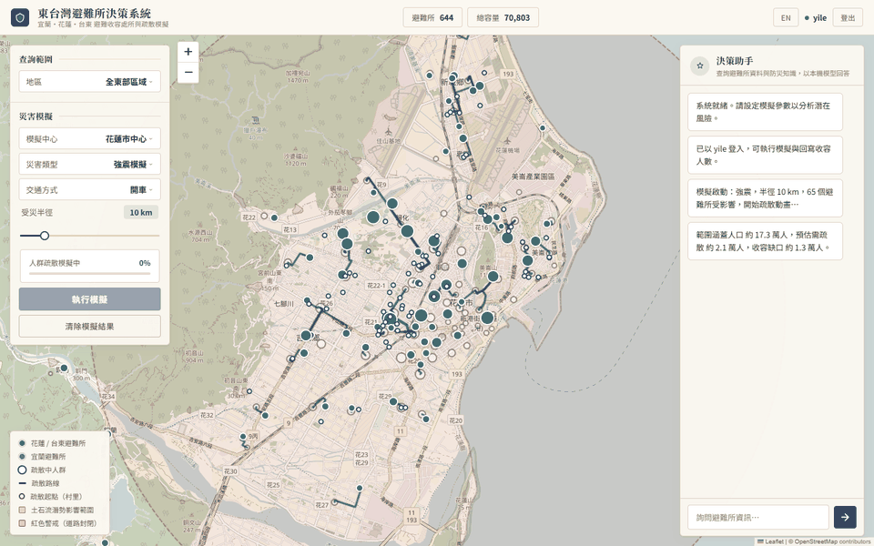
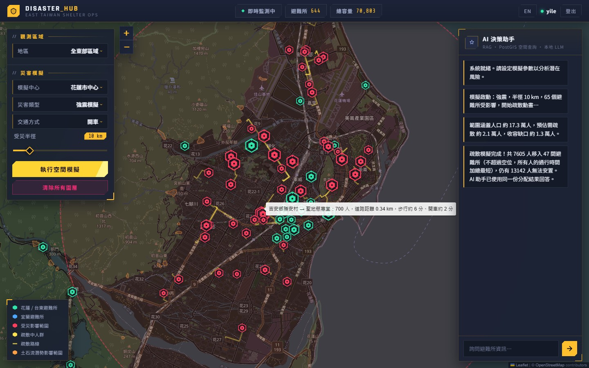
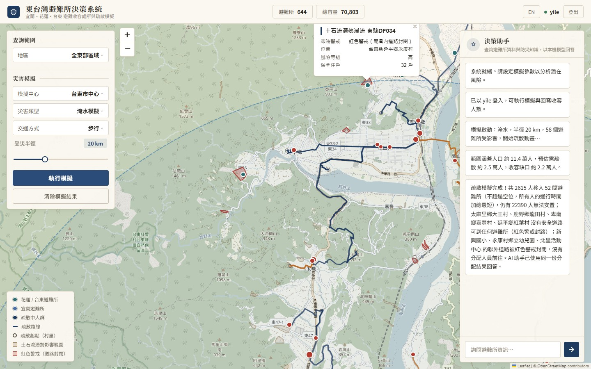
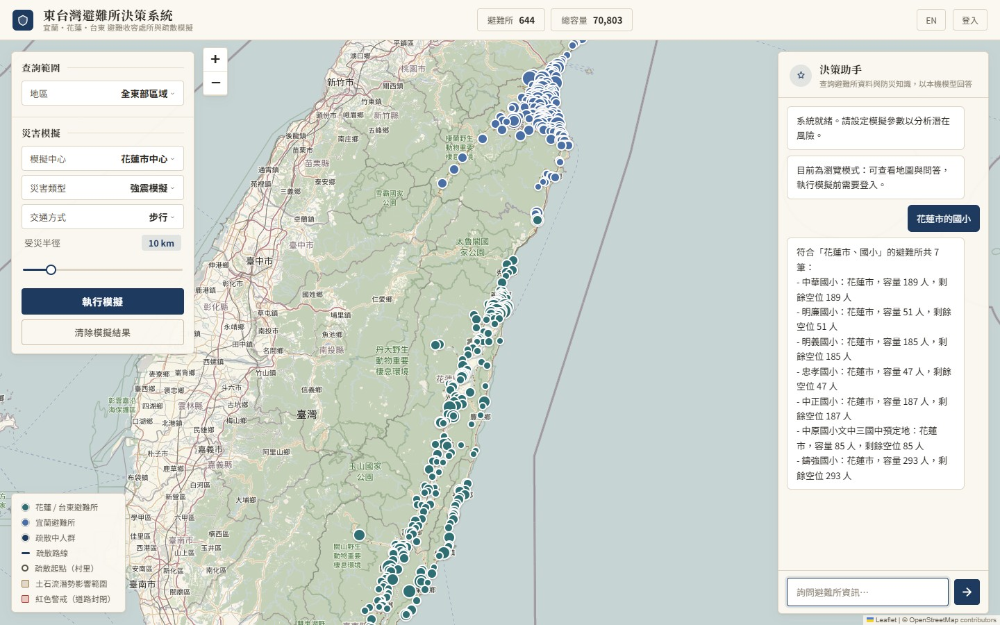
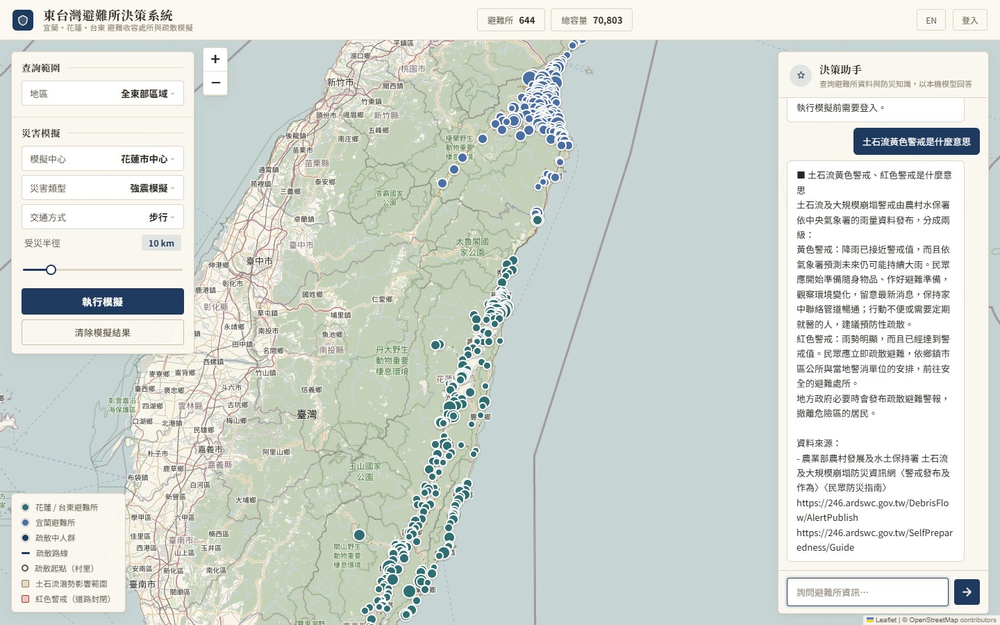
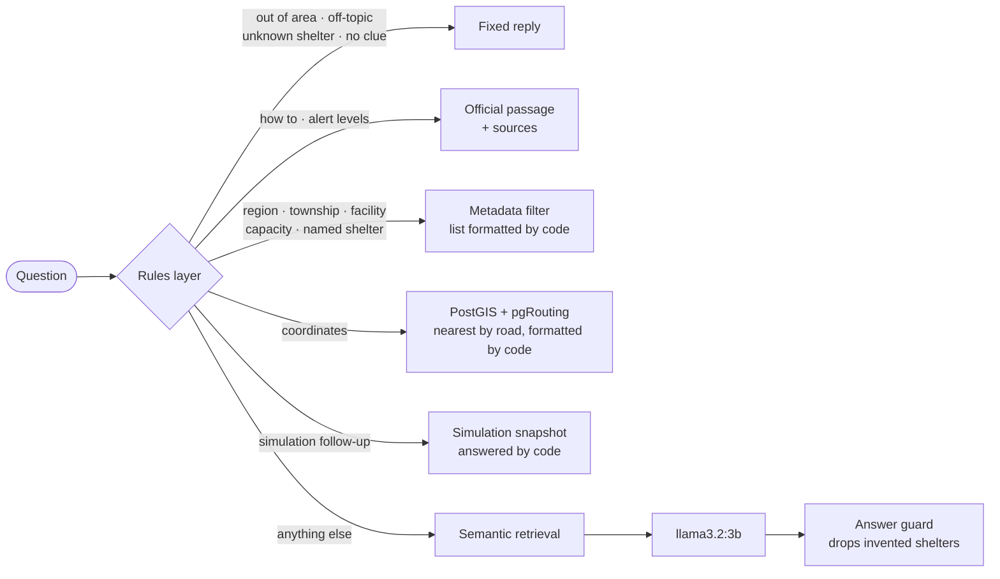
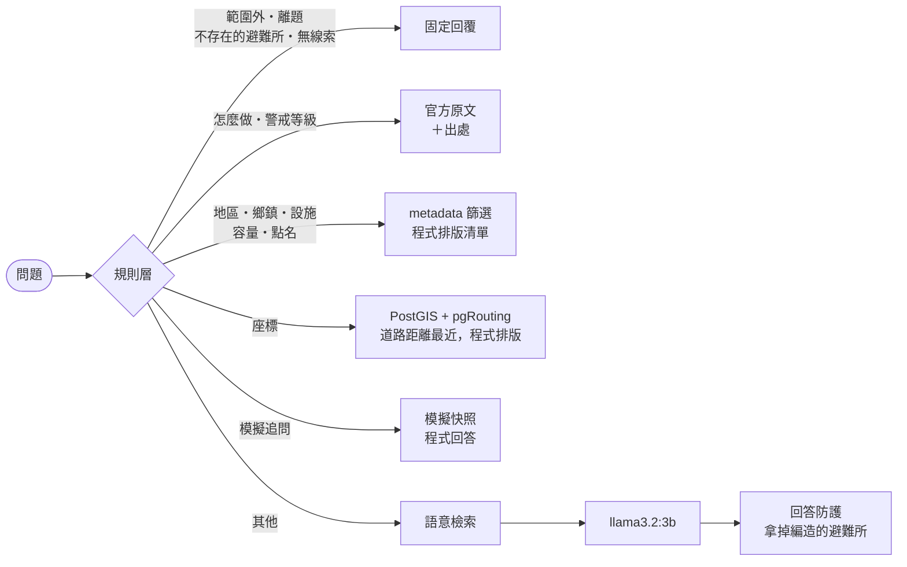

# Disaster Hub

<div align="center">

[](#english)
[](#zh-tw)

</div>

<a name="english"></a>

**An AI-powered shelter decision system for disasters in eastern Taiwan.**

Built in response to the 2025 barrier-lake disaster in Guangfu Township, Hualien, this simulation and decision system targets the three main pain points of existing shelter management: opaque information, no way to simulate, and slow decisions.

<p align="center"></p>
<p align="center"><em>A 10 km earthquake simulation in Hualien City with driving selected. Evacuees follow the road routes to the nearest shelters with room, and each shelter turns red as it fills. Played at about twice real speed.</em></p>

## At a glance

- **Real data.** 644 shelters from the National Fire Agency's open dataset, 531 debris-flow zones, the OpenStreetMap road network of the three counties, and 34 disaster-preparedness passages rewritten from official Central Weather Administration, Fire Agency and Soil and Water Conservation pages.
- **Answers in under a second, mostly without the LLM.** When the rules layer already knows which shelters or which passage answer a question, the reply is assembled by code. 201 of the 207 generation-eval questions never call the model. p50 latency is 0.2 s, and accuracy went up, because the model can no longer misquote a list it is copying.
- **Refuses what it does not know.** Out-of-area counties, off-topic questions, shelters that do not exist and misspelled names are handled before the model sees anything. 53 of 53 boundary questions are answered or refused correctly.
- **Evacuation by road, not straight line.** Simulations send evacuees to the shelters with room that they can reach fastest, on foot or by car, along the OpenStreetMap road network (pgRouting). The actual routes are drawn on the map, they bend around debris-flow zones in floods, and a red debris-flow alert from the soil and water conservation agency closes the roads inside its zone.
- **Measured, not claimed.** Separate evaluations for retrieval, generation, routing, boundaries, counterfactual faithfulness and knowledge answers, with bootstrap confidence intervals, plus 666 tests.

| | |
|---|---|
| Shelters / debris-flow zones / road edges | 644 / 531 / 118,641 |
| Answered by code, no LLM | 201 of 207 eval questions, p50 0.2 s |
| Boundary and refusal questions | 53 / 53 |
| Routing decisions | 56 / 56 |
| Knowledge questions, right passage returned | 40 / 40 |
| Simulation follow-ups, complete and correct | 20 / 20 in 0.1 s (the model: lists cut off, 4 of 5 "excluded" answers wrong) |
| Route length inside debris-flow zones (太麻里 flood example) | 6.18 km → 2.21 km, for 3.3 km more driving |

<table>
<tr>
<td width="50%"></td>
<td width="50%"></td>
</tr>
<tr>
<td>Each yellow line is one township → shelter allocation, drawn along the road. Hovering shows the headcount, the road distance, and the time on foot and by car.</td>
<td>A red debris-flow alert closes the Su-Hua Highway north of 南澳, so no one is sent to the two 東澳 shelters, and the reply says why. This alert was inserted for the screenshot; live alerts come from the agency's feed every 10 minutes.</td>
</tr>
<tr>
<td width="50%"></td>
<td width="50%"></td>
</tr>
<tr>
<td>「花蓮市的國小」: a filtered list built from the index metadata in 0.2 s, one shelter per line.</td>
<td>「土石流黃色警戒是什麼意思」: the official passage verbatim, with its sources appended.</td>
</tr>
</table>

## How a question is answered



Only the last path, plain semantic questions with no condition, still uses the language model. Everything else is answered by code from the data, which is why most answers take well under a second and cannot invent a shelter or a number.

## Quick start

Requires Docker, [Ollama](https://ollama.com) on the host, and about 16 GB of RAM.

```bash
git clone https://github.com/sleepomen/DisasterHub.git
cd DisasterHub
cp .env.example .env        # then replace every change_me value
ollama pull llama3.2:3b     # chat model
ollama pull bge-m3          # embedding model
docker compose up --build
```

Open <http://localhost:8501>. The first start loads the shelters, hazard zones and road network into PostGIS and builds the vector index, which takes a few minutes. The map and the chat work without logging in; running a simulation needs the `ADMIN_USERNAME` / `ADMIN_PASSWORD` from `.env`. Configuration, development mode and tests are in [docs/setup.md](docs/setup.md).

## Documentation

| Document | What it covers |
|---|---|
| [Design decisions](docs/decisions.md) | What went wrong along the way, how it was measured, and what was decided. **Start here.** |
| [Evaluation](docs/evaluation.md) | Retrieval, generation, boundary, routing, knowledge and simulation follow-up evaluations, with confidence intervals |
| [Question answering](docs/chat.md) | Answers written by code, verbatim knowledge passages, English mode, example questions |
| [Simulation and routing](docs/simulation-and-routing.md) | Evacuation assignment, road routes, hazard-aware routing, live alerts, walking and driving |
| [Architecture](docs/architecture.md) | Features, stack, project structure, data sources |
| [API and observability](docs/api.md) | Endpoints, streaming, counters and logs |
| [Setup and development](docs/setup.md) | Configuration, development mode, tests, deployment |

## Limitations

- **The language model is small and local** (llama3.2:3b). It only answers what code cannot: plain semantic questions with no condition. Those are the weakest answers; 「知本附近有避難所嗎」 retrieves shelters in 吉安 instead of 知本.
- **The evacuation is a model, not a plan.** Each township starts from one centroid, the allocation is greedy rather than optimal, road speeds are fixed with no traffic or congestion, and roads are treated as two-way.
- **Live alerts have not been seen live yet.** The feed reported no alerts while this was built, so the alert format is inferred from the dataset description.
- **English mode is partial.** The 34 knowledge passages have draft translations awaiting review, so English answers still show the Chinese passage.
- **Two retrieval categories are partly circular.** The township and facility answers in the retrieval set come from the same functions that write the index metadata, so they partly test the retriever against itself. The alias, semantic, boundary, routing and knowledge questions are written by hand.

## Data sources

- Shelters: National Fire Agency, [避難收容處所點位檔](https://data.gov.tw/dataset/73242)
- Debris-flow impact zones: Ministry of Agriculture, [土石流潛勢溪流影響範圍圖](https://data.gov.tw/dataset/176526)
- Debris-flow alerts: Agency of Rural Development and Soil and Water Conservation, [土石流及大規模崩塌警戒資料](https://data.gov.tw/dataset/148402)
- Preparedness passages: Central Weather Administration, National Fire Agency, Agency of Rural Development and Soil and Water Conservation

All of the above are published under the [Open Government Data License, version 1.0](https://data.gov.tw/license). The road network is © [OpenStreetMap](https://www.openstreetmap.org/copyright) contributors, available under the Open Database License (ODbL 1.0); `data_reference/east_roads.json.gz` is a derived database under the same licence.

## License

The code is released under the [MIT License](LICENSE). The data keeps its own licences, listed under [Data sources](#data-sources): the government open data under the Open Government Data License, and the road network under the ODbL.

## Author

**Vessel**

<p align="right"><a href="#zh-tw">繁體中文 ↓</a> · <a href="#disaster-hub">Back to top ↑</a></p>

---
---

<a name="zh-tw"></a>

<div align="center">

[](#english)
[](#zh-tw)

</div>

**AI 驅動的台灣東部災害避難所決策系統**

以 2025 年花蓮光復鄉堰塞湖災害為出發點，針對現有避難所管理系統資訊不透明、無法模擬、決策緩慢三大痛點所開發的災害模擬決策系統。

<p align="center"></p>
<p align="center"><em>花蓮市 10 公里強震模擬，交通方式選開車。人群沿道路路線移到最近、還有空位的避難所，避難所滿了就變紅。播放速度約為實際的兩倍。</em></p>

## 重點一覽

- **真實資料**：消防署開放資料的 644 間避難所、531 個土石流潛勢區域、三縣的 OpenStreetMap 路網，以及依中央氣象署、消防署、農村水保署官方頁面改寫的 34 段防災知識。
- **不到一秒回答，大部分不經過 LLM**：只要規則層已經知道答案是哪些避難所或哪一段知識，回覆就由程式組出來。生成評測 207 題裡有 201 題完全不打模型，p50 延遲 0.2 秒；正確率也跟著提升，因為模型沒機會在重抄清單時抄錯。
- **不知道的就不答**：範圍外縣市、離題問題、不存在的避難所、錯字名稱，都在模型看到之前處理掉。邊界題 53 題全部正確回答或拒答。
- **依道路疏散，不是直線**：模擬時沿 OpenStreetMap 路網（pgRouting），把疏散人口送到步行或開車最快到、還有空位的避難所。實際路線畫在地圖上，淹水時會繞開土石流潛勢範圍；農村水保署發布土石流紅色警戒時，範圍內的道路直接封閉。
- **用數字說話**：檢索、生成、路由、邊界題、反事實忠實度、防災知識各有獨立評測，附 bootstrap 信賴區間，另有 666 個測試。

| | |
|---|---|
| 避難所 / 土石流潛勢區 / 路網路段 | 644 / 531 / 118,641 |
| 由程式回答、不經 LLM | 評測 207 題中 201 題，p50 0.2 秒 |
| 邊界與拒答題 | 53 / 53 |
| 路由判斷 | 56 / 56 |
| 防災知識題回到正確段落 | 40 / 40 |
| 模擬追問完整且正確 | 20 / 20，0.1 秒（交給模型時：長清單被截斷，「排除」5 題錯 4 題） |
| 路線落在土石流潛勢範圍內的長度（太麻里淹水模擬） | 6.18 公里 → 2.21 公里，多開 3.3 公里 |

<table>
<tr>
<td width="50%"></td>
<td width="50%"></td>
</tr>
<tr>
<td>每條黃線是一筆「鄉鎮 → 避難所」的分配，沿道路畫出。滑鼠移上去會顯示人數、道路距離，以及步行和開車各要幾分鐘。</td>
<td>土石流紅色警戒封閉南澳北邊的蘇花公路，所以沒有人被送往東澳的兩間避難所，回答裡也會說明原因。這張的警戒是為截圖插入的測試資料；實際警戒由農村水保署的資料每 10 分鐘更新一次。</td>
</tr>
<tr>
<td width="50%"></td>
<td width="50%"></td>
</tr>
<tr>
<td>「花蓮市的國小」：依索引 metadata 直接排出的清單，0.2 秒，一間一行。</td>
<td>「土石流黃色警戒是什麼意思」：直接回官方原文，最後附上出處。</td>
</tr>
</table>

## 一個問題怎麼被回答



只有最後一條路（沒有任何條件的純語意題）還會用到語言模型，其餘都由程式依資料直接回答。所以大部分回答遠低於一秒，也不可能編出不存在的避難所或數字。

## 快速開始

需要 Docker、裝在宿主機上的 [Ollama](https://ollama.com)，以及約 16 GB 記憶體。

```bash
git clone https://github.com/sleepomen/DisasterHub.git
cd DisasterHub
cp .env.example .env        # 接著把所有 change_me 換掉
ollama pull llama3.2:3b     # 對話模型
ollama pull bge-m3          # embedding 模型
docker compose up --build
```

打開 <http://localhost:8501>。第一次啟動會把避難所、土石流潛勢範圍與路網匯入 PostGIS，並建立向量索引，需要幾分鐘。不登入也能看地圖、問 AI；執行模擬要用 `.env` 裡的 `ADMIN_USERNAME` / `ADMIN_PASSWORD` 登入。完整設定、開發模式與測試見 [docs/zh-TW/setup.md](docs/zh-TW/setup.md)。

## 文件

| 文件 | 內容 |
|---|---|
| [設計決定](docs/zh-TW/decisions.md) | 一路上遇到的問題、怎麼量出來的、最後怎麼決定。**建議從這裡開始看。** |
| [評測](docs/zh-TW/evaluation.md) | 檢索、生成、拒答、路由、防災知識、模擬追問評測，附信賴區間 |
| [問答流程](docs/zh-TW/chat.md) | 程式直接回答、防災知識原文、英文模式、問題範例 |
| [模擬與路線規劃](docs/zh-TW/simulation-and-routing.md) | 疏散分配、道路路線、避開災害範圍、即時警戒、步行與開車 |
| [架構](docs/zh-TW/architecture.md) | 功能、技術架構、專案結構、資料來源 |
| [API 與監控](docs/zh-TW/api.md) | 端點、串流、計數器與日誌 |
| [安裝與開發](docs/zh-TW/setup.md) | 設定、開發模式、測試、部署 |

## 限制

- **語言模型小、跑在本機**（llama3.2:3b）。它只回答程式答不了的題目：沒有任何條件的語意題。這些也是答得最弱的；「知本附近有避難所嗎」會撈到吉安的避難所，而不是知本。
- **疏散是模型，不是計畫**。每個鄉鎮只用一個人口重心當起點，分配是貪婪法而不是最佳解，道路速度是固定值、沒有路況與壅塞，道路一律當作雙向。
- **即時警戒還沒遇過真的警戒**。開發期間來源都回報沒有警戒，所以警戒格式是依資料集說明推斷的。
- **英文模式只做了一部分**。34 段防災知識的英文稿還在等審稿，英文回答目前仍顯示中文原文。
- **檢索評測有兩類部分是循環的**。檢索題庫裡鄉鎮與設施兩類的正解，是用寫進索引 metadata 的同一組函式算出來的，等於讓檢索器考自己。別名、語意、拒答、路由與防災知識題都是人工出題。

## 資料來源

- 避難所：內政部消防署「[避難收容處所點位檔](https://data.gov.tw/dataset/73242)」
- 土石流潛勢範圍：農業部「[土石流潛勢溪流影響範圍圖](https://data.gov.tw/dataset/176526)」
- 土石流警戒：農業部農村發展及水土保持署「[土石流及大規模崩塌警戒資料](https://data.gov.tw/dataset/148402)」
- 防災知識：中央氣象署、內政部消防署、農業部農村發展及水土保持署

以上皆依[政府資料開放授權條款第 1 版](https://data.gov.tw/license)使用。路網 © [OpenStreetMap](https://www.openstreetmap.org/copyright) contributors，以開放資料庫授權（ODbL 1.0）提供；`data_reference/east_roads.json.gz` 是衍生資料庫，以同樣的授權散布。

## 授權

程式碼以 [MIT 授權](LICENSE)釋出。資料沿用各自原本的授權，見[資料來源](#資料來源)：政府開放資料依政府資料開放授權條款，路網依 ODbL。

## 開發者

**Vessel**

<p align="right"><a href="#english">English ↑</a> · <a href="#disaster-hub">回到頂端 ↑</a></p>
