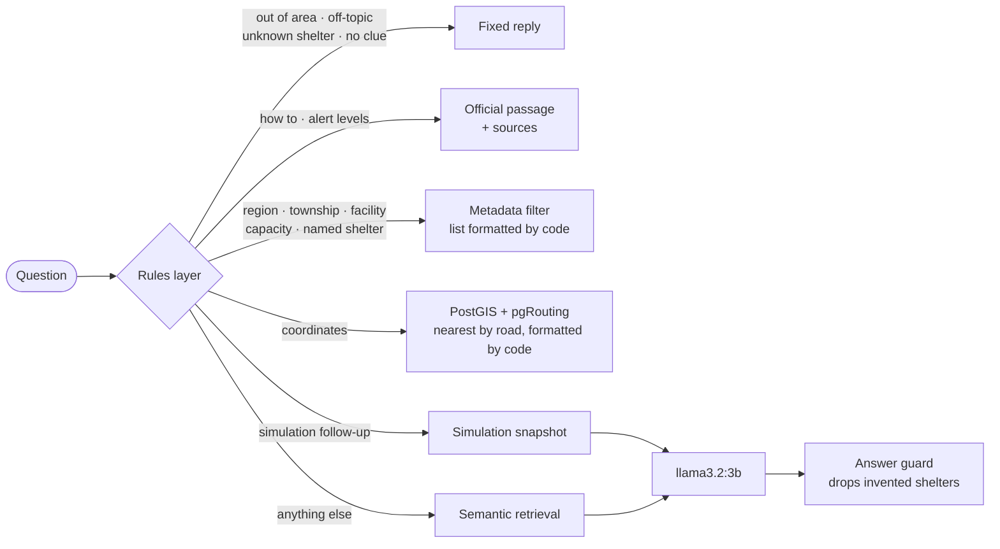

# Disaster Hub

English · [繁體中文](README.zh-TW.md)

**An AI-powered shelter decision system for disasters in eastern Taiwan.**

Built in response to the 2025 barrier-lake disaster in Guangfu Township, Hualien, this simulation and decision system targets the three main pain points of existing shelter management: opaque information, no way to simulate, and slow decisions.

<p align="center"></p>
<p align="center"><em>A 10 km earthquake simulation in Hualien City with driving selected. Evacuees follow the road routes to the nearest shelters with room, and each shelter turns red as it fills. Played at about twice real speed.</em></p>

## At a glance

- **Real data.** 644 shelters from the National Fire Agency's open dataset, 531 debris-flow zones, the OpenStreetMap road network of the three counties, and 34 disaster-preparedness passages rewritten from official Central Weather Administration, Fire Agency and Soil and Water Conservation pages.
- **Answers in under a second, mostly without the LLM.** When the rules layer already knows which shelters or which passage answer a question, the reply is assembled by code. 201 of the 207 generation-eval questions never call the model. p50 latency is 0.2 s, and accuracy went up, because the model can no longer misquote a list it is copying.
- **Refuses what it does not know.** Out-of-area counties, off-topic questions, shelters that do not exist and misspelled names are handled before the model sees anything. 53 of 53 boundary questions are answered or refused correctly.
- **Evacuation by road, not straight line.** Simulations send evacuees to the shelters with room that they can reach fastest, on foot or by car, along the OpenStreetMap road network (pgRouting). The actual routes are drawn on the map, they bend around debris-flow zones in floods, and a red debris-flow alert from the soil and water conservation agency closes the roads inside its zone.
- **Measured, not claimed.** Separate evaluations for retrieval, generation, routing, boundaries, counterfactual faithfulness and knowledge answers, with bootstrap confidence intervals, plus 666 tests.

| | |
|---|---|
| Shelters / debris-flow zones / road edges | 644 / 531 / 118,641 |
| Answered by code, no LLM | 201 of 207 eval questions, p50 0.2 s |
| Boundary and refusal questions | 53 / 53 |
| Routing decisions | 56 / 56 |
| Knowledge questions, right passage returned | 40 / 40 |
| Route length inside debris-flow zones (太麻里 flood example) | 6.18 km → 2.21 km, for 3.3 km more driving |

<table>
<tr>
<td width="50%"></td>
<td width="50%"></td>
</tr>
<tr>
<td>Each yellow line is one township → shelter allocation, drawn along the road. Hovering shows the headcount, the road distance, and the time on foot and by car.</td>
<td>A red debris-flow alert closes the Su-Hua Highway north of 南澳, so no one is sent to the two 東澳 shelters, and the reply says why. This alert was inserted for the screenshot; live alerts come from the agency's feed every 10 minutes.</td>
</tr>
<tr>
<td width="50%"></td>
<td width="50%"></td>
</tr>
<tr>
<td>「花蓮市的國小」: a filtered list built from the index metadata in 0.2 s, one shelter per line.</td>
<td>「土石流黃色警戒是什麼意思」: the official passage verbatim, with its sources appended.</td>
</tr>
</table>

## How a question is answered



Only the last two paths (simulation follow-ups and plain semantic questions) still use the language model. Everything else is answered by code from the data, which is why most answers take well under a second and cannot invent a shelter or a number.

## Quick start

Requires Docker, [Ollama](https://ollama.com) on the host, and about 16 GB of RAM.

```bash
git clone https://github.com/sleepomen/DisasterHub.git
cd DisasterHub
cp .env.example .env        # then replace every change_me value
ollama pull llama3.2:3b     # chat model
ollama pull bge-m3          # embedding model
docker compose up --build
```

Open <http://localhost:8501>. The first start loads the shelters, hazard zones and road network into PostGIS and builds the vector index, which takes a few minutes. The map and the chat work without logging in; running a simulation needs the `ADMIN_USERNAME` / `ADMIN_PASSWORD` from `.env`. Configuration, development mode and tests are in [docs/setup.md](docs/setup.md).

## Documentation

| Document | What it covers |
|---|---|
| [Design decisions](docs/decisions.md) | What went wrong along the way, how it was measured, and what was decided. **Start here.** |
| [Evaluation](docs/evaluation.md) | Retrieval, generation, boundary, routing and knowledge evaluations, with confidence intervals |
| [Question answering](docs/chat.md) | Answers written by code, verbatim knowledge passages, English mode, example questions |
| [Simulation and routing](docs/simulation-and-routing.md) | Evacuation assignment, road routes, hazard-aware routing, live alerts, walking and driving |
| [Architecture](docs/architecture.md) | Features, stack, project structure, data sources |
| [API and observability](docs/api.md) | Endpoints, streaming, counters and logs |
| [Setup and development](docs/setup.md) | Configuration, development mode, tests, deployment |

## Limitations

- **The language model is small and local** (llama3.2:3b). It only answers what code cannot: simulation follow-ups and plain semantic questions. Those are the weakest answers; 「知本附近有避難所嗎」 retrieves shelters in 吉安 instead of 知本.
- **The evacuation is a model, not a plan.** Each township starts from one centroid, the allocation is greedy rather than optimal, road speeds are fixed with no traffic or congestion, and roads are treated as two-way.
- **Live alerts have not been seen live yet.** The feed reported no alerts while this was built, so the alert format is inferred from the dataset description.
- **English mode is partial.** The 34 knowledge passages have draft translations awaiting review, so English answers still show the Chinese passage.
- **Two retrieval categories are partly circular.** The township and facility answers in the retrieval set come from the same functions that write the index metadata, so they partly test the retriever against itself. The alias, semantic, boundary, routing and knowledge questions are written by hand.

## Data sources

- Shelters: National Fire Agency, [避難收容處所點位檔](https://data.gov.tw/dataset/73242)
- Debris-flow impact zones: Ministry of Agriculture, [土石流潛勢溪流影響範圍圖](https://data.gov.tw/dataset/176526)
- Debris-flow alerts: Agency of Rural Development and Soil and Water Conservation, [土石流及大規模崩塌警戒資料](https://data.gov.tw/dataset/148402)
- Preparedness passages: Central Weather Administration, National Fire Agency, Agency of Rural Development and Soil and Water Conservation

All of the above are published under the [Open Government Data License, version 1.0](https://data.gov.tw/license). The road network is © [OpenStreetMap](https://www.openstreetmap.org/copyright) contributors, available under the Open Database License (ODbL 1.0); `data_reference/east_roads.json.gz` is a derived database under the same licence.

## License

The code is released under the [MIT License](LICENSE). The data keeps its own licences, listed under [Data sources](#data-sources): the government open data under the Open Government Data License, and the road network under the ODbL.

## Author

**Vessel**
