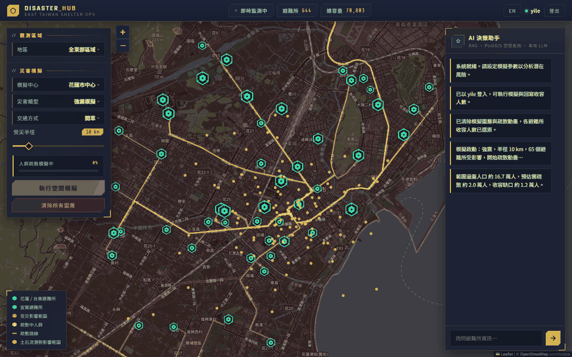
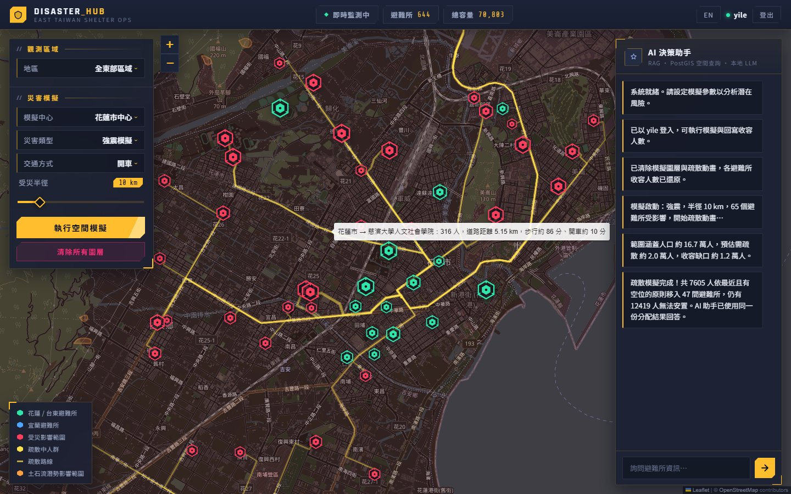
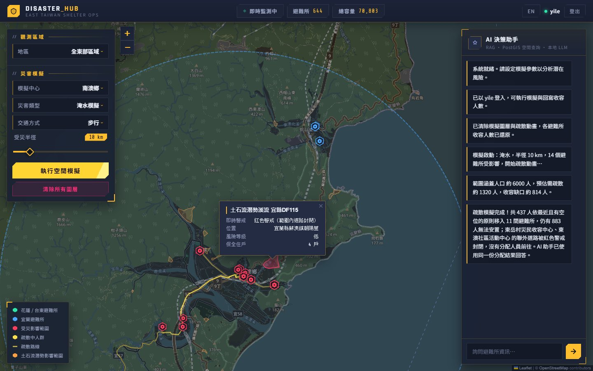
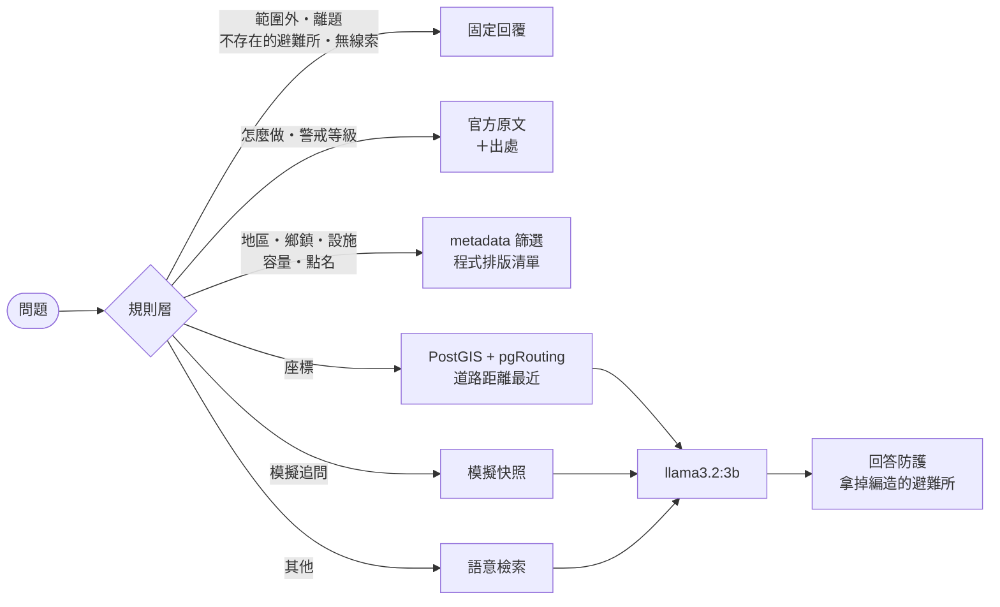

# Disaster Hub

[English](README.md) · 繁體中文

**AI 驅動的台灣東部災害避難所決策系統**

以 2025 年花蓮光復鄉堰塞湖災害為出發點，針對現有避難所管理系統資訊不透明、無法模擬、決策緩慢三大痛點所開發的災害模擬決策系統。

<p align="center"></p>
<p align="center"><em>花蓮市 10 公里強震模擬，交通方式選開車。人群沿道路路線移到最近、還有空位的避難所，避難所滿了就變紅。播放速度約為實際的兩倍。</em></p>

## 重點一覽

- **真實資料**：消防署開放資料的 644 間避難所、531 個土石流潛勢區域、三縣的 OpenStreetMap 路網，以及依中央氣象署、消防署、農村水保署官方頁面改寫的 34 段防災知識。
- **不到一秒回答，大部分不經過 LLM**：只要規則層已經知道答案是哪些避難所或哪一段知識，回覆就由程式組出來。生成評測 207 題裡有 201 題完全不打模型，p50 延遲 0.2 秒；正確率也跟著提升，因為模型沒機會在重抄清單時抄錯。
- **不知道的就不答**：範圍外縣市、離題問題、不存在的避難所、錯字名稱，都在模型看到之前處理掉。邊界題 53 題全部正確回答或拒答。
- **依道路疏散，不是直線**：模擬時沿 OpenStreetMap 路網（pgRouting），把疏散人口送到步行或開車最快到、還有空位的避難所。實際路線畫在地圖上，淹水時會繞開土石流潛勢範圍；農村水保署發布土石流紅色警戒時，範圍內的道路直接封閉。
- **用數字說話**：檢索、生成、路由、邊界題、反事實忠實度、防災知識各有獨立評測，附 bootstrap 信賴區間，另有 666 個測試。

| | |
|---|---|
| 避難所 / 土石流潛勢區 / 路網路段 | 644 / 531 / 118,641 |
| 由程式回答、不經 LLM | 評測 207 題中 201 題，p50 0.2 秒 |
| 邊界與拒答題 | 53 / 53 |
| 路由判斷 | 56 / 56 |
| 防災知識題回到正確段落 | 40 / 40 |
| 路線落在土石流潛勢範圍內的長度（太麻里淹水模擬） | 6.18 公里 → 2.21 公里，多開 3.3 公里 |

<table>
<tr>
<td width="50%"></td>
<td width="50%"></td>
</tr>
<tr>
<td>每條黃線是一筆「鄉鎮 → 避難所」的分配，沿道路畫出。滑鼠移上去會顯示人數、道路距離，以及步行和開車各要幾分鐘。</td>
<td>土石流紅色警戒封閉南澳北邊的蘇花公路，所以沒有人被送往東澳的兩間避難所，回答裡也會說明原因。這張的警戒是為截圖插入的測試資料；實際警戒由農村水保署的資料每 10 分鐘更新一次。</td>
</tr>
<tr>
<td width="50%"></td>
<td width="50%"></td>
</tr>
<tr>
<td>「花蓮市的國小」：依索引 metadata 直接排出的清單，0.2 秒，一間一行。</td>
<td>「土石流黃色警戒是什麼意思」：直接回官方原文，最後附上出處。</td>
</tr>
</table>

## 一個問題怎麼被回答



只有最後三條路（座標、模擬追問、純語意題）還會用到語言模型，其餘都由程式依資料直接回答。所以大部分回答遠低於一秒，也不可能編出不存在的避難所或數字。

## 快速開始

需要 Docker、裝在宿主機上的 [Ollama](https://ollama.com)，以及約 16 GB 記憶體。

```bash
git clone https://github.com/sleepomen/DisasterHub.git
cd DisasterHub
cp .env.example .env        # 接著把所有 change_me 換掉
ollama pull llama3.2:3b     # 對話模型
ollama pull bge-m3          # embedding 模型
docker compose up --build
```

打開 <http://localhost:8501>。第一次啟動會把避難所、土石流潛勢範圍與路網匯入 PostGIS，並建立向量索引，需要幾分鐘。不登入也能看地圖、問 AI；執行模擬要用 `.env` 裡的 `ADMIN_USERNAME` / `ADMIN_PASSWORD` 登入。完整設定、開發模式與測試見 [docs/zh-TW/setup.md](docs/zh-TW/setup.md)。

## 文件

| 文件 | 內容 |
|---|---|
| [設計決定](docs/zh-TW/decisions.md) | 一路上遇到的問題、怎麼量出來的、最後怎麼決定。**建議從這裡開始看。** |
| [評測](docs/zh-TW/evaluation.md) | 檢索、生成、拒答、路由、防災知識評測，附信賴區間 |
| [問答流程](docs/zh-TW/chat.md) | 程式直接回答、防災知識原文、英文模式、問題範例 |
| [模擬與路線規劃](docs/zh-TW/simulation-and-routing.md) | 疏散分配、道路路線、避開災害範圍、即時警戒、步行與開車 |
| [架構](docs/zh-TW/architecture.md) | 功能、技術架構、專案結構、資料來源 |
| [API 與監控](docs/zh-TW/api.md) | 端點、串流、計數器與日誌 |
| [安裝與開發](docs/zh-TW/setup.md) | 設定、開發模式、測試、部署 |

## 限制

- **語言模型小、跑在本機**（llama3.2:3b）。它只回答程式答不了的題目：給座標的、模擬中的追問、沒有任何條件的語意題。這些也是答得最弱的；「知本附近有避難所嗎」會撈到吉安的避難所，而不是知本。
- **疏散是模型，不是計畫**。每個鄉鎮只用一個人口重心當起點，分配是貪婪法而不是最佳解，道路速度是固定值、沒有路況與壅塞，道路一律當作雙向。
- **即時警戒還沒遇過真的警戒**。開發期間來源都回報沒有警戒，所以警戒格式是依資料集說明推斷的。
- **英文模式只做了一部分**。34 段防災知識的英文稿還在等審稿，英文回答目前仍顯示中文原文。
- **檢索評測有兩類部分是循環的**。檢索題庫裡鄉鎮與設施兩類的正解，是用寫進索引 metadata 的同一組函式算出來的，等於讓檢索器考自己。別名、語意、拒答、路由與防災知識題都是人工出題。

## 資料來源

- 避難所：內政部消防署「[避難收容處所點位檔](https://data.gov.tw/dataset/73242)」
- 土石流潛勢範圍：農業部「[土石流潛勢溪流影響範圍圖](https://data.gov.tw/dataset/176526)」
- 土石流警戒：農業部農村發展及水土保持署「[土石流及大規模崩塌警戒資料](https://data.gov.tw/dataset/148402)」
- 防災知識：中央氣象署、內政部消防署、農業部農村發展及水土保持署

以上皆依[政府資料開放授權條款第 1 版](https://data.gov.tw/license)使用。路網 © [OpenStreetMap](https://www.openstreetmap.org/copyright) contributors，以開放資料庫授權（ODbL 1.0）提供；`data_reference/east_roads.json.gz` 是衍生資料庫，以同樣的授權散布。

## 開發者

**Vessel**
